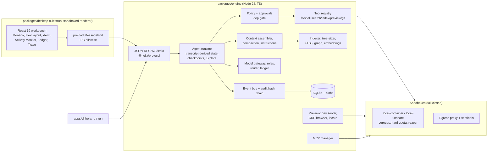
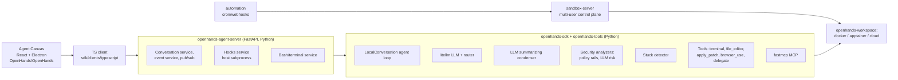
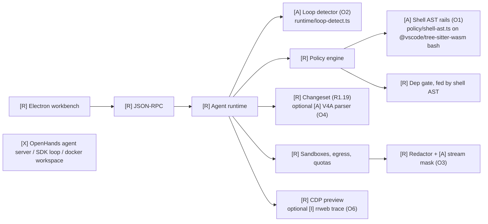

# Helix × OpenHands — M0/M1 Architecture Reuse Audit

> Research artifact only. It does not change scope, tasks, checkboxes or product code. User decisions Q1-Q7 are recorded in section G below and in the decision log of `../openhands-reuse-handoff.md` (O1/O2 approved as design inputs only; O3 isolated investigation only; O4 rejected; no code implementation approved).
> Authority is unchanged: `plan.md` > `architecture.md` > `docs/roadmap.md` > `AGENTS.md`.

## 0. Revisions examined (pinned)

| Repository | Commit SHA | Commit date | Licence (verified at this SHA) |
|---|---|---|---|
| Helix `daggerm29-oss/8`, branch `helix/session-2026-11-10-m1-workbench` (PR #23, draft) | `71616a64d39a0839a28a3911ca728a8619f0d850` | 2026-11-12 | n/a (our code) |
| `OpenHands/OpenHands` (now **Agent Canvas**: React 19 + Electron frontend) | `c26bda84cdc998eeeb99f5052c6aff666fe4aada` | 2026-11-12 | MIT, "Copyright © 2025 OpenHands contributors" (`LICENSE`) |
| `OpenHands/software-agent-sdk` (Python SDK, tools, agent server, workspaces, TS client) | `2cca5ba058bef0fcafb553b0bbcbf5f3ffc84a53` | 2026-11-12 | MIT, "Copyright (c) 2026 OpenHands contributors" (`LICENSE`); `clients/typescript/LICENSE` MIT "© 2025 OpenHands" |
| `OpenHands/automation` (cron/webhook automation service, FastAPI + Postgres) | `f5678e7fea09f826d16543d1e909c6e448b5111c` | 2026-11-11 | MIT, "Copyright (c) 2026 OpenHands contributors" |
| `OpenHands/sandbox-server` (extracted `openhands/app_server/`, FastAPI control plane) | `43e91604ccd0a9960c8d5c52faadd60b30f10e63` | 2026-10-22 | MIT outside `enterprise/` (carve-out clause in `LICENSE`; no `enterprise/` directory exists at this SHA) |

**Current upstream topology (verified, not from tutorials):** the old Python monorepo was split. The agent loop, tools, LLM layer, condenser, security analyzers, hooks, skills, MCP and the REST/WebSocket agent server now live in `software-agent-sdk` (Python ≥ 3.12, `openhands-sdk` 1.62.0). `OpenHands/OpenHands` is the Agent Canvas desktop/web client (runs OpenHands or any ACP agent). `sandbox-server` is the multi-user API/sandbox control plane. `automation` schedules conversations.

**Provenance warning:** not every file under these MIT repos is original OpenHands work. `openhands-tools/openhands/tools/apply_patch/core.py` states it is adapted from `openai/openai-cookbook` `examples/gpt-5/apply_patch.py`; any port must pin and credit that upstream (licence to be re-verified at port time).

## A. Executive summary

**Bottom line: OpenHands is not a platform Helix should integrate for M0/M1.** Its runtime is Python (pydantic, litellm, fastmcp, browser-use, tree-sitter Python bindings, FastAPI). Helix is a TypeScript/Node 24 Engine with its own JSON-RPC protocol, SQLite storage, event bus + audit chain, tool registry, policy engine and agent runtime, most of which is built and evidenced for M0/M1. Embedding the OpenHands agent server would create a second orchestration engine, a second event/conversation store and a second tool registry, and would bypass Helix's sandbox, egress and approval guarantees. That is classification **F** for the core.

**What Helix can reuse is narrow but real:** a handful of self-contained, well-tested *algorithms and test corpora* that map onto open M1 tasks, ported or re-implemented in TypeScript behind existing Helix interfaces (classifications C/D):

1. **Structural shell-command analysis** (`security/defense_in_depth/` + `_shell_ast.py`): tree-sitter-bash based "rails" (fetch-to-exec, catastrophic delete, raw disk, wrapper resolution). Helix's `policy.ts` and `depgate.ts` currently split commands with regexes. This directly de-risks **R1.30** (git safeguards: force-push, `reset --hard`, remote delete inside compound commands) and **R1.36** (every install path through the dep gate). Highest value.
2. **Stuck/loop detector** (`conversation/stuck_detector.py`): five deterministic patterns. Supports **R1.17** "minimal retries" and F-AGT-3 "no infinite retry". Small, cheap to port.
3. **Split-chunk secret masking** (`conversation/secret_registry.py::StreamOutputMask`): Helix's PTY stream redacts per chunk (`packages/engine/src/sandbox/sandbox.ts:1056`), so a secret split across chunks could pass unredacted. Needs a Helix regression test first; fix is ~40 lines.
4. **`apply_patch` V4A parser** (from openai-cookbook via OpenHands): candidate parser for multi-file **R1.19** changesets; Helix's changeset/hunk model stays native.
5. **Third-party instruction discovery table** (`skills/skill.py:349-355`, `skills/utils.py:351,449`): useful reference for **R1.14**, but OpenHands does **not** implement `.cursor/rules/*.mdc` or a precedence model, so Helix must still build the required parts.
6. **rrweb recording scripts** (`tools/browser_use/js/*`): reference for the "record" part of **R1.23**; it does not satisfy the "replay to the same final state" Accept, which needs a native action log.

**What must stay custom (E):** sandbox backends and containment, egress proxy and credential sentinels, hard disk quota, policy/approval engine, ledger and cost attribution, audit hash chain, indexer/retrieval, preview/CDP browser stack, Electron workbench, agent runtime/checkpoints, MCP client. On every one of these the Helix implementation is either more complete or more strictly secured than the OpenHands equivalent at the pinned revisions (evidence in §D).

**Realistic savings:** Low–Medium overall, concentrated in R1.30/R1.36 (rules + adversarial test cases already written upstream), R1.17 (loop patterns) and R1.19 (patch grammar + edge-case tests). Claims of "High" savings from adopting the SDK or agent server are not supported: the integration and security re-validation cost would exceed the code saved.

**Most important risks:** (1) silently importing OpenHands' weaker trust model (host-side hooks with `shell=True`, Docker without cap-drop/network-none/limits, LLM-based risk analysis) into Helix; (2) Python runtime creep into a TS product; (3) porting code whose provenance is not OpenHands (apply_patch); (4) treating any of these recommendations as approval.

## B. Reuse opportunity matrix

Effort saved/complexity/maintenance are relative to building the same Helix task from scratch, including tests.

| # | Helix task | Feature | OpenHands implementation | Helix implementation | Strategy | Effort saved | Integration | Maintenance | Licence | Recommendation |
|---|---|---|---|---|---|---|---|---|---|---|
| O1 | R1.30 (F-GIT-5, SEC-7, FR-29); R1.36 (SEC-8, F-REV-3) | Structural shell command analysis | sdk `security/defense_in_depth/{policy_rails,shell_semantics}.py`, `security/{_shell_ast,shell_parser}.py`; tests `tests/sdk/security/defense_in_depth/` | `packages/engine/src/policy/policy.ts` (regex `DESTRUCTIVE` table, l.18-25), `policy/depgate.ts::segments` (l.32-35, regex split) | D (re-implement on the Bash grammar Helix already loads from `@vscode/tree-sitter-wasm` 0.3.1, see `index/treesitter.ts:3`; no new dependency) + port test vectors | Medium: rules, wrapper resolution (`sudo/env/xargs/sh -c`), and adversarial cases already worked out | Medium: new parse step in `classify()` + depgate; must keep existing verdict contract | Low–Medium | MIT; cite SHA + files in a NOTICE line if test vectors are copied | **Adapt** |
| O2 | R1.17 (F-AGT-4, F-AGT-3) | Stuck/loop detection | sdk `conversation/stuck_detector.py::StuckDetector` (l.27-460); tests `tests/cross/test_stuck_detector*.py`, `tests/sdk/conversation/local/test_stuck_detector_nudge.py` | `agent/runtime.ts` has bounded retries but no repetition detector (grep: none) | C/D (port the five predicates to TS over Helix transcript messages) | Low–Medium | Low: pure function over persisted transcript (IMPL-ADR-012) | Low | MIT | **Adapt** (only the parts R1.17/F-AGT-3 need) |
| O3 | Existing M0 SEC/redaction (F-TRM-1 stream, F-OBS) — no new task; regression fix under current task rules | Split-chunk secret masking | sdk `conversation/secret_registry.py::StreamOutputMask` (l.117-160) | `util/redact.ts::Redactor`; PTY path `sandbox/sandbox.ts:1056` redacts each chunk independently | C (≈40 lines) | Low | Low | Low | MIT | **Needs investigation**: first write a failing Helix test; severity reduced because real provider keys never enter the sandbox (IMPL-ADR-031) |
| O4 | R1.19 (FR-13) | Multi-file patch grammar | tools `apply_patch/core.py` (`Parser` l.85, `text_to_patch` l.340, `patch_to_commit` l.415, `apply_commit` l.466); tests `tests/tools/apply_patch/` | No changeset module yet; edit tools in `tools/builtin.ts`; diff util `util/diff.ts` | C, but port from **openai-cookbook** original, not OpenHands | Low–Medium | Medium: must emit Helix changeset + hunks, checkpoint preimages (R0.6) | Low | Upstream cookbook licence must be verified; OpenHands adaptation MIT | **Needs investigation** (only if R1.19 design wants an `apply_patch` tool; plan requires create/edit/rename/delete grouping, not this grammar) |
| O5 | R1.14 (F-CTX-3, FR-30) | Third-party instruction files | sdk `skills/skill.py` `PATH_TO_THIRD_PARTY_SKILL_NAME` (l.349-355), `_handle_third_party` (l.638), `load_project_skills` (l.1076); `skills/utils.py::find_third_party_files` (l.351), `find_nested_third_party_files` (l.449) | `context/instructions.ts` (`INSTRUCTION_FILES = ['AGENTS.md','HELIX.md']`, l.9; global→root→nested, l.6) | D | Low (Helix already has the hierarchy; OpenHands lacks `.cursor/rules/*.mdc`, globs/`alwaysApply`, precedence explain) | Low | Low | MIT | **Borrow idea only** (case-insensitive names, `GEMINI.md`, git-root + cwd merge) |
| O6 | R1.23 (F-PRV-5, FR-23) | Browser interaction + recording | tools `browser_use/definition.py` (14 tools, l.177-790) via Python `browser-use>=0.8`; `browser_use/recording.py` + `js/*.js` (rrweb) | `preview/browser.ts` raw CDP, snapshot refs (IMPL-ADR-029), screenshot/console tools | D for recording (rrweb npm is MIT, usable directly via CDP `Runtime.evaluate`); F for browser-use (Python, own index-based element model) | Low | Medium | Medium (rrweb versioning) | MIT (OpenHands); rrweb MIT (verify at adoption) | **Retain Helix** CDP + refs; **Needs investigation** for rrweb as visual trace only. OpenHands lacks select/hover/wait_for/assert/eval/stale-ref, and rrweb does not satisfy action replay |
| O7 | R1.18 (F-AGT-5) | Hooks lifecycle | sdk `hooks/{types,config,executor,manager}.py` (events PreToolUse/PostToolUse/UserPromptSubmit/SessionStart/SessionEnd/Stop; exit code 2 = block) | `agent/runtime.ts:1226-1253` pre/post tool hooks run **inside the task sandbox**, output tainted; `.helix/hooks.json` | E (keep); D only for exit-code/JSON-stdin conventions if desired | Low | Low | Low | MIT | **Retain Helix.** OpenHands executor uses host `subprocess.Popen(shell=True)` (`executor.py:519-521`), incompatible with SEC-1. No `pre_commit`, no declared hook permissions upstream |
| O8 | F-CTX-2 (done), R1.15 (metrics) | Context condensation | sdk `context/condenser/llm_summarizing_condenser.py` (`LLMSummarizingCondenser`, `max_size=240`, `keep_first=2`, token trigger l.140-178) | `context/compaction.ts` (assistant-turn-boundary cut, originals retrievable by `ref`) | E | None | — | — | MIT | **Retain Helix.** No stable-prefix-ratio or long-horizon metric upstream to reuse for R1.15 |
| O9 | F-AGT-1/2, R1.16, R1.47 | Agent loop, plan, subagents | sdk `conversation/impl/local_conversation.py` (3,488 lines), `agent/`, `subagent/`, tools `delegate/`, `task_tracker/`, `planning_file_editor/` | `agent/runtime.ts` (transcript-derived state, checkpoints, cancel ≤1 s, Explore) | F | Negative (rewrite + re-evidence M0) | High | High | MIT | **Reject.** Would duplicate task state, events, tools and bypass policy |
| O10 | F-SBX-1/2/3/5, R1.8b | Sandbox/runtime | `openhands-workspace/.../docker/workspace.py` (`docker run -d --rm --ulimit nofile`, l.214-255, no cap-drop/network-none/read-only/limits); sandbox-server `sandbox/{docker,process,kubernetes}_sandbox_service.py` | `sandbox/{sandbox,container,cgroup,egress,net-policy,x509,reaper}.ts` | E | None | — | — | MIT | **Retain Helix** (stronger, evidenced). Nothing upstream helps R1.8b |
| O11 | F-MCP-1/3, R1.31, R1.32 | MCP client/permissions | sdk `mcp/{client,tool,config,oauth}.py` on `fastmcp>=4.1.6,<5` | `mcp/{client,http,manager}.ts`, sandboxed stdio servers (R1.7) | F (Python). For R1.31 the relevant reuse candidate is the official TS MCP SDK, not OpenHands | None from OpenHands | — | — | MIT | **Retain Helix**; evaluate official TS SDK separately (needs user approval: new dependency) |
| O12 | F-SBX-4, SEC-6 | Secrets | sdk `secret/secrets.py`, `conversation/secret_registry.py` (output masking `<secret-hidden>`); agent-server `_secret_redaction.py` (export-time) | sentinel substitution + TLS-terminating injection (IMPL-ADR-031) | E (+O3) | None beyond O3 | — | — | MIT | **Retain Helix** (secret never enters sandbox; upstream masks after exposure) |
| O13 | FR-33, F-UI-1/2, R1.1–R1.6 (done) | Desktop UI | Agent Canvas `src/components/features/{diff-viewer,terminal,browser,...}`, Electron `electron/main.mjs` (`contextIsolation:true`, `nodeIntegration:false`, l.358-401; no `sandbox:true` found) | `packages/desktop` React 19 + Monaco + FlexLayout, sandboxed renderer, MessagePort IPC allowlist | E | None (already built and evidenced) | — | — | MIT | **Retain Helix**. Possible UX reference only for R1.28 commit list/diff drawer |
| O14 | R1.39 (HTS), G1.1 | Eval harness | Not in the four repos; separate repo `OpenHands/benchmarks` @ `60b3548cea8b41276ac0d44ea36a01b82936bbe4`, now audited in `audit-benchmarks-r1-39.md` | `evals/*` | D (methodology only) | Native Node harness; no upstream code reused | — | — | MIT (harness); dataset licences vary, see that report | **Audited (Q4). Methodology reference only; policy Q5-Q7 approved.** |
| O15 | R0.8 (postponed) | CI | Upstream workflows | `.github/workflows/ci.yml` | — | None | — | — | — | **No action.** R0.8 stays postponed per user decision; Accept unchanged |
| O16 | F-TRM-1, R1.27 | Terminal | tools `terminal/` (tmux / subprocess / Windows backends, 4.8 k lines) | PTY in sandbox (`sandbox.ts`), xterm in desktop | E | None | — | — | MIT | **Retain Helix** (PTY already contained) |
| O17 | F-MDL-*, F-TOK-* | LLM layer, cost | sdk `llm/` on litellm, `llm/router/` (random/multimodal), `conversation_stats.py` | `models/{gateway,router,roles,ledger}.ts`, protocol adapters, reconciliation | F | None | — | — | MIT | **Retain Helix** (ledger attribution/reconciliation exceeds upstream) |

## C. Architecture comparison

### C.1 Existing Helix (at 71616a6)

### C.2 Relevant OpenHands (pinned SHAs)

### C.3 Recommended Helix after selective reuse

Legend: **[R]** retained native, **[A]** algorithm adapted from OpenHands into TS (no Python, no new runtime), **[I]** integrated external component, **[X]** rejected.

No component is **replaced**. Coexistence through an adapter (e.g. running OpenHands as one more agent backend over ACP or the TS client) is technically possible but belongs to later milestones and is not recommended for M0/M1.

## D. Competitive advantage report (evidence-graded)

Grades: **IT** implemented and tested (evidence artifact in repo), **IV** implemented, incompletely validated, **P** planned only.

| Area | Helix | Grade | OpenHands at pinned SHA | Differentiation opportunity |
|---|---|---|---|---|
| Whole-toolchain containment | Fail-closed backends, MCP stdio + Chrome in sandbox (R1.7) | IT (`evals/results/r1-7-mcp-containment-2026-11-11.txt`, `r1-7-redteam-ci-2026-11-12.txt`) | Docker workspace without cap-drop / network none / read-only (`workspace.py:214-255`); `process_sandbox_service.py` runs unisolated | Market "nothing agent-initiated runs on the host" with red-team evidence (R1.40) |
| Per-tool egress + network approvals | Exact-host allowlist, per-tool, approval class (R1.9) | IT (`evals/results/r1.9-egress-net-approval.log`) | Only `--network <name>`; no proxy/allowlist found | Strong |
| Resource limits, hard disk quota | cgroups + hard ENOSPC quota on local-unshare (R1.8/R1.8a) | IT for local-unshare; memory limit and container hard quota **IV/P** (ISSUE-005, R1.8b open) | `--ulimit nofile` only | Close R1.8b to make it backend-wide |
| Credential handling | Sentinels + TLS injection (IMPL-ADR-031) | IT (M2-era tests); bindings lost on restart | Mask after the secret reaches output | Strong; add O3 for streams |
| Observability, ledger, cost | Per-call attribution, reconciliation, trace viewer (R0.4, R1.6) | IT (`r1-6-ledger-2026-11-11.json`); live ±1% gate G1.5 **P** | `conversation_stats.py` totals | Strong; G1.5 still needed |
| Audit/reproducibility | SHA-256 hash chain, append-only triggers, session replay | IT (R0.5); BLAKE3 **P** (IMPL-ADR-004) | Event store; export-time redaction | Strong |
| Codebase indexing/retrieval | tree-sitter, FTS5, heuristic graph, local embeddings | IV (R1.11–R1.13 open; PERF-5..7 **P**) | No repository index; grep/glob tools | Strong if R1.11–R1.13 land |
| Live preview + browser verification | Dev server in sandbox, CDP screenshot/console/snapshot/locate | IV (R1.21–R1.25 open) | browser-use tools, rrweb recording | Interaction tools (R1.23) are the gap to close |
| Desktop DX | Electron, sandboxed renderer, IPC allowlist, a11y/i18n (R1.1–R1.5) | IT (packaged E2E artifacts); PERF-1/2 **P** (R1.38) | Agent Canvas: contextIsolation, no renderer sandbox found; multi-agent ACP backends | Helix: security; OpenHands: multi-backend breadth |
| Shell-command risk analysis | Regex classifier | IV | tree-sitter rails + tests | **OpenHands ahead** → O1 |
| Loop detection | None found | P | Stuck detector | **OpenHands ahead** → O2 |

Additional differentiation (proposals, not scope): deterministic, explainable approvals (AST rails produce a rule id in the audit row, unlike LLM risk scoring); evidence-backed "verified done" (gates + browser loop + ledger in one replay bundle).

## E. Proposed M0/M1 sequence (no implementation without approval)

Ordered by the prompt's priorities; every item maps to an existing task and never changes its Accept line. Roadmap order (AGENTS.md §2) still governs when work is executed; these packets are prepared so the session that reaches each task can use them.

1. **O1 → R1.30, then R1.36** (high savings for the hardest-to-get-right part, manageable risk).
2. **O2 → R1.17** (low risk, small).
3. **O3 → regression test under the current task rules** (only if the failing test reproduces; otherwise reject).
4. ~~O4 → R1.19~~ **Rejected by user (Q3); native atomic changeset retained.**
5. **O5/O6 → R1.14/R1.23** idea-level borrowing only.
6. Everything else native (E/F). R0.8 untouched and postponed.

Implementation packets with exact steps, files, tests and rollback are in `../openhands-reuse-handoff.md` §4.

## G. User decisions (Q1-Q7, 2026-11-12)

Authoritative copy with full conditions: `../openhands-reuse-handoff.md` section 5 "Decision log". Summary:

| Q | Status | Effect on this audit |
|---|---|---|
| Q1 | APPROVED | O1 (R1.30/R1.36) and O2 (R1.17) are design inputs. Adapt algorithms and test cases into existing TypeScript; no second runtime, no unnecessary dependencies; preserve all security policies; uncertain parsing fails toward approval; loop detector supports minimal-diff retries. Implementation not started. |
| Q2 | PARKED; isolated investigation approved | O3 split-chunk leak: reproduce in isolation without touching product code or PR #23; if reproducible, report evidence and propose a narrow fix for approval. Not yet investigated. |
| Q3 | NOT APPROVED | O4 `apply_patch` tool rejected; R1.19 keeps the native atomic changeset design. |
| Q4 | APPROVED, completed | See `audit-benchmarks-r1-39.md`. |
| Q5 | APPROVED | Public datasets as HTS seeds with a per-task licence manifest; exclude unverified and `license:other` sources until individually reviewed. |
| Q6 | APPROVED (hybrid) | Three contamination categories plus a separate high-confidence held-out set; record provenance and classification. |
| Q7 | APPROVED | Shared immutable base images by language/toolchain, fresh disposable environment per attempt, hidden tests never visible to the agent, separate clean grader. |

Sections A, B and E above were written before these decisions; where they say "Recommended" or "needs approval", the table here and the handoff decision log take precedence. Pinned SHAs in section 0 and licensing warnings are unchanged.
