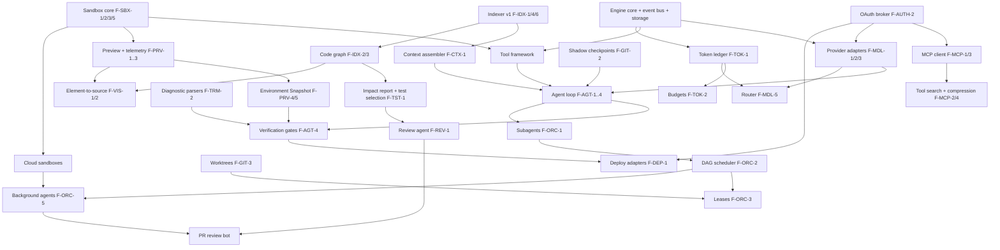

# Helix — Product Development & Execution Plan

> **Working codename:** Helix (placeholder — rename freely).
> **Document type:** Product requirements, competitive research, and execution plan.
> **Companion document:** [`architecture.md`](./architecture.md) — the technical blueprint. Every feature here has an `Arch §` reference to the section that implements it.
> **Build sessions:** this is the long-term vision, not the task list. The current milestone's trimmed scope in [`progress.md`](./progress.md) overrides §11, §12 and §19 for what to build now.
> **Research date:** November 6, 2026. All competitor facts reflect public documentation retrieved on that date and will drift; re-verify before relying on them.

---

## 0. How to read this document

### 0.1 Evidence legend

The brief asks to separate verified facts from assumptions. Every competitor claim carries a tag:

| Tag | Meaning |
|---|---|
| **[D]** | **Documented**: read directly from the official primary-source page linked during this research session. |
| **[S]** | **Search-indexed**: taken from a search-engine summary of official documentation. The page itself was not opened, so treat it as probable but unconfirmed. |
| **[K]** | **Prior knowledge**: known from earlier public material, not re-verified in this session. Re-check it before using it for decisions. |
| **[A]** | **Assumption / inference / Helix proposal**: our reasoning, not a vendor claim. |

**Important limitation:** none of the competitor capabilities were tested hands-on in this phase. Nothing here counts as "independently verified functionality" in the strict sense. §15.6 defines a hands-on verification protocol to run before Milestone M1 closes.

### 0.2 ID conventions

- `F-<AREA>-<n>`: feature (spec in §8). Areas: `MDL` models, `AUTH`, `IDX` indexing, `CTX` context/memory, `AGT` agent, `ORC` orchestration, `SBX` sandbox, `PRV` preview/browser, `TRM` terminal, `GIT`, `MCP`, `TOK` token efficiency, `VIS` visual debugging, `TST` testing, `REV` review/security, `UI`, `OBS` observability, `DEP` deploy, `TEAM`.
- `FR-<n>`: functional requirement. `NFR-<n>`: non-functional requirement. `SEC-<n>`: security requirement. `PERF-<n>`: performance budget.
- `M0…M6`: milestones (§12). Complexity uses T-shirt sizes (S/M/L/XL). The roadmap deliberately gives no calendar estimates.

---

## 1. Product vision and objectives

### 1.1 Vision

**Helix is an AI software-engineering environment where agents work inside a real, observable, isolated running system, not blindly in a text buffer.** It combines a professional IDE, an autonomous multi-agent runtime, a terminal-native agent, a visual app builder with live preview, and local or cloud sandboxes in one product. The same headless engine powers every surface.

### 1.2 Core thesis: five pillars

1. **Grounded.** Agents see what the user sees: the rendered UI, console, network, build output, and runtime state. They receive this as compact, structured observations, not raw screenshots or log dumps.
2. **Precise.** Agents understand how code connects: symbols, references, call and dependency graphs, tests, schemas, routes, and history. They do not depend on keyword search or whole-repo context stuffing.
3. **Orchestrated.** One capable primary agent delegates to isolated subagents only where parallelism or context isolation pays off. Write leases, worktrees, and checkpoints make parallel work safe.
4. **Safe by construction.** All agent-executed code runs in a sandbox with deny-by-default filesystem, network, and credential boundaries. MCP servers and tool output are untrusted.
5. **Efficient.** Every LLM token must earn its place. The system does deterministic work deterministically, routes to the cheapest capable model, caches aggressively, and accounts for every token by agent, task, provider, and tool.

### 1.3 Objectives (measurable)

| # | Objective | Metric | MVP target [A] | Long-term target [A] |
|---|---|---|---|---|
| O1 | Agents deliver working software | Pass rate on the Helix internal task suite (§15.4) where all verification gates pass | ≥ 55% | ≥ 80% |
| O2 | Agents verify their own UI work | % of UI tasks where the agent ran a browser verification loop before claiming done | ≥ 90% | ≥ 98% |
| O3 | Cost efficiency | Median tokens per *successful* task versus a naïve baseline harness on the same suite | −40% | −65% |
| O4 | Safety | Sandbox-escape or credential-exfiltration findings at severity ≥ High in the release red-team | 0 | 0 |
| O5 | Codebase understanding | Recall@10 of the "files actually edited" in held-out real PRs, using retrieval only | ≥ 0.70 | ≥ 0.85 |
| O6 | Responsiveness | p95 time-to-first-token for agent replies (excluding provider latency), and p95 search latency | < 300 ms; < 150 ms | < 150 ms; < 80 ms |
| O7 | Trust | % of agent edits accepted without manual rework (sampled) | ≥ 60% | ≥ 80% |

### 1.4 Non-goals (this product generation)

- Training our own frontier foundation model. Helix is a harness: it routes across providers and may fine-tune small specialist models later (§20).
- Replacing CI/CD systems. Helix integrates with them.
- Fully unattended production deployment without human approval. Helix rejects this explicitly (§5).
- Building our own browser engine or editor core. Helix uses Chromium, Monaco, and xterm.js.

---

## 2. Target users and use cases

### 2.1 Personas

| ID | Persona | Context | Primary jobs | Pain points today [A] |
|---|---|---|---|---|
| P1 | **Professional full-stack engineer** | Mid-size product team, TypeScript or Python, 50k–500k LOC | Ship features, fix bugs, refactor safely | Agents edit without checking the running app; context misses distant dependencies; review burden |
| P2 | **Staff engineer / tech lead on a large monorepo** | 1M+ LOC, many services, polyglot | Cross-cutting changes, migrations, impact analysis | Retrieval breaks at scale; no reliable "what will break"; parallel agents collide |
| P3 | **Founder / product builder** | Little ops experience | Go from idea to deployed app quickly | Prototype tools hit a ceiling; hard to graduate to a real codebase |
| P4 | **Platform / security admin** | Regulated enterprise | Govern models, data, credentials, MCP servers | Shadow AI tools, unclear data flows, no audit trail, unsafe MCP |
| P5 | **OSS maintainer** | Public repos, limited time | Triage, review PRs, write tests | Reviewing low-quality AI PRs; cost of API keys |

### 2.2 Key use cases

| ID | Use case | Personas | Representative workflow |
|---|---|---|---|
| UC-01 | Build a feature end to end in an existing repo: plan, implement, test, verify in the browser, then open a PR | P1, P2 | W1 |
| UC-02 | Fix a bug from an error report or screenshot: reproduce, diagnose, fix, add a regression test | P1, P5 | W2 |
| UC-03 | Visually tweak UI: select an element in the preview and say "make this match the header style" | P1, P3 | W3 |
| UC-04 | Run a cross-cutting migration in parallel (for example, a deprecated API across 300 files) | P2 | W4 |
| UC-05 | Scaffold a new app from a prompt or mockup, connect a database, and deploy | P3 | W5 |
| UC-06 | Understand an unfamiliar repo: architecture map, data flow, "where is X handled?" | P1, P2 | W6 |
| UC-07 | Run background or scheduled agents: nightly dependency audit, flaky-test triage, PR review | P2, P5 | W7 |
| UC-08 | Analyze change impact before merging: "what does this diff affect, and which tests cover it?" | P2 | W1 (review step) |
| UC-09 | Govern AI use: allowed models, MCP allowlist, budgets, audit export | P4 | W8 |
| UC-10 | Work headless from the terminal or CI using the same engine and policies | P1, P5 | CLI |
| UC-11 | Bring your own subscription or key: use a ChatGPT plan (where eligible) or a Gemini API key | P3, P5 | Onboarding |
| UC-12 | Resume after a failure or interruption: replay from a checkpoint, roll back safely | All | W9 |

---

## 3. Competitive research and feature comparison

### 3.1 Methodology and primary sources

Official documentation and changelogs were consulted on 2026-11-06:

- Cursor: changelog <https://cursor.com/changelog> [D], docs home <https://cursor.com/docs> [D], search docs <https://cursor.com/docs/context/semantic-search> [D].
- Vercel v0: docs <https://v0.app/docs> [D]; agent discovery <https://v0.app/docs/agents.md> (referenced from the docs) [S]; Vercel Sandbox <https://vercel.com/docs/vercel-sandbox> [D].
- Google Antigravity: docs home <https://antigravity.google/docs/home> [D]; browser and agent-panel pages via search index [S].
- Claude Code: overview <https://code.claude.com/docs/en/overview> [D], sandboxing <https://code.claude.com/docs/en/sandboxing> [D], doc index <https://code.claude.com/docs/llms.txt> [S].
- Providers: Gemini models <https://ai.google.dev/gemini-api/docs/models> [D, updated 2026-10-28]; OpenAI Codex authentication <https://developers.openai.com/codex/auth> [D]; Sign in with ChatGPT quickstart <https://developers.openai.com/siwc/quickstart> [S]; SIWC interest form <https://openai.com/form/sign-in-with-chatgpt-interest/> [S]; help article <https://help.openai.com/en/articles/20001410-sign-in-with-chatgpt> [S].
- Protocol: MCP specification, latest revision dated 2026-07-28 <https://modelcontextprotocol.io/specification/latest> [D].

### 3.2 Product profiles

#### 3.2.1 Cursor

**What it is.** An AI-first code editor, historically a VS Code fork [K]. It has grown into a multi-surface agent platform: desktop, cloud agents, mobile remote control, and an Agent SDK.

**How it works (key mechanisms).**
- **Agent + search.** Cursor documents *Instant Grep*, "a custom search engine that outperforms ripgrep on large codebases". It builds and queries its index locally, and Cursor "does not store embeddings of your codebase for search" [D]. For broad exploration, the agent spawns an **Explore subagent** "in its own context window with a faster model", which returns summaries instead of raw files [D]. This is a notable shift: exact and regex search plus context-isolated subagents now carry search, not server-side embedding retrieval. Earlier Cursor versions advertised embedding-based codebase indexing [K].
- **Cloud agents** run in managed environments. An **Environments API** (beta) manages these environments, which support up to 300 repositories and load large environments faster [D]. Search summaries also describe always-on cloud agents with event subscriptions (PRs, Slack, schedules), `/goal` long-lived goals, `/in-cloud` subagents on separate VMs, and async subagents that can spawn more subagents [S].
- **Build Live Apps (2026-11-05).** A cloud agent scaffolds a web app, provisions Postgres, sets up auth behind Cursor SSO, and hosts it. *Deterministic and agentic security checks* (for example, secrets in files) gate publishing, and admins can add rules and unpublish apps [D].
- **Agent SDK (2026-10-20).** "Agents as code": `instructions.md`, a `tools/` folder with typed actions, `skills/`, `mcp-connections/`, and `channels/`. Agents wake on GitHub, GitLab, or Bitbucket events, Slack, webhooks, and cron, and come with evals and PR replay [D].
- **Models.** A very broad catalog: Anthropic, OpenAI, Google, its own Composer models, xAI-co-trained Grok variants, Moonshot, Z.ai, DeepSeek, and Meta. Context windows range from 200k to 1M, with "Max Mode" and per-model pricing notes [D].
- **Customization and integrations.** Plugins, skills, MCPs, and rules managed "from one place"; Plan Mode; review changes; integrations with GitHub, GitLab, Azure DevOps, Bitbucket, JetBrains, Slack, and Linear [D]. Tab inline completion and next-edit prediction [K]. Bugbot PR review [K].

**Strengths.** Mature editor UX; very fast completion [K]; huge model choice [D]; strong cloud-agent and SDK story [D]; a security-gated publish flow [D].
**Weaknesses / gaps [A].** Removing embedding indexing favors precision but may hurt "conceptual" queries ("where do we handle refunds?") unless subagents compensate, at extra token cost. Search does not use an explicit code graph (call graph or impact analysis) as a documented primitive. Multi-root workspaces disable worktrees, and cloud agents do not support multi-root [D]. Live-preview awareness for local development is not documented as a structured observation channel (unverified).
**Opportunity for Helix.** Combine Cursor-grade exact search with a *persistent code graph*, so impact analysis needs no agent exploration. Make local runtime observation a first-class, structured, cheap context source.

#### 3.2.2 Vercel v0

**What it is.** A prompt-to-app builder focused on web apps (Next.js, Tailwind, shadcn/ui), with live preview and one-click deployment on Vercel [D].

**How it works.**
- Prompt, wireframe, or mockup to a high-fidelity UI and full-stack app; backend and database integrations; one-click deploy; "automatically fix errors… with intelligent diagnostics" [D].
- An agent with web search, *site inspection*, error fixing, and external tool integration; a real-time preview with "visual progress indicators" [D].
- Previews and commands run in **Vercel Sandbox**: Firecracker microVMs with millisecond startup, persistence by default, snapshots, drives, multi-agent Linux users, and Active-CPU pricing [D for the Sandbox; S that v0 uses it].
- A Design Mode for visual edits mapped to source, a VS Code-style editor, Git integration (branches, commits, PRs), and MCP [S].

**Strengths.** The fastest idea-to-deployed-URL path; strong design fidelity; integrated hosting, integrations, and sandbox; low setup for non-experts.
**Weaknesses / gaps [A].** Optimized for the web and Vercel stack. Less suited to large existing polyglot monorepos, desktop-local workflows, or arbitrary languages and tooling. Depth of repo-wide code intelligence is not publicly documented.
**Opportunity for Helix.** Bring v0-style "see it running, click it, change it" to *any* existing repo and stack, locally or in the cloud, while keeping professional IDE depth.

#### 3.2.3 Google Antigravity

**What it is.** Google's agent-first development platform with four surfaces on one harness: **Antigravity 2.0** (desktop command center), **Antigravity CLI** (TUI), **Antigravity SDK** (Python), and **Antigravity IDE** [D].

**How it works.**
- **Projects** bound the folders and repos an agent can access. Agents start in Local Mode or *New Worktree Mode* [S]. The desktop app works across multiple workspaces and worktrees with parallel local subagents, asynchronous task management, Scheduled Tasks ("Cron sidecars"), and voice transcription [D].
- **Shared harness "co-trained with Gemini models."** "Gemini 3.8 Flash" powers all local agents [D]. Asynchronous subagents take delegated background tasks [D].
- **Visual Artifacts** let users track and verify plans, code diffs, and browser recordings [D]. A **browser subagent** (`/browser`) controls local Chrome and produces screenshots and WebM recordings, with permissions for JavaScript execution and URL access [S]. Artifact review policies decide whether the agent pauses for approval [S].
- **Security by Design**: "safe defaults, local proxying, and granular tool approval gates" [D]. The SDK exposes "declarative safety policies" and "inspect/decide/transform hooks" [D].
- Agent-panel UX: `@` mentions, `/` commands (`/goal`, `/grill-me`, `/schedule`, `/browser`), and per-turn Accept/Reject of edits [S]. MCP, skills, and curated Google integration bundles (Android, Firebase, Chrome/Web MCP, DeepMind science skills) [D].
- The Gemini API also exposes a managed **Antigravity Agent** model (`antigravity-preview-09-2026`) that plans, runs code, manages files, and browses "inside a secure, isolated Linux sandbox" [D].

**Strengths.** Artifacts as a verification and trust medium; a first-class browser subagent; multi-surface parity on one harness; scheduled tasks; deep Google ecosystem.
**Weaknesses / gaps [A].** The harness is co-optimized for Gemini [D], so non-Gemini model parity is uncertain. The browser subagent observes mainly through screenshots and recordings (token-heavy and hard to diff). Documented code-graph depth is limited.
**Opportunity for Helix.** Adopt Artifacts-style verification, but generate *structured* evidence (assertions, DOM-diffs, network traces) alongside media. Make the harness provider-neutral, with capability-aware prompting per model.

#### 3.2.4 Claude Code

**What it is.** Anthropic's agentic coding tool. It runs in the terminal, IDE extensions (VS Code, Cursor, JetBrains), a desktop app, and the web, all on the same engine [D].

**How it works.**
- An agentic loop with file tools, a Bash tool, git, and MCP. Project instructions come from `CLAUDE.md`, which can read `AGENTS.md`. **Auto memory** saves learnings across sessions [D]. **Skills** (reusable workflows, for example `/review-pr`) and **hooks** (shell commands before or after actions) [D].
- **Subagents and parallelism**: "a lead agent coordinates the work, assigns subtasks, and merges results". Background agents, the Agent SDK for custom orchestration, cloud scheduled tasks, `/loop`, Remote Control, Channels (Telegram, Discord, iMessage, webhooks), `--teleport` between cloud and local, GitHub Code Review, Slack-to-PR, and Chrome integration "to debug live web applications" [D].
- **Sandboxing (documented in depth)** [D]. It is OS-enforced: Seatbelt on macOS, bubblewrap and socat on Linux and WSL2, built on the open-source `@anthropic-ai/sandbox-runtime`. It is off by default and covers **shell commands only**: file tools, MCP servers, hooks, and LSP servers run outside it. By default it can read most of the machine. Network traffic goes through a local proxy with a domain allowlist that starts empty. Credentials can be **denied** or **masked**: the command sees a per-session sentinel, and a TLS-terminating proxy injects the real value only for allowed hosts. Strict mode disables unsandboxed retries. Under an admin-required sandbox, repository settings cannot loosen the policy.

**Strengths.** A Unix-composable CLI (`claude -p`) that works well in CI; a deep permission and sandbox model; mature memory, skills, and hooks; cross-surface sessions.
**Weaknesses / gaps [A].** It is model-locked to Claude; third-party providers in the docs mean alternate hosting of Claude models [K]. The terminal surface has no built-in visual preview, so it relies on the Chrome integration. Shell-only sandbox coverage leaves file tools, MCP, and hooks outside the OS boundary unless the whole process is containerized [D].
**Opportunity for Helix.** Put **everything** the agent runs (shell, file tools, MCP servers, LSPs, dev servers, browser) inside one sandbox boundary by default. Keep the CLI composability and the credential-masking idea.

#### 3.2.5 Adjacent: OpenAI Codex (for auth and model context)

Codex supports **Sign in with ChatGPT** (subscription access) or **API key** (usage-based billing). Codex cloud *requires* ChatGPT sign-in. Credentials are cached in `~/.codex/auth.json` (plaintext) or the OS keyring, and admins can force a login method or workspace. Enterprise "Codex access tokens" support trusted automation [D]. Helix must not reuse Codex's cached credentials (§8 F-AUTH-2).

### 3.3 Feature comparison matrix

Legend: ● strong or documented, ◐ partial or limited, ○ absent or not documented, ? unknown. Evidence tags apply to each cell's claim. The **Helix target** column states our intended level and the differentiator.

| # | Capability | Cursor | v0 | Antigravity | Claude Code | **Helix target** |
|---|---|---|---|---|---|---|
| 1 | AI code editing & generation | ● IDE + agent [D] | ● prompt→app [D] | ● IDE + agents [D] | ● CLI/IDE agent [D] | ● All surfaces on one engine |
| 2 | Agentic workflows | ● Plan Mode, agent [D] | ● agent w/ tools [D] | ● agents + artifacts [D] | ● agentic loop [D] | ● Plan→act→verify loop with mandatory verification gates |
| 3 | Autonomous multi-step execution | ● cloud agents, /goal [D/S] | ◐ within the builder [A] | ● async tasks, /goal [D/S] | ● background agents, /loop [D] | ● Durable task DAG with checkpoints |
| 4 | Codebase indexing & semantic search | ◐ Instant Grep (local), no stored embeddings [D] | ? | ? | ◐ agentic grep/glob [K] | ● Hybrid: BM25 + vectors + code graph + rerank (local-first) |
| 5 | Repository-wide understanding | ◐ Explore subagent [D] | ◐ [A] | ◐ [A] | ◐ subagents [D] | ● Persistent code graph, architecture map |
| 6 | Context management | ● subagent isolation, Max Mode [D] | ? | ● subagents [D] | ● compaction, memory [D/K] | ● Budgeted context assembler + compaction + caching |
| 7 | Terminal & command execution | ● [K] | ● in sandbox [S] | ● [D] | ● Bash tool, sandboxed opt-in [D] | ● Sandboxed by default, PTY streaming |
| 8 | File creation / modification | ● [D] | ● [D] | ● Accept/Reject per turn [S] | ● [D] | ● Atomic multi-file changesets + review |
| 9 | Multi-file editing | ● [K] | ● [D] | ● [D] | ● [D] | ● Graph-aware edit planning |
| 10 | Inline code completion | ● Tab [K] | ○ [A] | ◐ IDE [K] | ○ CLI-first [A] | ◐ MVP: provider-backed FIM; later: small local model |
| 11 | Intelligent code navigation | ● IDE (LSP) [K] | ◐ editor [S] | ● IDE [K] | ◐ via IDE ext. [D] | ● LSP + SCIP precise refs exposed to agents |
| 12 | Debugging & error resolution | ● find/fix bugs [D] | ● auto-fix diagnostics [D] | ● [A] | ● [D] | ● Runtime telemetry + repro + fix + regression test |
| 13 | Browser automation | ◐ [K] | ● site inspection [D] | ● browser subagent [D/S] | ◐ Chrome integration [D] | ● In-sandbox Chromium, structured a11y refs |
| 14 | Visual app building | ● Build Live Apps (cloud) [D] | ● core strength [D] | ◐ [A] | ○ [A] | ● Element→source visual editing on any stack |
| 15 | Live application preview | ◐ [K] | ● [D] | ● browser recordings [S] | ○ in CLI [A] | ● Multi-tab preview with HMR + telemetry |
| 16 | Sandbox environments | ● cloud envs, Environments API [D] | ● Vercel Sandbox [S/D] | ● local proxying; managed agent sandbox [D] | ● OS sandbox (shell only) [D] | ● Full-process sandbox, local + cloud, same policy |
| 17 | Git integration | ● [D] | ● branches/PRs [S] | ● worktrees [D] | ● commits/PRs, CI [D] | ● Worktree-per-agent, shadow checkpoints |
| 18 | MCP integration | ● [D] | ● [S] | ● [D] | ● [D] | ● Tool search, schema on demand, result compression, sandboxed servers |
| 19 | Agent orchestration | ● SDK, async subagents [D/S] | ? | ● parallel subagents [D] | ● lead agent + subagents [D] | ● DAG scheduler + write leases + merge agent |
| 20 | Parallel agents | ● [S] | ? | ● [D] | ● [D] | ● Conflict-free via leases/worktrees |
| 21 | Background agents | ● cloud, event-driven [D/S] | ? | ● scheduled tasks [D] | ● cloud scheduled tasks [D] | ● Local + cloud workers, triggers, schedules |
| 22 | Code review | ● review changes; Bugbot [D/K] | ? | ◐ artifact review [S] | ● GitHub Code Review [D] | ● Impact-aware review using graph + tests |
| 23 | Testing & validation | ◐ [D] | ◐ [A] | ● browser artifacts [D] | ◐ runs tests [D] | ● Verification gates: build, test, browser assertions |
| 24 | Deployment workflows | ● Build Live Apps [D] | ● one-click Vercel [D] | ◐ Firebase etc. [D] | ◐ via CI [D] | ◐ Deploy adapters (Vercel, Cloudflare, Fly, Docker) with approval |
| 25 | Memory & persistent context | ● rules, skills [D] | ◐ [A] | ● skills [D] | ● CLAUDE.md + auto memory [D] | ● Typed project memory + ADRs + fix history |
| 26 | Model selection & configuration | ● very broad [D] | ◐ [A] | ◐ Gemini-centric harness [D] | ◐ Claude-only [K] | ● Per-role models, routing, fallback, BYO-key/plan |

### 3.4 Synthesis: market gaps Helix targets

1. **Structured environment awareness.** Competitors give agents browsers and screenshots or recordings. None documents a *compact, diffable, structured* runtime observation model fused with source mapping [A]. This is Helix's lead differentiator (F-PRV-*).
2. **Precise and conceptual code intelligence together.** Cursor moved toward exact search plus subagents [D]. Helix combines exact, semantic, *and* graph retrieval, so impact questions are answered deterministically (F-IDX-*).
3. **One sandbox boundary for everything.** Claude Code documents that file tools, MCP servers, and hooks fall outside its shell sandbox [D]. Helix puts the entire agent toolchain in the sandbox (F-SBX-*).
4. **Provider neutrality with capability-aware harnessing.** Antigravity is co-trained with Gemini [D] and Claude Code is Claude-only [K]. Helix makes multi-provider routing a core feature, not an afterthought (F-MDL-*).
5. **Cost transparency and control.** Helix offers per-agent, per-tool, and per-task token ledgers with enforced budgets (F-TOK-*). No competitor documents this at that granularity, so it is likely partial [A].

---

## 4. Feature parity analysis

Decision per capability: **Match** (table stakes, reach parity), **Exceed** (strategic differentiator), **Defer** (later milestone), or **Skip** (out of scope).

| Capability | Decision | Rationale | Milestone |
|---|---|---|---|
| Agent chat + multi-file edits + diff review | Match | Table stakes | M1 |
| Plan Mode / explicit plans | Match | Trust and steerability | M1 |
| Sandboxed terminal | **Exceed** | Whole-toolchain sandbox, credential masking | M1 |
| Live preview + browser automation | **Exceed** | Structured observations, source mapping | M1–M2 |
| Codebase search | **Exceed** | Hybrid plus code graph | M1 (v1), M2 (graph) |
| MCP | **Exceed** | Tool search, compression, sandboxed servers | M1 (basic), M2 (optimized) |
| Inline completion (Tab-like) | Match (later) | Large investment. Cursor leads here [K], and it is not core to the agent thesis | M3 |
| Subagents / parallel agents | Match → Exceed | Leases and worktrees make parallelism safe | M3 |
| Background / scheduled / event agents | Match | Expected by P2/P5 | M3–M4 |
| Cloud sandboxes / remote agents | Match | Required for background work and teams | M3 |
| Visual app builder (prompt → app) | Match (scoped) | Templates and scaffolds; not a v0 clone | M4 |
| Deploy | Match (adapters) | Integrations rather than our own hosting | M4 |
| Code review bot on PRs | Match | Reuses graph and review agent | M4 |
| Artifacts (plans, walkthroughs, recordings) | **Exceed** | Structured evidence plus media | M2 |
| Mobile remote control | Defer | Nice to have; fits our event architecture | M5 |
| Agents-as-code SDK | Match | Extensibility; reuses the engine | M5 |
| Own hosting platform / app marketplace | Skip | Not core; partner instead | — |
| Voice transcription | Defer | Low engineering value per cost | M6 |

---

## 5. Proposed advanced features and differentiators

Each proposal is scored on **Value** (to P1–P5), **Feasibility**, **Complexity**, and **Operating cost**, then given a verdict. Proposals are Helix inventions [A] unless noted.

| ID | Feature | Value | Feasibility | Complexity | Op. cost | Verdict |
|---|---|---|---|---|---|---|
| X1 | **Environment Snapshot protocol**: compact structured observation of the running app (a11y-tree refs, console/network digests, build state, perceptual-hash screenshot only on change) | Very high | High (CDP, Playwright) | L | Low (cuts tokens) | **Build (M1–M2)** |
| X2 | **Element→source mapping**: click a rendered element to get its file:line and component chain, then edit visually | Very high | High for React/Vue/Svelte via dev-time compiler plugins; medium for others | L | Low | **Build (M2)** |
| X3 | **Persistent code graph + impact analysis** (definitions, refs, calls, imports, tests-covering) | Very high | High (tree-sitter + SCIP/LSP) | XL | Low (local) | **Build (M1 v1, M2 full)** |
| X4 | **Verification gates**: a task cannot be marked "done" until configured checks (typecheck, tests, browser assertions) pass or the user waives them | Very high | High | M | Medium (runs checks) | **Build (M1)** |
| X5 | **Write leases + worktree-per-agent**: conflict-free parallelism | High | High | M | Low | **Build (M3)** |
| X6 | **Token ledger + budgets**: per agent, task, tool, and provider, with hard and soft limits | High | High | M | Low | **Build (M1)** |
| X7 | **Tool search + schema-on-demand for MCP** | High | High | M | Negative (saves cost) | **Build (M2)** |
| X8 | **Fix-history memory**: recurring-bug fingerprints mapped to prior fixes | Medium-high | Medium | M | Low | **Build (M3)** |
| X9 | **Auto ADRs**: detect architectural changes from diffs and the graph, and draft an ADR for approval | Medium | Medium | M | Low-medium | **Build (M4)** |
| X10 | **Visual regression via perceptual diff + DOM diff** | High (UI teams) | High | M | Medium (storage) | **Build (M3)** |
| X11 | **Bug auto-reproduction**: from an issue or stack trace, generate a failing test or browser script first | High | Medium | L | Medium | **Build (M3)** |
| X12 | **Deterministic architecture diagrams** generated from the code graph (no LLM needed for the structure; LLM optional for labels) | Medium-high | High | M | Low | **Build (M3)** |
| X13 | **Credential masking with sentinels** (Claude Code-style [D]) across all tools, including MCP | High | Medium-high | L | Low | **Build (M2)** |
| X14 | **Replayable sessions**: deterministic replay of tool results for debugging agents and evals | High (internal + users) | High | M | Medium (storage) | **Build (M2)** |
| X15 | **Cost-aware model router with learned priors** | High | Medium | L | Negative | **Build (M2 rules, M4 learned)** |
| X16 | **Specification-by-example**: user records a browser interaction, which becomes an acceptance test the agent must satisfy | High | High (Playwright codegen) | M | Low | **Build (M3)** |
| X17 | **Dependency risk gate**: block or flag new deps by CVE, license, typosquat, and install scripts | High | High (OSV, registry metadata) | M | Low | **Build (M2)** |
| X18 | **Shared team memory and playbooks** (skills) with review | Medium | High | M | Low | **Build (M4)** |
| X19 | Fully autonomous deploy to production without approval | Negative (risk) | — | — | — | **Reject** |
| X20 | LLM-generated "documentation for every file" on index | Low (stale, costly) | High | S | High | **Reject**: generate summaries lazily, on demand, and cache them |
| X21 | Sending full screenshots every agent step | Negative (cost) | — | — | High | **Reject**: use X1 instead |
| X22 | Custom-trained small models for routing and rerank | Medium | Medium | L | Medium (training) | **Defer (M5+)** after collecting telemetry with consent |
| X23 | Multiplayer real-time co-editing with agents | Medium | Medium (CRDT) | L | Medium | **Defer (M6)** |
| X24 | Execution-flow visualization (runtime traces mapped onto the graph) | Medium-high | Medium (OpenTelemetry auto-instrumentation in dev) | L | Medium | **Defer (M5)** |

---

## 6. Complete functional requirements

Grouped by area. "MUST" = MVP-critical unless a later milestone is marked.

**Models and providers**
- FR-1 The system MUST support Google Gemini through user-provided API keys, with model listing, selection, and per-request configuration (temperature, thinking or reasoning level where supported, max output).
- FR-2 The system MUST support OpenAI models through API keys, and through official Sign in with ChatGPT OAuth where Helix is approved or eligible (feature-flagged).
- FR-3 The system MUST let users assign models per role: planner, coder, explorer, reviewer, debugger, summarizer, embedder, and completion.
- FR-4 The system MUST route automatically by task class, capability requirements, cost, and latency, and fall back when a provider fails (M2).
- FR-5 New providers MUST be addable through a provider adapter without changing the agent core.

**Authentication**
- FR-6 Credentials MUST be stored in the OS keychain (desktop) or a KMS-backed vault (cloud), never in plaintext project files.
- FR-7 OAuth MUST use authorization code + PKCE with loopback redirect (desktop) and refresh-token rotation.

**Codebase intelligence**
- FR-8 The system MUST index repositories incrementally: symbols, references, imports/exports, call edges, tests, routes, schemas, configs, and docs.
- FR-9 The system MUST provide exact (regex), lexical (BM25), semantic (vector), structural (AST pattern), and graph queries to agents and users.
- FR-10 The system MUST answer impact queries such as "what depends on symbol S" and "which tests cover file F" without an LLM.
- FR-11 Indexing MUST respect `.gitignore`, `.helixignore`, and secret-file patterns, and MUST never embed secrets.

**Agent and orchestration**
- FR-12 The agent MUST support plan → act → verify loops with explicit plans the user can edit before execution (Plan Mode).
- FR-13 The agent MUST create, edit, rename, and delete files as atomic changesets with per-hunk accept or reject.
- FR-14 The agent MUST run commands in the sandbox, stream output, and parse diagnostics.
- FR-15 The system MUST support subagents with isolated context and restricted tool sets (M1: Explore; M3: general).
- FR-16 Parallel agents MUST NOT write the same file at the same time (leases) and MUST work in separate worktrees when parallel (M3).
- FR-17 Every agent step MUST be checkpointed and reversible.
- FR-18 Human approval MUST be configurable per action class: file write, command, network domain, MCP tool, git push, and deploy.

**Sandbox, preview, browser**
- FR-19 All agent-executed processes MUST run inside a sandbox with deny-by-default network and credential policies.
- FR-20 The system MUST detect and start dev servers automatically (framework detection), expose ports to the preview, and support HMR.
- FR-21 The system MUST provide multiple preview tabs and browser sessions, viewport presets, and device emulation.
- FR-22 The system MUST capture console messages, uncaught errors, failed network requests, and build errors as structured events.
- FR-23 Agents MUST be able to navigate, click, type, select, scroll, and assert using stable element references.
- FR-24 The system MUST map rendered elements to source locations for supported frameworks (M2).

**MCP and tools**
- FR-25 The system MUST support MCP over stdio and Streamable HTTP, following the 2026-07-28 spec revision, and MUST negotiate extensions (Tasks, Skills over MCP, MCP Apps) when the server offers them.
- FR-26 Tools MUST be discoverable through search, so only relevant tool schemas enter model context (M2).
- FR-27 Each MCP server MUST have its own permission scope, credential scope, and process sandbox.

**Git**
- FR-28 The system MUST support status, diff, stage, commit, branch, worktree, rebase-assist, and PR creation (GitHub first, then GitLab).
- FR-29 Destructive git operations (force push, reset --hard, branch deletion on remote) MUST require explicit approval.

**Memory**
- FR-30 The system MUST load project instructions (`AGENTS.md`, `HELIX.md`, and imported `CLAUDE.md`/`.cursor/rules` where present) and maintain typed project memory with user review.

**Token and cost**
- FR-31 The system MUST record tokens (input, cached input, output, reasoning) and cost per call, attributed to agent, task, tool, provider, and model.
- FR-32 Users and admins MUST be able to set budgets per task, session, day, and organization, with soft warnings and hard stops.

**UI**
- FR-33 The desktop app MUST provide: project explorer, editor, agent panel, terminal, preview, problems, agent task monitor, source control, code-intelligence explorer, MCP manager, and model settings, in a dockable, resizable layout with a command palette.
- FR-34 The CLI MUST expose the same engine for headless and CI use (`helix run`, `helix -p`).

**Testing, review, deploy, team**
- FR-35 The system MUST generate and run tests linked to changed code (M2) and browser end-to-end tests from recorded interactions (M3).
- FR-36 The system MUST provide automated review of agent and human diffs with impact analysis (M2 local, M4 PR bot).
- FR-37 Deploy adapters MUST require explicit approval and pass pre-deploy checks (M4).
- FR-38 Teams MUST be able to share policies, MCP allowlists, memory, and skills, with RBAC and audit logs (M4).

---

## 7. Non-functional requirements

| ID | Category | Requirement |
|---|---|---|
| NFR-1 | Performance | See §17 budgets (PERF-*). |
| NFR-2 | Scalability | Index repositories up to 5M LOC / 200k files on a 16 GB laptop, with graceful degradation (sharded index, lazy vectors). |
| NFR-3 | Concurrency | ≥ 8 concurrent local agents per workspace, given available CPU and RAM. ≥ 1,000 concurrent cloud sessions per region in M4. |
| NFR-4 | Reliability | The engine survives a UI crash. Agent tasks resume from the last checkpoint after an engine restart. No data loss for committed checkpoints. |
| NFR-5 | Availability (cloud) | 99.9% monthly for the control plane. Sandboxes are best-effort with auto-restore from snapshot. |
| NFR-6 | Portability | macOS (arm64/x64) and Linux (x64/arm64) in M1. Windows 11 (native shell plus WSL2 sandbox backend) in M2. |
| NFR-7 | Privacy | Local-first: code and indexes stay on the device unless a cloud feature is enabled. Zero-retention provider endpoints are selectable where the provider offers them. |
| NFR-8 | Extensibility | Providers, sandbox backends, deploy adapters, language indexers, and tools are plugins behind stable interfaces (architecture §31). |
| NFR-9 | Accessibility | WCAG 2.2 AA for the desktop UI: keyboard-operable everywhere, screen-reader labels, high-contrast themes. |
| NFR-10 | Observability | Every agent step is traceable (OpenTelemetry spans) with tokens, latency, and tool I/O references. |
| NFR-11 | Maintainability | Modular monolith with enforced module boundaries (lint rules). ≥ 80% unit coverage in core packages. |
| NFR-12 | Internationalization | The UI is i18n-ready. Agent prompts are language-neutral, and users may converse in any language. |
| NFR-13 | Cost | Platform overhead (non-LLM compute for indexing, sandboxes, and storage) stays below 20% of the median user's LLM spend [A]. |

---

## 8. Detailed feature specifications

Format: **Purpose / Behavior / Acceptance criteria (AC) / Arch §**.

### 8.1 Models and providers (MDL)

**F-MDL-1 Provider adapter framework**
- *Purpose:* Integrate any LLM provider without touching the agent core.
- *Behavior:* Each provider implements `ProviderAdapter`, which handles chat or stream, tool calls, structured output, embeddings, token counting, caching hints, and error normalization. A **capability manifest** per model records context window, max output, modalities, tool-calling dialect, parallel tool calls, reasoning controls, prompt-caching type (implicit, explicit, none), and pricing.
- *AC:* (1) Adding a new provider takes ≤ 1 package and no core changes. (2) A conformance test suite passes: streaming, tool round-trip, structured output, cancellation, rate-limit retry. (3) Unsupported features degrade explicitly (for example, no parallel tool calls means serialized calls) and are logged.
- *Arch §7.*

**F-MDL-2 Gemini integration**
- *Purpose:* First-class Gemini support with user API keys.
- *Behavior:* Keys go in the keychain. The model list is fetched live from the Gemini API, with a bundled fallback manifest. At research time the list included `gemini-4-argon` (flagship, 1M context), `gemini-3.8-flash`, `gemini-3.6-flash`, `gemini-3.5-flash-lite`, `gemini-3.1-pro-preview`, and `gemini-embedding-2` (multimodal embeddings) [D]. The adapter supports multimodal input (images, PDFs) and explicit context caching where available [K: Gemini context caching API]. Preview models are flagged as such [D: preview models are deprecated with at least 2 weeks' notice].
- *AC:* (1) A key is validated on entry. (2) Model picker shows live models with capability badges. (3) Image input works for screenshots. (4) Cache hit rate is reported in the ledger. (5) Deprecated or shut-down models are hidden, with a migration hint. For example, the docs list `gemini-2.5-computer-use-preview-10-2025` as shut down [D], so Helix must not depend on provider computer-use models.
- *Arch §7.3.*

**F-MDL-3 OpenAI integration (API key + Sign in with ChatGPT)**
- *Purpose:* Support OpenAI through officially supported authentication only.
- *Behavior:*
  - **API key** (always available): Responses API with tool calling, streaming, reasoning-effort controls, and prompt caching [K].
  - **Sign in with ChatGPT (SIWC)**: OpenID Connect with PKCE. Identity scopes are `openid profile email`. *Separate* Responses API scopes, granted by the user, let eligible Plus and Pro plan usage pay for inference [S]. Eligibility: "ChatGPT plan usage is available to all open-source partners and selected private clients". Commercial sign-in is "a limited trial" through an interest form [S]. **Helix therefore ships SIWC behind a feature flag. It activates only after OpenAI approves Helix as a partner, or in an open-source Helix CLI build that registers through the documented open-source flow.**
  - **Explicitly prohibited:** reading `~/.codex/auth.json`, reusing the Codex CLI's OAuth client ID or loopback port, or impersonating Codex. Codex documents that file as plaintext tokens that should be treated "like a password" [D]. Reusing another product's credentials is a security and contractual risk [A].
- *AC:* (1) The API-key path passes the conformance suite. (2) The SIWC path completes OIDC+PKCE, verifies the ID token, stores refresh tokens in the keychain, and shows plan-usage status. (3) When plan usage is unavailable, the user gets a clear message and an API-key fallback. (4) No code path reads any other application's credential store (verified by test and code-search rule).
- *Arch §7.4, §8.*

**F-MDL-4 Role-based model configuration**
- *Purpose:* Different models for planning, coding, exploration, review, debugging, summarization, embeddings, and completion.
- *Behavior:* Settings hierarchy: org policy > user > workspace > task override. Each role has a primary model and a fallback chain.
- *AC:* Role assignment shows on every ledger entry. Org policy can forbid models or providers.
- *Arch §7.5.*

**F-MDL-5 Automatic model router + fallback**
- *Purpose:* Pick the cheapest model that can reliably do the step, and survive outages.
- *Behavior:* M2 uses a rule-based classifier over deterministic features: step type, required capabilities, context size, file count, prior failures, and budget remaining. The router escalates to a stronger model after a failed verification gate. A circuit breaker per provider and model handles 429/5xx/timeouts. M4 adds learned priors from opt-in telemetry.
- *AC:* (1) On the internal suite, routing reduces cost ≥ 30% versus "always strongest" with ≤ 3 pp success drop. (2) A provider outage fails over within one retry window, and the transcript survives through provider-neutral message normalization. (3) Every routing decision records its rationale.
- *Arch §7.6.*

### 8.2 Authentication (AUTH)

**F-AUTH-1 Secure credential vault**: keychain (macOS Keychain, libsecret, Windows Credential Manager) or cloud KMS envelope encryption. Secrets never reach model context, logs, or sandboxes in cleartext; sandboxes receive sentinels (F-SBX-4). *AC:* secret scanner finds zero secrets in logs and transcripts under fuzzed tests. *Arch §8, §25.*

**F-AUTH-2 OAuth broker**: one component for all OAuth flows (SIWC, GitHub App, MCP server OAuth, deploy providers). It handles PKCE, loopback redirect on an ephemeral port, state and nonce, refresh rotation, and revocation. *AC:* passes the OAuth 2.1 / RFC 8252 native-app checklist. Tokens are scoped per integration and never shared across MCP servers. *Arch §8.*

**F-AUTH-3 Helix account and org SSO (M4)**: OIDC/SAML SSO, SCIM provisioning, RBAC. *Arch §8.5.*

### 8.3 Codebase intelligence (IDX)

**F-IDX-1 Incremental parser and symbol index**
- *Purpose:* Fast, precise structural understanding of every file.
- *Behavior:* tree-sitter grammars for the top 20 languages extract symbols (kind, name, range, signature, docstring, visibility), imports, exports, and call sites. A file watcher plus content hashes (BLAKE3) re-index only changed files. A Merkle tree over directories enables fast sync and diffing [A, a common technique].
- *AC:* (1) Cold index of a 1M LOC TypeScript repo in ≤ 5 min on an 8-core laptop (PERF-6). (2) Incremental update ≤ 300 ms p95 after save. (3) The index survives branch switches by content-addressing.
- *Arch §11, §12.*

**F-IDX-2 Precise references (SCIP/LSP)**
- *Purpose:* Compiler-accurate go-to-definition and find-references for agents, not just heuristics.
- *Behavior:* Run language servers (tsserver, pyright, gopls, rust-analyzer, jdtls…) inside the sandbox. Where available, ingest SCIP indexes (scip-typescript, scip-python, etc.) into the graph. Tree-sitter heuristics fill gaps, and each edge records its confidence.
- *AC:* Precision ≥ 0.95 for reference edges in TS, Python, Go, and Rust on benchmark repos. Each edge carries `confidence` and `source`.
- *Arch §11.4.*

**F-IDX-3 Code graph**
- *Purpose:* Answer "where is it defined, who depends on it, what calls it, what types it uses, which tests cover it, and what might break".
- *Behavior:* Nodes: file, module, symbol, test, route, db_table, config_key, package, and doc. Edges: defines, references, calls, imports, exports, extends/implements, tests (static mapping plus coverage-derived), reads/writes table, handles route, and configures. Exposed through the `graph.query` tool and an "Impact Report".
- *AC:* For a symbol change, the Impact Report lists dependents, callers to depth N, covering tests, routes, and entry points, deterministically and in ≤ 500 ms p95 on 1M LOC.
- *Arch §11.5.*

**F-IDX-4 Hybrid retrieval engine**
- *Purpose:* Find the right context for vague and precise queries alike.
- *Behavior:* Query → parallel retrievers (exact or regex, BM25 over identifiers and comments, vector over chunk embeddings, symbol-name fuzzy, graph neighborhood of seeds) → reciprocal-rank fusion → cross-encoder or LLM-lite rerank (optional by budget) → dependency-aware expansion (pull type definitions and interfaces of the top results) → budgeted packing.
- *AC:* Recall@10 ≥ 0.70 on held-out PR file sets (O5). p95 ≤ 150 ms without rerank.
- *Arch §11.6, §12.*

**F-IDX-5 Domain extractors**: API endpoint discovery (Next.js/Express/FastAPI/Django/Rails/Spring/Go routers), DB schema (Prisma, Drizzle, SQL migrations, Django and ActiveRecord models), env and config keys (`.env.example`, config schemas), docs (Markdown/MDX), and git history (blame, co-change frequency, recent authors). *AC:* each extractor has fixture tests, and its output appears in the Intelligence Explorer. *Arch §11.7.*

**F-IDX-6 Semantic embeddings (local-first)**: AST-aligned chunking (function or class granularity with parent context). Embeddings come from the user-selected provider (for example, `gemini-embedding-2` [D]) or a bundled local embedding model. Vectors are stored locally. Secret-bearing files are excluded. Embedding is lazy and prioritized by recency and centrality. *AC:* embedding cost is visible in the ledger. Disabling vectors does not break search. *Arch §12.3.*

### 8.4 Context and memory (CTX)

**F-CTX-1 Budgeted context assembler**: builds each prompt from typed "context items" (instructions, plan, file slices, symbols, observations, tool results, memory) under a token budget. Priority and recency scoring, deduplication, and a stable-prefix layout for prompt caching. *AC:* never exceeds the model's context window. Cache-friendly prefix stability ≥ 90% across consecutive turns. *Arch §13.*

**F-CTX-2 Compaction**: when a conversation approaches the budget, older turns are summarized into structured state (decisions, open questions, files touched, failing checks), while originals stay retrievable by reference. *AC:* task success does not drop more than 2 pp on long-horizon suites after compaction. *Arch §13.4.*

**F-CTX-3 Project instructions**: reads `AGENTS.md` (cross-tool convention), `HELIX.md`, and nested directory-scoped instruction files. Can import `CLAUDE.md` and `.cursor/rules` for migration. *AC:* the scope resolution order is documented and testable. *Arch §13.5.*

**F-CTX-4 Typed project memory**: memory entries of type `fact`, `convention`, `decision` (ADR), `fix` (bug fingerprint → fix commit), `preference`, and `pitfall`. Each has provenance (session, commit) and expiry or verification. Memories are proposed by agents and confirmed by the user (or auto-confirmed per policy). *AC:* stale memory is flagged when its referenced symbols change. Memory retrieval is budgeted like any other context. *Arch §13.6.*

### 8.5 Agent runtime (AGT)

**F-AGT-1 Primary agent loop**: plan → act → observe → verify → reflect, with tool calling. The plan is visible and editable. Steps are checkpointed. *AC:* every tool call has a span, cost, and checkpoint ID. Cancellation stops within 1 s. *Arch §9.*

**F-AGT-2 Plan Mode**: read-only exploration produces a plan (goals, affected files from the graph, steps, risks, verification). The user approves or edits it before any write. *AC:* no write-class tool is callable in Plan Mode (enforced by policy, not by prompt). *Arch §9.4.*

**F-AGT-3 Self-correction loop**: on a failed gate (compile, test, or browser assertion), the agent receives a *structured* diagnostic (file, line, rule, message, related symbols), not raw logs. It retries up to N times, escalates the model, then asks the human. *AC:* loop bounds are enforced, with no infinite retry. Each retry includes the minimal diff of what changed. *Arch §9.5.*

**F-AGT-4 Verification gates**: per-project `verify` config (typecheck, lint, unit tests scoped by the graph, e2e or browser checks). Gates are auto-inferred from `package.json`/`pyproject`/`Makefile` on first run and confirmed by the user. *AC:* the "Done" state requires all required gates green or an explicit user waiver, which is logged. *Arch §9.6.*

**F-AGT-5 Skills and hooks**: skills are Markdown procedures loaded on demand (name and description indexed; body loaded when relevant). Hooks are lifecycle scripts (pre/post tool, pre-commit, on-session-start) that run *inside the sandbox* with a declared permission set. *AC:* skills load lazily. A hook cannot exceed its declared permissions. *Arch §9.7.*

### 8.6 Orchestration (ORC)

**F-ORC-1 Subagents**: built-in types are `explore` (read-only, fast model), `browser-verify`, `test-runner`, `reviewer`, and `researcher` (web/docs). Each has its own context, tool allowlist, budget, and output schema. Results return as structured summaries plus references. *AC:* subagent output never exceeds its return budget (default 1.5k tokens). The parent can open references on demand. *Arch §10.*

**F-ORC-2 Task DAG scheduler**: decomposes approved plans into a DAG with dependencies and declared write-sets. Independent nodes run in parallel up to the concurrency limit. *AC:* there is a deterministic schedule given the same DAG, and failed nodes block only their dependents. *Arch §10.3.*

**F-ORC-3 Write leases and worktrees**: an agent must hold a lease on a path or glob before writing. Parallel agents run in separate git worktrees, and a merge step uses 3-way merge plus a reviewer subagent for conflicts. *AC:* zero lost writes in concurrency stress tests. Conflicts are surfaced, never silently overwritten. *Arch §10.4.*

**F-ORC-4 Human-in-the-loop approvals**: an approval queue per action class with policies `auto`, `ask`, or `deny`, plus batch approval. *AC:* policies are enforced in the engine, so a model cannot bypass them through prompt content. *Arch §10.5, §25.*

**F-ORC-5 Background and scheduled agents (M3–M4)**: triggers are cron, git events, webhooks, and issue trackers. They run in cloud or local workers with the same policies. Results arrive as PRs, reports, or artifacts. *AC:* each run is durable and resumable, with idempotency keys on triggers. *Arch §10.6.*

### 8.7 Sandbox (SBX)

**F-SBX-1 Sandbox provider abstraction**: backends include `local-container` (rootless Podman or Docker, optional gVisor runtime), `local-os` (Seatbelt or bubblewrap, a *light mode* for trusted repos), `cloud-microvm` (self-hosted Firecracker), and `cloud-provider` (Vercel Sandbox [D], E2B, others). *AC:* a single policy file yields equivalent enforcement across backends (conformance suite). *Arch §16.*

**F-SBX-2 Whole-toolchain containment**: shell, file tools, LSPs, dev servers, test runners, MCP stdio servers, hooks, and the automation browser all run inside the sandbox. The engine reaches them over a narrow RPC channel. *AC:* the red-team suite (§15.5) cannot read host home-directory files or reach non-allowlisted hosts from any tool. *Arch §16.3.*

**F-SBX-3 Network egress control**: all egress goes through the Helix egress proxy with domain allowlists per workspace and per tool. Package registries are allowlisted by default with a dependency gate (F-REV-3). DNS is pinned through the proxy. *AC:* direct-socket bypass attempts fail. Each denied host is reported with a one-click allow prompt. *Arch §16.5.*

**F-SBX-4 Credential masking**: secrets are injected as per-session sentinels, and the TLS-terminating egress proxy substitutes real values only for bound hosts. This mirrors the documented Claude Code approach [D], applied to *all* tools including MCP. *AC:* `env`, `cat`, and memory-dump attempts inside the sandbox reveal only sentinels. *Arch §16.6.*

**F-SBX-5 Lifecycle and resources**: create → hydrate (repo, deps cache) → run → snapshot → suspend → resume → destroy. CPU, memory, PIDs, disk, and wall-time limits. Idle suspend. Cleanup on crash. *AC:* p95 warm start ≤ 2 s locally (PERF-9). No orphaned sandboxes after an engine crash (reaper test). *Arch §16.4.*

### 8.8 Preview and browser (PRV)

**F-PRV-1 Dev server detection and startup**: detect framework and package manager from manifests and lockfiles. Infer the start command and port. Start the server in the sandbox. Health-check over TCP. Expose the port to the preview. Persist the recipe. *AC:* ≥ 90% auto-detection success on the top 25 web frameworks fixture set. *Arch §17.2.*

**F-PRV-2 Live preview panel**: multiple tabs, each bound to a sandbox port and a browser context. HMR passthrough, viewport presets, device emulation, dark/light media emulation, and a URL bar with route suggestions from the API/route index. *AC:* HMR updates are visible ≤ 1 s after the dev server rebuilds (framework-dependent). *Arch §17.*

**F-PRV-3 Runtime telemetry**: a CDP-based collector records console messages, exceptions (with source-mapped stacks), network requests (status, timing, size; bodies only on demand and redacted), performance marks, and Web Vitals. A dev-overlay detector catches framework error overlays. *AC:* every uncaught error appears in Problems within 500 ms, with source-mapped `file:line`. *Arch §18.3.*

**F-PRV-4 Environment Snapshot (X1)**: on request or after each agent action, the system produces a compact JSON observation: route, title, a pruned accessibility tree with stable element refs (`@e12`), visible-text digest, new console errors since the last snapshot, failed requests, build status, and a screenshot hash. The screenshot image is attached *only* when the perceptual hash changed beyond a threshold or the agent explicitly asks. Diff mode sends only changes since the previous snapshot. *AC:* median snapshot ≤ 1,500 tokens on fixture apps. Diff snapshots ≤ 400 tokens. Agents complete the browser-task suite with ≥ 50% fewer tokens than a screenshot-every-step baseline. *Arch §18.4, §29.*

**F-PRV-5 Browser automation tools**: `navigate`, `click(@ref)`, `fill`, `select`, `press`, `scroll`, `hover`, `wait_for(condition)`, `assert(condition)`, `screenshot(region?)`, `eval` (policy-gated), and `record`/`replay`. *AC:* actions use refs from the latest snapshot. Stale refs error deterministically with a fresh snapshot attached. *Arch §18.5.*

### 8.9 Terminal (TRM)

**F-TRM-1 Integrated terminal**: PTY sessions in the sandbox via xterm.js. Agent and user terminals are separate but observable. Command history and exit codes are indexed. *AC:* user and agent terminals never interleave input. *Arch §19.*

**F-TRM-2 Diagnostic parsers**: deterministic parsers for tsc, eslint, pytest, jest/vitest, go, cargo, mypy, webpack/vite/next build, and docker. They convert output to structured Problems. Unknown formats fall back to a generic regex plus a small-model extraction only when needed. *AC:* ≥ 95% of errors on fixtures parse to `{file, line, code, message}`. *Arch §19.4.*

### 8.10 Git (GIT)

**F-GIT-1 Source control panel**: status, diff (side-by-side and inline), stage hunks, commit (AI message draft), branches, and stash. *Arch §20.*
**F-GIT-2 Shadow checkpoints**: a separate shadow git object store (outside the user's `.git`) records a checkpoint per agent step, enabling instant rollback without polluting history. *AC:* restoring any checkpoint ≤ 1 s for ≤ 1k changed files. The user repo history is untouched. *Arch §20.3.*
**F-GIT-3 Worktree manager**: create and clean worktrees per parallel agent (F-ORC-3). *Arch §20.4.*
**F-GIT-4 PR integration**: create PRs with summary, impact report, and verification evidence (GitHub App first). *Arch §20.5.*
**F-GIT-5 Git safeguards**: deny or ask for force-push, history rewrite, pushes to protected branches, and large deletions. Secret scan before commit. *AC:* safeguards apply to agents and CLI alike. *Arch §20.6.*

### 8.11 MCP (MCP)

**F-MCP-1 MCP client manager**: register servers (stdio, Streamable HTTP) at user, workspace, or org scope. Lifecycle management (spawn in sandbox, health, restart with backoff, idle shutdown). Spec revision and extension negotiation (Tasks, Skills over MCP, MCP Apps) [D: 2026-07-28 spec]. *AC:* conformance tests against the reference servers. *Arch §14.*

**F-MCP-2 Tool registry and tool search (X7)**: indexes tool names, descriptions, and parameter summaries (BM25 + embeddings). The model sees a compact `tool_search` meta-tool plus a small always-on core toolset. Full JSON schemas load only for selected tools. *AC:* with 200 registered tools, per-turn tool-definition tokens ≤ 3k (versus about 40–80k naïve [A]), and task success does not regress by more than 2 pp. *Arch §14.4, §15.*

**F-MCP-3 Permissions and trust tiers**: each server has a trust tier (`verified`, `org-approved`, `user-added`, `untrusted`) that governs auto-approval, network scope, and credential access. Tool annotations from untrusted servers are treated as untrusted, as the spec instructs [D]. *Arch §14.6, §25.*

**F-MCP-4 Result normalization, compression, caching**: normalize to `{status, summary, data_ref, truncated}`. Large results are stored in the artifact store and summarized or projected (JSONPath/columns). A cache keyed by server, tool, args, and resource version, with TTL by read-only annotation. *AC:* duplicate read-only calls within TTL hit the cache (100%). The summary never drops error fields. *Arch §15.4.*

**F-MCP-5 Injection defense**: tool output is wrapped in provenance-tagged blocks. Instructions found in tool output cannot trigger approvals or policy changes. High-risk follow-up actions after reading untrusted content require confirmation ("taint tracking"). *Arch §25.6.*

### 8.12 Token efficiency (TOK)

**F-TOK-1 Token ledger**: per call, records provider, model, role, agent, task, tool, input/cached/output/reasoning tokens, cost, and latency. Includes a UI dashboard and export. *AC:* ledger totals reconcile with provider-reported usage to within ±1%. *Arch §29.*
**F-TOK-2 Budgets**: soft and hard limits per task, session, day, and org. Behavior on a hard limit: pause and ask, never silently continue. *Arch §29.6.*
**F-TOK-3 Deterministic-first policy**: a catalog of operations performed without an LLM (§18.2), enforced by tool design. *Arch §29.2.*
**F-TOK-4 Prompt-cache optimizer**: stable prefix ordering (system, tools core, instructions, memory), then dynamic suffix. Uses provider explicit caching where supported. *AC:* cache-hit-token ratio ≥ 60% on multi-turn sessions with providers that support caching. *Arch §29.4.*

### 8.13 Visual debugging (VIS)

**F-VIS-1 Element→source mapping (X2)**: dev-time compiler plugins (Babel/SWC/Vite/esbuild) inject `data-helix-loc` attributes or a sidecar map. For React, the fiber `_debugSource`/owner stack is used where available [K], with source maps as a fallback. *AC:* clicking an element opens the correct `file:line` in ≥ 95% of cases on React/Vue/Svelte fixture apps. *Arch §18.6.*
**F-VIS-2 Select-and-instruct**: select an element (or a region) and type an instruction. The agent receives element context (component chain, computed styles summary, source slice) and edits the source, then a verification snapshot confirms the change. *Arch §18.6.*
**F-VIS-3 Visual regression (X10)**: baseline screenshots per route and viewport. pHash + SSIM diff, plus DOM-structure diff, flags regressions with highlighted regions. *Arch §18.7.*
**F-VIS-4 UI consistency analysis**: deterministic extraction of design tokens actually used (colors, spacing, fonts) versus the project's theme. Off-token values are flagged. *Arch §18.7.*

### 8.14 Testing (TST)

**F-TST-1 Change-based test selection**: the graph maps changed symbols to covering tests (static plus coverage data), so only those run first, then the full suite before PR. *Arch §11.5.*
**F-TST-2 Test generation**: generate unit tests for changed or uncovered symbols, and run them. Mutation smoke checks verify that tests fail when the code is broken. *Arch §9.6.*
**F-TST-3 Browser E2E from recordings (X16)**: record a user interaction, generate a Playwright test, and treat it as an acceptance criterion. *Arch §18.5.*
**F-TST-4 Bug auto-reproduction (X11)**: from an issue or stack trace, produce a failing test or script *before* fixing. *Arch §9.5.*

### 8.15 Review and security (REV)

**F-REV-1 Review agent**: reviews diffs with the Impact Report, test evidence, and checklists (security, performance, accessibility). Comments are anchored to lines. *Arch §10.2.*
**F-REV-2 Security analysis**: SAST (Semgrep-compatible rules), secret scanning, and IaC checks on changed files. LLM triage only on findings. *AC:* (1) Zero LLM tokens are spent when a changeset has no new findings. (2) Findings that already exist on the base branch are labeled pre-existing and do not block. (3) New critical or high findings block "done" unless waived, and every waiver is audited. *Arch §25.10.*
**F-REV-3 Dependency risk gate (X17)**: before install, check OSV vulnerabilities, license policy, typosquat distance, install scripts, and package age. Policy is `allow`, `ask`, or `deny`. *Arch §16.7.*

### 8.16 UI (UI)

**F-UI-1 Workbench**: dockable panels (all from FR-33), saved layouts per task type ("Build", "Debug", "Review", "Explore"), and a command palette with fuzzy search over commands, files, symbols, and agents. *Arch §5.*
**F-UI-2 Agent activity monitor**: a live tree of agents, subagents, tool calls, budgets, leases, and checkpoints, with pause, resume, cancel, and rollback controls. *Arch §5.4.*
**F-UI-3 Intelligence Explorer**: interactive dependency, call, and architecture graphs, plus API, route, and DB schema views (deterministic, from the graph). *Arch §5.5.*
**F-UI-4 Artifacts**: plans, walkthroughs, impact reports, verification evidence (snapshots, assertions, recordings), and review results as first-class, linkable documents. *Arch §5.6.*

### 8.17 Observability (OBS)

**F-OBS-1 Traces and logs**: OpenTelemetry spans for every agent step and tool call, with local trace viewer and optional OTLP export. *Arch §26.*
**F-OBS-2 Session replay (X14)**: record tool I/O to enable deterministic replay for debugging and evals. *Arch §26.4.*
**F-OBS-3 Audit log**: append-only and hash-chained. Records approvals, policy changes, credential use, and git pushes. *Arch §26.5.*

### 8.18 Deploy (DEP)

**F-DEP-1 Deploy adapters (M4)**: Vercel, Cloudflare, Fly.io, and generic Docker/OCI registry. Pre-deploy gates (tests, security, secrets scan). Explicit approval. Rollback link. *Arch §22.6.*

### 8.19 Team (TEAM)

**F-TEAM-1 Org policies**: models, providers, MCP allowlists, sandbox policy, budgets, and data residency. *Arch §25.8.*
**F-TEAM-2 Shared memory and skills (X18)**: with review workflow and versioning. *Arch §13.6.*
**F-TEAM-3 Cloud workspaces**: same engine in cloud sandboxes, handoff between local and cloud ("teleport"-like) via a git and session bundle. *Arch §28.*

---

## 9. User workflows

**W1: Feature in existing repo (UC-01, UC-08)**
1. User: "Add CSV export to the invoices table."
2. Plan Mode: the Explore subagent queries the graph (`InvoicesTable` component, `/api/invoices` route, `Invoice` type, covering tests). It returns a plan with affected files, steps, and gates. The user approves.
3. The agent takes leases and edits files as a changeset. Typecheck and graph-selected tests run (deterministic).
4. The dev server runs and a browser-verify subagent takes an Environment Snapshot, clicks "Export", and asserts the download request returns 200 with `text/csv`.
5. The review agent produces an Impact Report and findings. The user accepts the hunks, the commit draft, and the PR with evidence.

**W2: Bug from error (UC-02)**: paste the stack trace → map it to symbols → auto-reproduce (failing test or browser script) → fix → gate turns green → a regression test is added → a `fix` memory entry is proposed.

**W3: Visual edit (UC-03)**: Inspect mode → click a button in the preview → the element→source chain is shown → the user says "use the primary variant and 8px more padding" → the agent edits → the snapshot diff confirms → visual regression shows the intended change only.

**W4: Parallel migration (UC-04)**: plan → the graph finds 300 call sites, partitioned by module → the DAG has 12 nodes in 12 worktrees with leases → each node passes scoped gates → the merge agent integrates → the full suite runs → a single PR results.

**W5: New app (UC-05)**: template or prompt → scaffold in sandbox → integrations wizard (DB, auth) with secrets in the vault → preview → iterate → deploy adapter (with approval).

**W6: Understand repo (UC-06)**: open the Intelligence Explorer → architecture map (deterministic) → ask "how does checkout work?" → the answer cites graph paths and files, with an optional execution trace in M5.

**W7: Background agents (UC-07)**: schedule "nightly: audit deps, open PRs for safe patch bumps" → a cloud worker runs in a sandbox → produces PRs and a report artifact → notifies Slack.

**W8: Governance (UC-09)**: the admin sets allowed providers and models, an MCP allowlist, budgets, and sandbox strictness. Users inherit these settings. Audit exports go to SIEM.

**W9: Recovery (UC-12)**: the engine crashes mid-task → on restart, the task list shows "interrupted at step 7" → resume (replays the context state from the checkpoint) or roll back to any checkpoint.

---

## 10. Product development phases

| Phase | Theme | Outcome |
|---|---|---|
| Phase A: Foundations (M0) | Engine skeleton, storage, event bus, provider adapters, sandbox v0, CLI | A headless agent can edit and run tests in a container through the CLI |
| Phase B: Grounded single agent (M1 = MVP) | Desktop workbench, indexing v1, preview + telemetry + snapshots, verification gates, MCP basic, ledger | Closed-loop "build, see, verify" on real repos |
| Phase C: Precision and efficiency (M2) | Code graph + precise refs, element→source, tool search, credential masking, router, replay, Windows | Differentiators production-grade |
| Phase D: Parallel and background (M3) | Subagents general, DAG, leases/worktrees, cloud sandboxes, schedules, visual regression, repro, E2E-from-recording, Tab completion | Multi-agent at scale |
| Phase E: Team and ecosystem (M4) | SSO/RBAC/org policy, PR review bot, deploy adapters, shared memory/skills, ADRs, app scaffolding | Team adoption |
| Phase F: Platform (M5–M6) | Agents-as-code SDK, execution-flow viz, learned router/rerank models, mobile remote, multiplayer | Platform and moat |

---

## 11. Feature prioritization

Scoring: **Impact** (1–5) × **Confidence** (0.5–1.0) / **Effort** (S=1, M=2, L=3, XL=5) gives a RICE-lite priority. MoSCoW applies to MVP.

| Feature | Impact | Conf. | Effort | Score | MVP MoSCoW |
|---|---|---|---|---|---|
| F-AGT-1/2/3/4 agent loop, plan, self-correct, gates | 5 | 1.0 | L | 1.67 | Must |
| F-SBX-1/2/3/5 sandbox core | 5 | 0.9 | L | 1.50 | Must |
| F-PRV-1/2/3/4/5 preview + telemetry + snapshot | 5 | 0.9 | L | 1.50 | Must |
| F-IDX-1/4/6 parser + hybrid retrieval | 5 | 0.9 | L | 1.50 | Must |
| F-TOK-1/2/3 ledger, budgets, deterministic-first | 4 | 1.0 | M | 2.00 | Must |
| F-MDL-1/2/3(API key)/4 | 5 | 1.0 | M | 2.50 | Must |
| F-GIT-1/2/5 | 4 | 1.0 | M | 2.00 | Must |
| F-MCP-1 basic + F-MCP-3 | 4 | 0.9 | M | 1.80 | Must |
| F-TRM-1/2 | 4 | 1.0 | M | 2.00 | Must |
| F-UI-1/2/4 | 4 | 0.9 | L | 1.20 | Must |
| F-CTX-1/3, F-CTX-2 | 4 | 0.9 | M | 1.80 | Must |
| F-ORC-1 (explore only) | 4 | 0.9 | S | 3.60 | Must |
| F-IDX-2/3 graph + precise refs | 5 | 0.8 | XL | 0.80 | Should (v1 import graph in MVP) |
| F-VIS-1/2 element→source | 5 | 0.8 | L | 1.33 | Should (M2) |
| F-MCP-2/4 tool search + compression | 4 | 0.8 | M | 1.60 | Should (M2) |
| F-SBX-4 credential masking | 4 | 0.8 | L | 1.07 | Should (M2) |
| F-MDL-5 router | 4 | 0.7 | L | 0.93 | Could (M2) |
| F-MDL-3 SIWC | 3 | 0.5 (partner approval) | M | 0.75 | Could (flagged) |
| F-ORC-2/3 DAG + leases | 4 | 0.8 | L | 1.07 | Won't (M3) |
| Tab completion | 3 | 0.7 | XL | 0.42 | Won't (M3) |
| F-DEP-1 | 3 | 0.9 | M | 1.35 | Won't (M4) |

---

## 12. Development roadmap

No calendar dates are given. Each milestone has scope, exit criteria, and overall complexity. Milestones are sequential gates, and work within a milestone runs in parallel streams (Engine, Intelligence, Runtime/Sandbox, Desktop UI, Providers).

### M0: Foundations (XL)
- **Scope:** monorepo + build; Helix Engine process (JSON-RPC over WebSocket/stdio); event bus; SQLite storage layer; provider adapters (Gemini, OpenAI API key) + conformance suite; `local-container` sandbox v0 (no masking yet); tool framework (fs, shell, search-exact); CLI `helix -p`; ledger v0; OpenTelemetry spans.
- **Exit criteria:** the CLI agent fixes a seeded failing test in 3 fixture repos inside a container. Ledger totals reconcile with provider usage. Engine restart resumes a task.

### M1: MVP, grounded single agent (XL)
- **Scope:** Electron desktop workbench (explorer, Monaco editor, agent panel, terminal, preview, problems, SCM, task monitor, settings); indexing v1 (tree-sitter symbols, imports, BM25, vectors, hybrid retrieval); Explore subagent; Plan Mode; verification gates; dev-server detection; preview + CDP telemetry + Environment Snapshot + browser tools; diagnostic parsers; shadow checkpoints; MCP client (stdio/HTTP) with permissions; budgets; egress proxy with allowlists; dependency gate v0 (OSV check).
- **Exit criteria:** meets O1 ≥ 55%, O2 ≥ 90%, O4 = 0 High findings, and PERF budgets on reference hardware. Usability test with 10 P1 users: ≥ 7 complete W1 unaided.

### M2: Precision and efficiency (L)
- **Scope:** code graph + SCIP/LSP precise refs + Impact Report; domain extractors; element→source + select-and-instruct; MCP tool search + result compression + cache; credential masking via TLS-terminating proxy; router v1 + fallback; session replay; artifacts v2 (structured evidence); test generation + change-based selection; Windows support; SIWC behind a flag (if approved).
- **Exit criteria:** O3 ≥ −40% cost versus baseline; O5 ≥ 0.70; element→source ≥ 95% on fixtures; MCP tool tokens ≤ 3k per turn at 200 tools.

### M3: Parallel and background (XL)
- **Scope:** general subagents; DAG scheduler; write leases + worktrees + merge agent; cloud sandboxes (provider + self-hosted Firecracker option); local and cloud background workers; schedules and triggers; visual regression; bug auto-repro; E2E from recordings; fix-history memory; architecture diagrams; inline completion v1.
- **Exit criteria:** a 300-file migration completes with zero lost writes; background runs are durable across worker restarts; visual regression false-positive rate ≤ 5% on fixtures.

### M4: Team and ecosystem (L)
- **Scope:** Helix Cloud control plane (orgs, SSO, SCIM, RBAC, policies, audit export); PR review bot (GitHub App, then GitLab); deploy adapters; shared memory and skills; auto ADRs; app scaffolding templates and integration wizards; learned routing priors (opt-in data).
- **Exit criteria:** pilot with 3 design-partner orgs; SOC 2 Type I readiness; policy enforcement verified by external pen test.

### M5: Platform (L)
- **Scope:** agents-as-code SDK on the Helix Engine; execution-flow visualization; specialist small models (rerank, routing, diagnostics extraction); mobile remote control; marketplace for skills and MCP bundles (curated).

### M6: Collaboration (L)
- **Scope:** multiplayer sessions (CRDT), voice input, enterprise data residency regions, on-prem control plane.

---

## 13. Dependencies between features

**Critical path:** Engine → Sandbox → Tools → Agent loop → Preview → Snapshot → Gates (MVP). Then Graph → Impact/Visual (M2). Then Subagents → DAG → Leases → Background (M3).

---

## 14. Engineering complexity and feasibility

| Area | Complexity | Key risks | Mitigation | Feasibility |
|---|---|---|---|---|
| Whole-toolchain sandbox, cross-platform | XL | macOS lacks native containers (needs a VM); performance of bind mounts; Windows | Use a lightweight Linux VM on macOS (Apple Virtualization.framework through an existing runtime such as Podman machine, Colima, or Lima) [K]; virtiofs; `local-os` light mode for trusted repos | High (proven patterns) |
| Code graph at 1M+ LOC | XL | Memory; precise refs need per-language toolchains | SCIP where available; heuristics plus confidence; sharding; lazy vectors | Medium-high |
| Element→source mapping | L | Framework diversity; production builds strip info | Dev-only plugins; React/Vue/Svelte first; source maps as fallback | High for top frameworks |
| Environment Snapshot quality | L | A11y trees are noisy; dynamic apps | Pruning heuristics; stable refs; diff mode; evaluation suite | High |
| Multi-provider harness parity | L | Tool-calling dialect differences; reasoning-token semantics; prompt sensitivity | Normalized message IR; per-model prompt profiles; conformance + eval suites per model | Medium-high |
| SIWC integration | M | Partner approval required for commercial apps [S] | Feature flag; API-key default; OSS CLI path | Contingent |
| Credential masking (TLS MITM in sandbox) | L | Cert pinning breaks some tools; HTTP/2/3 | Per-host opt-out to `deny` mode; CA injection inside sandbox only | Medium-high |
| Parallel agents + merge | L | Semantic conflicts that git cannot detect | Graph-based conflict prediction; post-merge full gates; reviewer agent | Medium-high |
| Desktop app performance (Electron) | M | Memory footprint | Engine is a separate process; virtualized lists; lazy panels | High |
| Inline completion | XL | Latency < 150 ms needs specialized FIM models | Defer to M3; provider FIM first, then a distilled local model | Medium |

---

## 15. Testing and quality assurance strategy

### 15.1 Test pyramid (software)
- **Unit tests:** core packages ≥ 80% line coverage. Property-based tests for the diff/patch engine, lease manager, and context packer.
- **Integration tests:** engine + sandbox backends (conformance suite per backend); provider adapters against recorded fixtures (VCR-style), plus live smoke tests nightly; MCP against reference servers.
- **End-to-end tests:** Desktop app driven by Playwright for Electron; CLI golden-output tests.
- **Contract tests:** JSON-RPC API schemas (generated types) with backward-compatibility checks.

### 15.2 Agent evaluation (the most important suite)
- **Helix Task Suite (HTS):** ≥ 300 curated tasks across 30 real OSS repos (TS, Python, Go, Rust, Java), categorized as feature, bugfix, refactor, UI tweak, migration, and test-writing. Each task has hidden acceptance tests plus browser assertions for UI tasks.
- **Metrics:** success rate, tokens, cost, wall time, number of human interventions, gate-skip rate, and regression in unrelated tests.
- **Replay-based regression:** recorded sessions (F-OBS-2) replay deterministically, so harness changes can be A/B tested without live model variance where possible.
- **Per-model matrices:** each supported model runs the HTS subset per release. Routing tables update from the results.
- **Public benchmarks** (for example, SWE-bench-style suites) are used as *sanity checks only*. Contamination risk makes them unreliable as primary metrics [A].

### 15.3 Retrieval evaluation
- Held-out PRs from fixture repos: the query is the PR description, and the gold set is the edited files and symbols. Track Recall@k, MRR, and tokens per recall point.

### 15.4 Browser and observation evaluation
- Fixture web apps with injected bugs (layout overflow, failed fetch, console error, a11y violations). Measure detection rate, tokens per detection, and false positives.

### 15.5 Security testing
- Red-team suite: sandbox escape attempts (mount tricks, `/proc` access, symlink races, Docker socket, metadata IP 169.254.169.254, DNS exfiltration), credential exfiltration (env dump, proxy bypass), and prompt injection via repo files, web pages, and MCP outputs.
- Fuzzing of the RPC surface and patch applier. Dependency confusion and typosquat tests for the dependency gate.
- External pen test before M4 GA.

### 15.6 Competitive hands-on verification protocol (before M1 exit)
Run HTS-lite (30 tasks) plus the browser suite on Cursor, Antigravity, Claude Code, and v0 where applicable. Record capabilities actually observed, upgrade [S]/[K] claims in §3 to verified or refuted, and capture token and cost behavior where it is exposed.

### 15.7 Performance testing
- Benchmarks for PERF-* budgets run in CI on reference hardware, with a ±10% regression gate.

### 15.8 Release quality gates
- Zero open Critical/High security findings; HTS success not below the previous release by more than 2 pp; PERF budgets met; crash-free sessions ≥ 99.5%.

---

## 16. Security requirements

| ID | Requirement |
|---|---|
| SEC-1 | No agent-initiated process runs outside a sandbox, except when the user explicitly selects `local-os` light mode for a repo marked trusted. The UI permanently indicates that state. |
| SEC-2 | The sandbox filesystem sees only the workspace (and declared caches). Host home, SSH keys, cloud credentials, and browser profiles are never mounted. |
| SEC-3 | Network is deny-by-default with egress through the Helix proxy. Cloud metadata endpoints and private ranges are blocked unless explicitly allowed. |
| SEC-4 | Secrets are stored in the OS keychain or KMS. Sandboxes receive sentinels, and the proxy injects real values only for bound hosts (F-SBX-4). |
| SEC-5 | Each MCP server runs in its own sandbox with its own credential scope. Tool descriptions and output are untrusted [D: MCP spec]. Servers are pinned by version and hash. |
| SEC-6 | Approval policies are enforced in the engine policy layer, never only in prompts. Prompt content cannot change policy. |
| SEC-7 | Git safeguards: no force-push or protected-branch push without approval; secret scan before commit and push. |
| SEC-8 | Dependency installs go through the dependency gate. Install scripts run in a sandbox without secrets by default. |
| SEC-9 | Audit logs are append-only, hash-chained, and exportable. They cover approvals, credential use, policy changes, and pushes. |
| SEC-10 | OAuth follows RFC 8252 (native apps) with PKCE, rotation, and revocation. No foreign credential stores are read (F-MDL-3). |
| SEC-11 | Model-provider data handling is shown per provider. Zero-retention options are selectable where offered. Org policy can restrict providers. |
| SEC-12 | Sandbox cleanup: a reaper destroys orphaned sandboxes, and snapshots containing secrets are prohibited by construction because secrets are never written to disk inside a sandbox. |
| SEC-13 | The Helix desktop app uses Electron hardening: context isolation, a sandboxed renderer, no `nodeIntegration`, a strict CSP, and a validated IPC allowlist. |
| SEC-14 | Supply chain: signed releases, SBOM, reproducible builds for the engine, and pinned dependencies. |

---

## 17. Performance requirements

Reference hardware [A]: 8-core / 16 GB laptop (Apple M-class or x64 equivalent), NVMe SSD.

| ID | Metric | Budget (p95) |
|---|---|---|
| PERF-1 | Desktop cold start to interactive workbench | ≤ 2.5 s |
| PERF-2 | Keystroke latency in editor | ≤ 16 ms |
| PERF-3 | Engine overhead before first provider byte (context assembly + routing) | ≤ 300 ms |
| PERF-4 | Exact search over 1M LOC | ≤ 100 ms |
| PERF-5 | Hybrid retrieval (no rerank) | ≤ 150 ms |
| PERF-6 | Cold index 1M LOC (symbols + BM25; vectors lazy) | ≤ 5 min |
| PERF-7 | Incremental re-index after save | ≤ 300 ms |
| PERF-8 | Impact report on 1M LOC | ≤ 500 ms |
| PERF-9 | Local sandbox warm start / resume | ≤ 2 s; cold ≤ 15 s |
| PERF-10 | Environment Snapshot generation | ≤ 400 ms |
| PERF-11 | Checkpoint create / restore (≤ 1k files) | ≤ 200 ms / ≤ 1 s |
| PERF-12 | Engine memory (idle, 1 workspace of 1M LOC) | ≤ 1.5 GB |
| PERF-13 | UI event-stream latency (engine → panel) | ≤ 50 ms |

---

## 18. AI token and operational cost optimization

### 18.1 Principles
1. **Deterministic first.** If normal software can compute it exactly, the LLM never sees the raw input.
2. **Retrieve, don't stuff.** Context is a budgeted, ranked selection.
3. **Observe in diffs.** Send changes since the last observation, not full state.
4. **Smallest capable model.** Route by step type. Escalate only on failure.
5. **Cache everything stable.** Use provider prompt caching, a tool-result cache, and a summary cache.
6. **Isolate exploration.** Subagents absorb search noise and return compact summaries (a pattern Cursor documents for its Explore subagent [D]).
7. **Measure everything.** If it is not in the ledger, it cannot be optimized.

### 18.2 LLM versus deterministic responsibilities

| Operation | Who does it |
|---|---|
| File search, symbol lookup, references, callers, impact, covering tests | Deterministic (index + graph) |
| Parsing compiler, test, and lint output into diagnostics | Deterministic parsers; small model only for unknown formats |
| Dev server detection, port discovery, health check | Deterministic |
| Applying patches, formatting, import sorting | Deterministic (formatters, LSP code actions) |
| Dependency risk (CVE, license, typosquat) | Deterministic |
| Screenshot change detection | Deterministic (pHash/SSIM) |
| A11y tree pruning, DOM diff | Deterministic |
| Architecture diagrams (structure) | Deterministic (graph); LLM optional for naming clusters |
| Commit message, PR summary | Small model |
| Summarizing large tool output | Small model, only after deterministic projection |
| Retrieval rerank | Cross-encoder (local) or small model, by budget |
| Planning, multi-file design, debugging hypotheses, code generation | Strong model (routed) |
| Review reasoning on findings | Mid or strong model, only on deterministic findings and diffs |

### 18.3 Inefficient versus optimized workflow examples (estimates [A])

**Example A: "Why is the checkout button not working?"**
- *Inefficient:* send a full-page screenshot (about 1.5–3k image tokens [A, provider-dependent]), the full DOM (about 30–80k tokens), and the last 2,000 console and network lines (about 25k tokens), repeated for each of 6 iterations. Total ≈ 340–650k input tokens.
- *Optimized:* Environment Snapshot (≈ 1.2k tokens) reveals a failed `POST /api/checkout` with status 500 and a source-mapped server stack. The graph locates the handler. Retrieval packs the handler and the `Order` type (≈ 3k tokens). The fix, test, and diff snapshot cost ≈ 0.3k. Three iterations with a cached prefix. Total ≈ 15–25k input tokens, roughly **20–30× less**.

**Example B: 120 MCP tools registered across 8 servers**
- *Inefficient:* all schemas every turn (≈ 50k tokens) × 30 turns = 1.5M tokens (partly cacheable, but caches break when the tool list changes).
- *Optimized:* a core toolset (≈ 2k) + the `tool_search` meta-tool. About 4 schemas loaded on demand (≈ 1.5k) as a stable cached prefix. Total ≈ 105k, roughly **14× less**, and the cache stays stable.

**Example C: Build failure with a 6,000-line log**
- *Inefficient:* paste the log (≈ 70k tokens).
- *Optimized:* the deterministic parser extracts 3 errors with `file:line` and a code frame (≈ 400 tokens), plus a reference ID for the full log if the agent asks.

**Example D: "Where do we compute tax?"**
- *Inefficient:* the agent greps iteratively in the main context and reads 15 files (≈ 60k tokens).
- *Optimized:* hybrid retrieval returns 5 ranked symbols with signatures (≈ 1.5k). The agent opens 2 slices (≈ 3k). Or an Explore subagent on a cheap model returns a 600-token summary.

### 18.4 Operational cost levers
- Sandboxes: suspend when idle; snapshot-based warm starts; shared read-only dependency caches; Active-CPU-style billing providers for cloud work [D: Vercel Sandbox pricing model].
- Embeddings: lazy, prioritized by centrality and recency; content-hash dedupe across branches; optional local model.
- Storage: artifact retention policies; screenshots stored as perceptual-hash-deduplicated WebP.
- Budgets with forecasting: before a large DAG run, estimate cost from historical per-node averages and require approval above a threshold.

---

## 19. MVP definition (end of M1)

**In scope**
- Desktop app (macOS, Linux) + CLI on one engine.
- Providers: Gemini (API key), OpenAI (API key). SIWC is code-complete but flag-off pending eligibility.
- Role-based model settings (manual routing). Fallback chain on errors.
- Agent: Plan Mode, act, self-correct, verification gates, Explore subagent, skills (read-only loading), hooks (sandboxed).
- Indexing v1: tree-sitter symbols and imports for TS/JS, Python, Go, Rust, Java; BM25; vectors; hybrid retrieval; import graph (call graph in M2).
- Sandbox: `local-container` (default) and `local-os` (trusted light mode); egress proxy with allowlist; resource limits; checkpoints.
- Preview: dev-server detection, multi-tab preview, CDP telemetry, Environment Snapshot, browser tools.
- Terminal with diagnostic parsers. Git panel, shadow checkpoints, safeguards.
- MCP: stdio + HTTP, per-server permissions, sandboxed stdio servers (tool search in M2).
- Token ledger + budgets.

**Out of scope for MVP:** cloud sandboxes, parallel write agents, background or scheduled agents, element→source, credential masking (MVP uses *deny*: secrets never enter the sandbox), PR bot, deploy, team features, inline completion, Windows.

**MVP success criteria:** O1 ≥ 55%, O2 ≥ 90%, O4 = 0, PERF budgets met, and 10-user usability test ≥ 70% W1 completion. Ledger reconciliation within ±1%.

---

## 20. Long-term product evolution

1. **From harness to learning system:** opt-in, privacy-preserving telemetry trains small specialist models (router, reranker, diagnostic extractor, snapshot pruner) that reduce cost and latency. The frontier models stay third-party.
2. **From single repo to system-of-systems:** multi-repo graphs linking services through API contracts (OpenAPI, gRPC, GraphQL schemas) and infrastructure (Terraform, Kubernetes manifests). This enables cross-service impact analysis.
3. **From preview to production awareness:** read-only connectors to observability (Sentry, Datadog via MCP), so agents correlate production errors with code and the graph, then reproduce them in the sandbox.
4. **From tool to platform:** agents-as-code SDK, curated skill and MCP bundles, and partner deploy and CI apps.
5. **From individual to team:** shared memory, policy-as-code, multiplayer sessions, and agent fleets with org-level budgets.
6. **Standards participation:** track MCP revisions (stateless model, Tasks, Skills, MCP Apps [D]) and the `AGENTS.md` conventions. Contribute conformance tests.

---

## Appendix A: Traceability matrix (plan → architecture)

Group-level mapping is below. The **per-ID** mapping (every F-ID and X-ID → exact architecture subsection) is in architecture.md §31.4, and the architectural hooks for deferred or rejected items (X19–X24) are in architecture.md §31.5.

| Feature group | architecture.md section(s) |
|---|---|
| F-MDL-* | §7 Model-provider abstraction |
| F-AUTH-* | §8 Authentication & OAuth; §25 Security |
| F-IDX-* | §11 Indexing & retrieval; §12 Semantic search & AST |
| F-CTX-* | §13 Context & memory |
| F-AGT-* | §9 Agent runtime |
| F-ORC-* | §10 Multi-agent orchestration |
| F-SBX-* | §16 Sandbox |
| F-PRV-* | §17 Live preview; §18 Browser inspection & automation |
| F-TRM-* | §19 Terminal |
| F-GIT-* | §20 Git |
| F-MCP-* | §14 MCP; §15 Tool orchestration |
| F-TOK-* | §29 Token optimization |
| F-VIS-* | §18.6–18.7 |
| F-TST-* | §9.6, §11.5, §18.5 |
| F-REV-* | §10.2, §16.7, §25 |
| F-UI-* | §5 Desktop & frontend |
| F-OBS-* | §26 Observability |
| F-DEP-* | §22.6 |
| F-TEAM-* | §8.5, §13.6, §25.8, §28 |

## Appendix B: Open questions and unsupported assumptions

1. **SIWC commercial eligibility.** Approval is required [S]. Until it is granted, Helix ships API-key-only for OpenAI.
2. **Competitor claims tagged [S]/[K]** must be confirmed by §15.6 before external marketing use.
3. **Token-savings estimates** in §18.3 are engineering estimates [A]. They must be validated on HTS.
4. **Provider model IDs** change frequently (the Gemini page was updated 2026-10-28 [D]). Helix must fetch model lists live and never hardcode them as the only source.
5. **macOS sandbox VM overhead** (file-sync performance) needs a benchmark spike in M0.
6. **Local embedding model choice** is pending a license and quality evaluation in M0.

## Appendix C: Glossary

- **Environment Snapshot:** Helix's compact, structured observation of a running app (F-PRV-4).
- **Gate:** a verification check that must pass before a task is done.
- **Lease:** an exclusive, time-bounded write right on a path or glob held by one agent.
- **Shadow checkpoint:** a per-step snapshot stored outside the user's git history.
- **SCIP:** Sourcegraph's Code Intelligence Protocol index format for precise references.
- **SIWC:** Sign in with ChatGPT.
